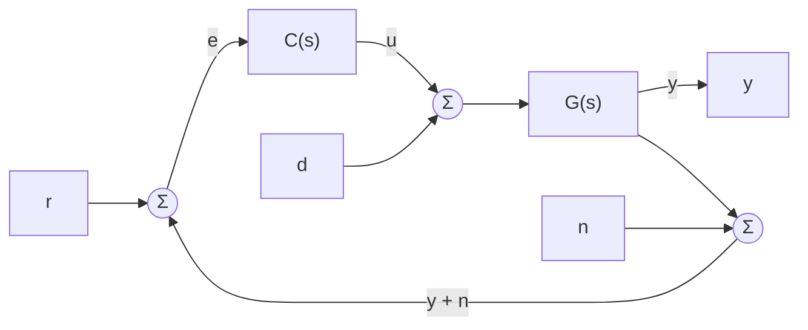
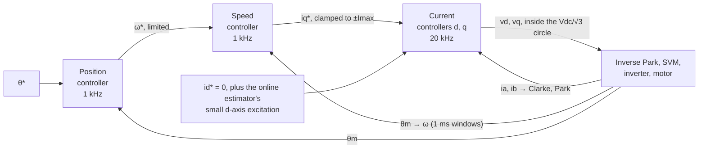
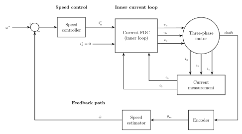
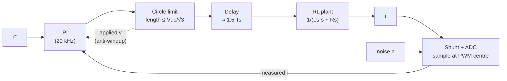

| Field     | Value                         |
|-----------|-------------------------------|
| Title     | Closed-Loop Control of a PMSM |
| Type      | theory                        |
| Status    | draft                         |
| Version   | 0.2.0                         |
| Component | closed-loop-control           |
| Date      | 2026-10-30                    |

> **Theory document**: Explains the mathematical and engineering principles behind a component or algorithm.
> This document is descriptive — it records the *why* and *how* at a scientific level, independent of any
> specific implementation. Equations use KaTeX ($inline$ and $$block$$). Diagrams use Mermaid, and the
> cascade figures are TikZ.

---

## Overview

[The motor model](motor-model.md) says which voltages produce which currents, and which currents produce
which torque. Applying those voltages blindly would work only if the model were exact and the load known in
advance. Neither is true, so e-foc measures what the motor does and corrects the command: it closes loops.

This chapter covers what every loop in the firmware has in common, before the
[controller chapters](advanced-controllers.md) look at individual algorithms:

- what feedback buys and what it costs, in two functions, $S$ and $T$, with $S + T = 1$;
- why the loops are **cascaded**, current inside speed inside position, and why each inner loop must be
  several times faster than the one around it;
- which signals close the loops, and what is known in advance and can be fed forward instead;
- what happens at the actuator limits, and why every integrator needs anti-windup;
- what sampling and computation delay take away, which sets the fastest loop the hardware can run;
- what each loop's one tuning knob, its bandwidth, means, what bounds it, and how e-foc sets it.

---

## Prerequisites

[The motor model](motor-model.md). Laplace transforms, transfer functions and Bode plots at the level of a
first course in control.

| Symbol           | Meaning                                                               | Unit  |
|------------------|-----------------------------------------------------------------------|-------|
| $r, y, e$        | Reference, measured output, error $r - y$                             | —     |
| $u$              | Controller output (actuator command)                                  | —     |
| $d$              | Disturbance at the plant input                                        | —     |
| $n$              | Measurement noise                                                     | —     |
| $C(s)$, $G(s)$   | Controller and plant transfer functions                               | —     |
| $L(s)$           | Loop gain $C(s)G(s)$                                                  | —     |
| $S(s)$, $T(s)$   | Sensitivity $1/(1+L)$ and complementary sensitivity $L/(1+L)$         | —     |
| $\omega_c$       | Crossover frequency, $\lvert L(j\omega_c)\rvert = 1$                  | rad/s |
| $\omega_{bw}$    | Closed-loop bandwidth                                                 | rad/s |
| $\varphi_m$      | Phase margin                                                          | °     |
| $T_s^i$, $T_s^o$ | Inner (current) and outer (speed, position) loop periods: 50 µs, 1 ms | s     |
| $T_d$            | Total loop delay                                                      | s     |
| $K_p$, $K_i$     | Proportional and integral gains                                       | —     |
| $f_{PWM}$        | PWM switching frequency: 20 kHz                                       | Hz    |
| $\sigma_i$       | RMS current-sensor noise                                              | A     |

---

## Mathematical Foundation

### 1. Why Open Loop Is Not Enough

An open-loop drive computes the voltage from the model and applies it. At standstill, a q current $I$ needs
$v_q = R_s I$. If the winding's resistance is 30 % above the value the drive was given, which a rise of about
75 K does to copper, the current and the torque are 23 % low. At speed the error is worse: the voltage is
dominated by the back-EMF $\omega_e \psi_f$, and a small error in $\psi_f$ or in the measured speed becomes a
large error in the much smaller difference that drives the current. A load torque the drive did not expect
changes the speed, the back-EMF with it, and the current again.

Feedback replaces the requirement "know the motor exactly" by "measure the output". The controller compares
the measured current with the requested one and keeps adjusting the voltage until they agree, whatever the
resistance or the load.

### 2. The Feedback Loop



With the loop gain $L = CG$, the output and the tracking error are

$$
y = T\,r + S\,G\,d - T\,n, \qquad
r - y = S\,r - S\,G\,d + T\,n
$$

where

$$
S = \frac{1}{1 + L}, \qquad T = \frac{L}{1 + L}, \qquad \boxed{S + T = 1}
$$

Read the equations term by term:

- **$S$ multiplies the reference error and the disturbance.** Where $|S|$ is small, the loop tracks and
  rejects load. That needs a large loop gain.
- **$T$ multiplies the noise.** Where $|T|$ is near one, measurement noise goes straight to the output as
  if it were real. That needs a small loop gain.
- **They add to one.** At any given frequency the loop can be good at one job or the other, not both. Low
  frequencies (references, loads, drift) are given to $S$; high frequencies (sensor noise, quantisation) to
  $T$. The **bandwidth**, close to the crossover $\omega_c$ where $|L| = 1$, is where the hand-over happens.

**Phase margin.** At crossover, the phase of $L$ must stay clear of $-180^\circ$; the distance is the phase
margin $\varphi_m$. Margins of 45–70° give a well-damped response. Below about 30° the loop rings, and at
zero it oscillates. Delay (§7) eats phase margin first.

**The waterbed.** For a stable loop whose gain falls at least as $1/s^2$ at high frequency, which every
physical loop does, pushing $|S|$ down over one band of frequencies pushes it up over another (Bode's
sensitivity integral); delay and right-half-plane zeros make the trade worse. A loop cannot be made faster for free:
past a point, more gain only moves the error to another frequency, where it appears as overshoot and noise.

**Integral action.** A controller with a pole at $s = 0$ makes $|L| \to \infty$ at DC, so $S(0) = 0$: no
steady-state error for a constant reference or a constant input disturbance. That is why every current and
speed controller in e-foc integrates, and why each needs anti-windup (§6).

### 3. The Cascade

e-foc nests three loops:



The cascade exists for four reasons:

1. **The inner loop hides the electrical dynamics.** Once the current follows its reference within a
   fraction of a millisecond, the speed loop sees an almost ideal torque source: $\tau_e \approx K_t i_q^*$.
   Its plant shrinks from the fourth-order model to $K_t / (J s + B_f)$.
2. **Limits sit where the quantity is controlled.** Clamping $i_q^*$ is a torque limit and a current
   limit, applied where current is regulated, so neither the motor nor the inverter sees more than
   $I_{max}$ whatever the outer loops ask for.
3. **Each loop has a simple plant** and is designed alone: an RL circuit, an inertia, an integrator.
4. **Each loop runs at its own rate.** The current loop needs 20 kHz; the mechanics do not, and the outer
   loops run at 1 kHz in a lower-priority interrupt.

| Loop     | Rate   | Input → output                     | Plant it controls (inner loops ideal)                             | Plant chapter            |
|----------|--------|------------------------------------|-------------------------------------------------------------------|--------------------------|
| Current  | 20 kHz | $i^* \to v$                        | $\dfrac{1}{L_s s + R_s}$ per axis, after decoupling               | `foc-plant-models.md` §1 |
| Speed    | 1 kHz  | $\omega^* \to i_q^*$               | $\dfrac{K_t}{J s + B_f}$                                          | `foc-plant-models.md` §2 |
| Position | 1 kHz  | $\theta^* \to \omega^*$ or $i_q^*$ | $\dfrac{1}{s}$ around a speed loop, or $\dfrac{K_t}{s(Js + B_f)}$ | `foc-plant-models.md` §3 |

**Time-scale separation.** "Inner loop ideal" is an approximation, and the price of it is phase. A
first-order inner loop of bandwidth $\omega_{bw,i}$ adds a lag of $\arctan(\omega_{c,o}/\omega_{bw,i})$ at the
outer crossover $\omega_{c,o}$:

| Ratio $\omega_{bw,i} / \omega_{c,o}$ | Phase lost by the outer loop |
|--------------------------------------|------------------------------|
| 3                                    | 18.4°                        |
| 5                                    | 11.3°                        |
| 10                                   | 5.7°                         |
| 20                                   | 2.9°                         |

A ratio of 5–10 is the usual compromise. e-foc keeps the current loop at least ten times the default speed
loop (`documentation/design/controller-selection.md`, automatic bandwidth), and the speed loop chapter uses
the same rule (`documentation/theory/speed-loop-pi.md`).

### 4. Feedback Signals

A loop is only as good as what it measures.

- **Phase currents.** Shunts in the low-side legs are sampled once per PWM period, at the centre of the
  low-side conduction window, where the switching ripple crosses its average. All three phases are
  converted; above 70 % duty a phase's shunt is not conducting long enough to read, and that phase is rebuilt
  from the other two through $i_a + i_b + i_c = 0$ (`core/platform_abstraction/LowSideShuntWindow.hpp`).
  Offsets are measured at calibration (`documentation/design/service-current-offsets.md`).
- **Rotor angle.** A quadrature encoder, 4000 counts per mechanical revolution by default, gives
  $\theta_m$; the alignment offset turns it into $\theta_e = p\,(\theta_m - \theta_0)$
  (`documentation/theory/alignment.md`).
- **Speed** is not measured. It is the change in encoder angle over a 1 ms window, with no further
  filtering (`core/foc/cascade/SpeedDifferentiator.cpp`). One count in one window is
  $2\pi / 4000 / 1\ \text{ms} = 1.57$ rad/s (15 rpm), the speed quantum the speed loop works with.

Each signal's errors enter the loop through $T$, at full strength inside the bandwidth:
[disturbances and noise](disturbances-and-noise.md) follows each one through.

### 5. Feedforward and Two Degrees of Freedom

Feedback reacts after an error appears. What is known in advance can be added to the command directly:

| Feedforward     | Term                                     | Where in e-foc                                                       |
|-----------------|------------------------------------------|----------------------------------------------------------------------|
| Axis decoupling | $-\omega_e L_s i_q$, $+\omega_e L_s i_d$ | Decoupled PID current controller (`current-loop-decoupled-pid.md`)   |
| Back-EMF        | $\omega_e \psi_f$ on $v_q$               | Decoupled PID; deadbeat (`current-loop-deadbeat.md`)                 |
| Cogging         | $-\tau_{cog}(\theta_e)/K_t$ on $i_q^*$   | Cogging map (`documentation/design/service-cogging-compensation.md`) |
| Velocity        | $\dot\theta^*$ on $\omega^*$             | Cascade P position controller (`position-loop-cascade-p.md`)         |

A feedforward term is only as good as the model behind it, and its error falls back to the feedback loop.
It cannot destabilise the loop when it is computed from references, and barely can when it uses a slow
measured signal such as speed. Speed voltages computed from measured speed are, strictly, inside the loop;
at the speed loop's time scale they are a slowly varying correction.

The same idea generalises to the **two-degree-of-freedom** structure: one part shapes the response to the
reference (a pre-filter $F$), another the response to disturbances (the feedback $C$), and they are tuned
separately instead of trading against each other in one gain
(`speed-loop-two-dof.md`, `position-loop-two-dof.md`).

### 6. Saturation and Anti-Windup

Every loop's output is limited:

| Loop     | Limit                                                              | Shape                       |
|----------|--------------------------------------------------------------------|-----------------------------|
| Current  | $\sqrt{v_d^2 + v_q^2} \le V_{dc}/\sqrt3$ (unit circle in per-unit) | Circle: couples $d$ and $q$ |
| Speed    | $\lvert i_q^* \rvert \le I_{max}$                                  | Interval                    |
| Position | Speed or current limit of the loop below                           | Interval                    |

While the output is held at its limit the error persists, and an integrator keeps accumulating it. When the
error finally reverses, the integrator holds the output at the limit until it has unwound, and the loop
overshoots. This is **windup**. Every PI in e-foc is protected against it:

- the **current loop** commits the voltage actually applied after the circle limit back into its
  incremental form (back-calculation), so the integrator never leaves what the modulator can produce
  (`current-loop-pi.md`, *Anti-Windup*). A per-axis clamp would not do: $v_d' = v_q' = 0.8$ passes it and
  still has length 1.13;
- the **speed loop** clamps the incremental update to $\pm I_{max}$, which gives the same effect
  (`speed-loop-pi.md`).

When the voltage vector is too long, e-foc scales both components by the same factor, which keeps the
*voltage* angle. Near standstill that keeps the current on its axis too. At speed it does not: with the
back-EMF and the speed voltages in the balance, a voltage scaled by $k < 1$ settles with
$i_d = -(1 - k)\,\omega_e^2 L_s \psi_f / (R_s^2 + \omega_e^2 L_s^2)$, negative, so the current turns off the q-axis
and torque per ampere falls while the loop stays saturated.

### 7. Digital Control: Sampling and Delay

The controllers are discrete. Between the instant a current is sampled and the instant the inverter
applies the voltage computed from it, time passes:

| Contribution                               | e-foc current loop                                                                                                                                     | Delay                            |
|--------------------------------------------|--------------------------------------------------------------------------------------------------------------------------------------------------------|----------------------------------|
| Computation, then duty applied next period | Duty takes effect one period after the sample (`targets/platform_implementations/ti/implementation/PlatformFactoryImpl.cpp`, `DutyUpdateDelayPeriods`) | $T_s^i$ = 50 µs                  |
| Zero-order hold                            | A duty held for a whole period acts on average half a period late                                                                                      | $T_s^i/2$ = 25 µs                |
| **Total**                                  |                                                                                                                                                        | $T_d \approx 1.5\,T_s^i$ = 75 µs |

A pure delay has unit gain and a phase of $-\omega T_d$. For a PI current controller that cancels the
plant pole ([current-loop-pi.md](current-loop-pi.md)), the loop gain is
$L(s) = \dfrac{\omega_{bw}}{s}\, e^{-s T_d}$, crossover is at $\omega_{bw}$, and

$$
\varphi_m = 90^\circ - \omega_{bw} T_d \cdot \frac{180^\circ}{\pi}
$$

| Current-loop bandwidth                                               | Phase lost to delay | Phase margin |
|----------------------------------------------------------------------|---------------------|--------------|
| 2000 rad/s                                                           | 8.6°                | 81°          |
| 5000 rad/s                                                           | 21.5°               | 68.5°        |
| 8378 rad/s ($2\pi \cdot 20\,\text{kHz}/15$, the PWM-derived default) | 36.0°               | 54°          |
| 10 470 rad/s                                                         | 45°                 | 45°          |

The delay alone caps the current loop near $10^4$ rad/s at 20 kHz, the same figure
`current-loop-pi.md` quotes as its practical limit. A faster loop needs a faster PWM, or a controller that
models the delay explicitly (the two-step deadbeat of `current-loop-deadbeat.md`).

The **speed loop** has its own delay. The 1 ms window difference is the average speed over the last
millisecond, half a window old. The speed controller runs as soon as the window closes, and the current
reference it produces is picked up by the next 20 kHz period and held for the next millisecond, half a window
late on average. With $T_d \approx 1$ ms, a 100 rad/s speed loop loses 5.7°, a 300 rad/s loop 17°.

**Sampling the right instant.** Sampling the phase currents at the centre of the PWM period, where the
symmetric ripple crosses its mean, takes the average current without filtering it, so the current loop
carries no filter delay and no aliased ripple.

### 8. Choosing Bandwidths

**What the number is.** Each loop has one tuning knob, its closed-loop bandwidth $\omega_{bw}$: the
frequency up to which the loop's output follows its reference, close to the crossover of §2. It states how
fast the loop should be, so it belongs to the controller, not to the motor: the same motor runs at any
bandwidth inside the limits below.

The current and position designs close to a first-order loop, $T(s) = \omega_{bw}/(s + \omega_{bw})$, so the
bandwidth reads directly as a step-response time:

| Step-response measure | Value              |
|-----------------------|--------------------|
| Time constant (63 %)  | $1/\omega_{bw}$    |
| Rise time, 10–90 %    | $2.2/\omega_{bw}$  |
| Settling to 2 %       | $3.9/\omega_{bw}$  |
| Bandwidth in hertz    | $\omega_{bw}/2\pi$ |

The speed PI closes to a second-order loop ([speed-loop-pi.md](speed-loop-pi.md)), so for it these
figures are approximate.

**Where the motor enters.** The motor does not set the bandwidth; it sets the gains that reach it. Every
law derives its gains from the bandwidth and the identified model, so no gain is ever entered by hand:

| Loop     | Gains from $\omega_{bw}$ (PI/P laws)                                        | Model it needs                 | Chapter                                      |
|----------|-----------------------------------------------------------------------------|--------------------------------|----------------------------------------------|
| Current  | $K_p = L_s\,\omega_{bw}$, $K_i = R_s\,\omega_{bw}$                          | $R_s$, $L_s$                   | [current-loop-pi.md](current-loop-pi.md)     |
| Speed    | $K_p = 2J\,\omega_{bw}/K_t$, integral zero at $\max(B_f/J,\ \omega_{bw}/4)$ | $J$, $B_f$, $K_t$              | [speed-loop-pi.md](speed-loop-pi.md)         |
| Position | $K_p = \omega_{bw}$                                                         | None: the speed loop inside it | [position-loop-pid.md](position-loop-pid.md) |

A model error scales the bandwidth the loop reaches: a speed loop designed with $\hat{J}$ for a rotor of
inertia $J$ closes at $\omega_{bw}\hat{J}/J$, and a current loop at $\omega_{bw}\hat{L}_s/L_s$
([disturbances and noise](disturbances-and-noise.md)).

**What bounds it.** The motor, the sensors and the control rate bound each loop's bandwidth from above,
and the loop around it and the load bound it from below:

| Loop     | Rate   | Typical $\omega_{bw}$                   | Bounded above by                                                          | Bounded below by        |
|----------|--------|-----------------------------------------|---------------------------------------------------------------------------|-------------------------|
| Current  | 20 kHz | 2000–8400 rad/s                         | Delay (§7); sensor noise through $K_p = L_s\omega_{bw}$; voltage headroom | ≥ 10 × speed loop       |
| Speed    | 1 kHz  | 50–300 rad/s                            | Current loop ÷ 10; speed quantum through $K_p$; 1 ms delay                | Load rejection required |
| Position | 1 kHz  | ≈ 19 rad/s ($2\pi \cdot 3$ Hz, default) | Speed loop ÷ 5                                                            | Stiffness required      |

**How e-foc sets it.** A bandwidth left at 0 is *automatic* (`documentation/design/controller-selection.md`):

| Loop     | Automatic value                                                                       | Time constant |
|----------|---------------------------------------------------------------------------------------|---------------|
| Current  | $\min\!\big(2\pi f_{PWM}/15,\ \max(0.08\,\text{V}/(L_s\,\sigma_i),\ 1885)\big)$ rad/s | 0.12–0.53 ms  |
| Speed    | 50 rad/s                                                                              | 20 ms         |
| Position | $2\pi \cdot 3 \approx 18.8$ rad/s                                                     | 53 ms         |

$\sigma_i$ is the RMS current-sensor noise the calibration measured: the second term keeps the noise
$L_s\,\omega_{bw}$ puts on the voltage command under 0.08 V RMS. At 20 kHz the first term is 8378 rad/s.

None of these is identified from the motor; the identified inductance and the measured noise only cap the
current loop. The calibration record has a current-loop and a speed-loop bandwidth field, and a value in
range there replaces the automatic one, but calibration measures neither: it carries the current-loop
field over from the record it replaces, zero on a first calibration, and writes a fixed 50 rad/s into the
speed-loop field. A loop is made faster or slower by setting its bandwidth over CAN or the CLI, inside the
bounds above; 0 returns it to automatic. The trade-offs between controller algorithms within these bounds
are the subject of the [controller chapter](advanced-controllers.md).

---

## Block Diagrams

### The Cascade with Its Limits



```{=latex}
\input{speed-loop.tex}
```

### Where Delay and Noise Enter



---

## Numerical Properties

| Property                              | Value / Condition                                              |
|---------------------------------------|----------------------------------------------------------------|
| Current loop period                   | 50 µs (20 kHz)                                                 |
| Outer loop period                     | 1 ms (1 kHz), prescaler 20                                     |
| Current-loop delay                    | $\approx 1.5\,T_s^i = 75$ µs                                   |
| Current-loop bandwidth for 45° margin | $\approx 10^4$ rad/s                                           |
| Speed-loop delay                      | $\approx 1$ ms                                                 |
| Speed quantum                         | 1.57 rad/s per encoder count per 1 ms window (4000 counts/rev) |
| Cascade separation                    | current ≥ 10 × speed (automatic bandwidth)                     |
| Integral action                       | Current and speed loops; anti-windup on every integrator       |

---

## Worked Example

Teknic M-2310P-LN-04K ($R_s = 0.36\ \Omega$, $L_s = 0.2$ mH, $K_t = 38.4$ mN·m/A, $J = 7.06\ \mu$kg·m²),
40 V bus, bench current-sensor noise 38.5 mA RMS.

**Current loop at 5000 rad/s.** Pole-zero cancellation gives

$$
K_p = L_s\,\omega_{bw} = 1.0\ \text{V/A}, \qquad K_i = R_s\,\omega_{bw} = 1800\ \text{V/(A·s)}
$$

or $K_p\sqrt{3}/V_{dc} = 0.043$ per ampere in the modulator's per-unit. The delay costs 21.5° and leaves
68.5° of margin. The sensor noise becomes $38.5\ \text{mA} \times 1.0\ \text{V/A} = 38.5$ mV RMS of voltage
command, under the 0.08 V bound.

**Speed loop at 100 rad/s.** The implementation's gain (`speed-loop-pi.md`, *What the implementation
uses*) is

$$
K_p = \frac{2\,J\,\omega_{bw}}{K_t} = \frac{2 \times 7.06 \times 10^{-6} \times 100}{0.0384} = 0.037\ \text{A per rad/s}
$$

One speed quantum, 1.57 rad/s, moves $i_q^*$ by 58 mA, a torque step of 2.2 mN·m, 0.8 % of rated torque. The
separation is $5000/100 = 50$, the inner loop costs 1.1° at the outer crossover and the delay 5.7°.

---

## Limitations & Assumptions

- **Assumes**: linear, time-invariant loops around an operating point; speed treated as a slowly varying
  parameter of the current loop.
- **Assumes**: first-order closed inner loops when quoting separation and phase loss.
- **Simplifies**: the delay figures ignore the ADC conversion time and the current-sense amplifier's
  ≈ 200 ns lag, both small against 50 µs.
- **Does not cover**: resonant mechanical loads (compliant couplings), which cap the speed loop below the
  figures here, and multivariable design beyond the decoupled per-axis view.

## References

1. Åström, K.J. & Murray, R.M. — *Feedback Systems: An Introduction for Scientists and Engineers*, 2nd ed.,
   Princeton University Press, 2021.
2. Franklin, G.F., Powell, J.D. & Workman, M.L. — *Digital Control of Dynamic Systems*, 3rd ed.,
   Addison-Wesley, 1998.
3. Skogestad, S. & Postlethwaite, I. — *Multivariable Feedback Control: Analysis and Design*, 2nd ed., Wiley,
   2005.
4. Harnefors, L. & Nee, H.-P. — "Model-based current control of AC machines using the internal model control
   method", *IEEE Transactions on Industry Applications*, vol. 34, no. 1, 1998.
