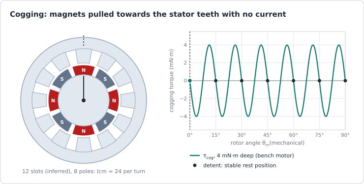
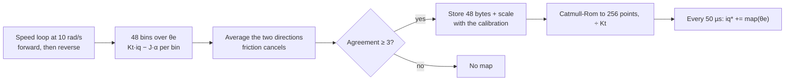
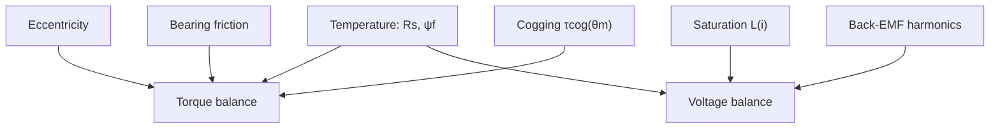

| Field     | Value                                 |
|-----------|---------------------------------------|
| Title     | Cogging and Other Motor Imperfections |
| Type      | theory                                |
| Status    | draft                                 |
| Version   | 0.1.0                                 |
| Component | cogging-and-motor-imperfections       |
| Date      | 2026-10-29                            |

> **Theory document**: Explains the mathematical and engineering principles behind a component or algorithm.
> This document is descriptive — it records the *why* and *how* at a scientific level, independent of any
> specific implementation. Equations use KaTeX ($inline$ and $$block$$). Diagrams use Mermaid, and the
> animated figure is generated by `documentation/tools/generate-animations.py`.

---

## Overview

A real motor is not the sinusoidal machine of [the motor model](motor-model.md). Its magnets are pulled
towards the stator teeth even with no current (**cogging**), its back-EMF carries harmonics, its iron
saturates, its resistance and magnets drift with temperature, and its bearings rub. The firmware cannot change
any of this; it can only measure it and compensate for what it measures.

This chapter treats cogging in depth, because it is the imperfection a position drive feels most and the one
e-foc measures and cancels, and then the other motor imperfections at the level a drive engineer needs. The
main results:

- Cogging repeats $N_{cog} = \operatorname{lcm}(N_s, 2p)$ times per revolution, and always an **even whole
  number of times per electrical period**, which is why a map over one electrical period holds it.
- At low speed it shows as velocity ripple, at rest as detents, and against a position loop as a stiffness of
  $N_{cog} T_{cog}$ that the loop must exceed.
- It can be measured by turning the rotor slowly in both directions: the cogging follows the angle, the
  friction follows the motion, and their average and difference separate them.

---

## Prerequisites

[Physical picture](motor-physics.md), [motor model](motor-model.md),
[disturbances and noise](disturbances-and-noise.md).

| Symbol     | Meaning                                   | Unit  |
|------------|-------------------------------------------|-------|
| $N_s$      | Stator slots                              | —     |
| $2p$       | Rotor poles                               | —     |
| $N_{cog}$  | Cogging periods per mechanical revolution | —     |
| $C_T$      | Goodness factor $2p\,N_s / N_{cog}$       | —     |
| $T_{cog}$  | Cogging torque amplitude (fundamental)    | N·m   |
| $W$        | Magnetic co-energy stored in the air gap  | J     |
| $\theta_m$ | Mechanical rotor angle                    | rad   |
| $J$        | Rotor inertia                             | kg·m² |
| $K_t$      | Torque constant                           | N·m/A |

---

## Mathematical Foundation

### 1. Where Cogging Comes From

With no current in the winding, the magnets still drive flux across the air gap and through the stator teeth.
The energy stored in that field depends on the rotor position, because the slot openings make the air gap
wider in some places than others. A system free to move goes towards lower energy, and the torque is the
slope:

$$
\tau_{cog}(\theta_m) = -\frac{\partial W(\theta_m)}{\partial \theta_m}
$$

The energy is lowest when the magnet edges sit where the air gap is narrowest, over the teeth. Turning the
rotor by hand, these are the notches you feel: the **detents**.

**Periodicity.** The stator's pattern repeats every slot pitch, $2\pi/N_s$. The rotor's pattern, as far as the
air-gap energy is concerned, repeats every pole pitch, $2\pi/2p$: a north pole and a south pole store the same
energy. The combined pattern repeats at the smallest angle that is a whole number of both:

$$
N_{cog} = \operatorname{lcm}(N_s,\ 2p) \quad \text{periods per mechanical revolution}
$$

The torque is then a Fourier series in that period:

$$
\tau_{cog}(\theta_m) = \sum_{k \ge 1} T_k \sin\!\left(k\, N_{cog}\, \theta_m + \varphi_k\right)
$$

**Periods per electrical cycle.** One electrical period is $1/p$ of a revolution, so it holds $N_{cog}/p$
cogging periods. Because $N_{cog}$ is a multiple of $2p$,

$$
\frac{N_{cog}}{p} = 2\,\frac{\operatorname{lcm}(N_s, 2p)}{2p} \in \{2, 4, 6, \dots\}
$$

is always an even integer. Whatever the slot and pole counts, cogging repeats exactly within every electrical
period, so a map indexed by the electrical angle represents its fundamental and all its harmonics, provided the
pole pairs are identical. Differences between pole pairs (magnet tolerances) repeat once per revolution and
are what such a map cannot hold.

**The goodness factor.** How many magnet edges meet a slot edge at the same instant decides how strongly
their individual pulls add. Zhu and Howe's goodness factor counts it:

$$
C_T = \frac{2p\, N_s}{N_{cog}}
$$

$C_T = 1$ is best: the contributions are spread evenly and largely cancel.

| Slots / poles | $N_{cog}$ | $C_T$ | Per electrical period | Typical cogging        |
|---------------|-----------|-------|-----------------------|------------------------|
| 6 / 4         | 12        | 2     | 6                     | Moderate               |
| 9 / 8         | 72        | 1     | 18                    | Very low               |
| 12 / 8        | 24        | 4     | 6                     | High (the bench motor) |
| 12 / 10       | 60        | 2     | 12                    | Low                    |
| 24 / 4        | 24        | 4     | 12                    | High unless skewed     |

The bench motor shows 24 detents a revolution, six per electrical period, 4 mN·m deep. Its rest positions,
scattered by torque pulses, cluster at 24 a revolution, which is what 12 slots and 8 poles give; the slot count is
inferred from that, not read from a datasheet (`documentation/design/software-in-the-loop.md` Part K).

### 2. What the Motor Designer Can Do

The remedies are mechanical and fixed at manufacture:

- **Skew** the magnets or the stator stack by one cogging period, $2\pi/N_{cog}$. Each axial slice then sees a
  shifted cogging, and the fundamental integrates to zero; the price is a few per cent of back-EMF.
- **Choose the slot and pole counts** for a low goodness factor (fractional-slot windings such as 9/8, 12/10).
- **Shape the magnets**: arc width, edge chamfers, and narrower slot openings reduce the energy variation.

The firmware gets the motor as it is. What it can do is cancel the torque, which needs a map of it.

### 3. What Cogging Does to the Drive

**At speed.** Cogging is a torque disturbance at $N_{cog} f_m$. Above the speed loop's bandwidth the rotor's
inertia absorbs it as speed ripple. Integrating $J\,\dot\omega = \tau_{cog}$ for one harmonic:

$$
\Delta\omega \approx \frac{T_{cog}}{J\, N_{cog}\, \omega_m}
$$

which **grows as the speed falls**. The bench rotor ($J \approx 12.4\ \mu$kg·m², $T_{cog}$ = 4 mN·m,
$N_{cog}$ = 24) at 10 rad/s ripples by about 1.3 rad/s, 13 % of its speed; at 100 rad/s by 0.13 rad/s.

**At low speed**, inside the speed bandwidth, the loop fights it with current: a ripple of $T_{cog}/K_t$ in
$i_q$ at $N_{cog} f_m$, which the speed quantum and the loop's own lag make imperfect.

**At rest**, the rotor settles in a detent. Near a detent the cogging acts like a torsional spring of stiffness

$$
k_{cog} = \left|\frac{d\tau_{cog}}{d\theta_m}\right|_{max} = N_{cog}\, T_{cog}
$$

24 × 4 mN·m = 0.096 N·m/rad on the bench. A position setpoint between two detents sits on a slope that pushes the
rotor away; the loop holds it only if its own stiffness is larger. For the cascade it is
$2 J\,\omega_{bw}^s\,\omega_{bw}^p$, 0.10 N·m/rad at the default bandwidths: barely more, and with dry friction
the rotor stepped between detents instead (`documentation/theory/position-loop-pid.md`,
*Limitations & Assumptions*).

**Breakaway.** To start the rotor, the drive must exceed cogging and dry friction together: 0.135–0.23 A of q
current on the bench. That is 5.7–9.7 mN·m with the configured 7 mWb flux linkage, or 3.7–6.3 mN·m with the
4.6 mWb the flux-linkage identification measured on the same motor (`documentation/design/state-machine.md`).

**Alignment.** The alignment pulls the rotor to the electrical zero against the cogging, so it can settle a
little to either side, which limits the repeatability of everything referenced to it, a cogging map included
(`documentation/theory/alignment.md`).

### 4. Measuring Cogging

Turn the rotor under speed control at a constant low speed $\omega_0$, once in each direction, and record, for
each bin of electrical angle, the torque the winding supplied. In steady motion the torque balance in a bin is

$$
K_t\, \bar{i}_q - J\,\bar\alpha = -\tau_{cog}(\theta) + T_f \operatorname{sgn}(\omega) + B_f\,\omega
$$

where the inertia term removes what went into accelerating the rotor (at 10 rad/s the bench cogging repeats at
240 rad/s, far above a 50 rad/s speed loop, so most of it shows as acceleration, not current). Write the left
side as $\tau_+(\theta)$ for the forward run and $\tau_-(\theta)$ for the reverse run at the same speed. Then

$$
\tfrac{1}{2}\left(\tau_+ + \tau_-\right) = -\tau_{cog}(\theta), \qquad
\tfrac{1}{2}\left(\tau_+ - \tau_-\right) = T_f + B_f\,\omega_0
$$

Friction and viscous torque follow the motion and cancel in the average; cogging follows the angle and stays.

**Telling cogging from noise.** Each run's noise is independent of the other's, while the cogging is common to
both. With their means removed, the RMS of the sum against the RMS of the difference, the *agreement*, is about 1
for noise alone and grows with the cogging. e-foc keeps a map only above 3; the bench's 4 mN·m gives 26
(`documentation/design/service-cogging-compensation.md` Part B).

**Bin width.** Averaging over a bin of width $\Delta$ multiplies a harmonic of period $P$ by
$\operatorname{sinc}(\pi\Delta/P)$. With 48 bins per electrical period and six cogging periods in it, a bin is an
eighth of a cogging period: $\operatorname{sinc}(\pi/8) = 0.975$, the 2.5 % the design records.

### 5. Compensating Cogging

The map is the torque the winding must add to cancel the cogging. Divided by $K_t$ it is a current, added to
the current reference at every control period, looked up at the rotor's electrical angle:

$$
i_q^* \leftarrow i_q^* + \frac{\hat\tau_{map}(\theta_e)}{K_t}
$$

It is a feed-forward: it acts before any error appears, so it works at every speed, including the low speeds
the speed loop cannot reach and the rest positions a position loop has to hold. Its error is the map's error
plus the angle error since the map was measured. e-foc stores 48 bins, expands them to 256 points with a
periodic Catmull-Rom curve, interpolates linearly at run time (about the cost of one sine from the table), and
keeps the sum inside the current limit. With it, every position law holds a setpoint between detents on the
bench (`documentation/design/service-cogging-compensation.md` Part D).

What it does not reach: a map shifted by a later alignment that settled to a different side of a detent;
torque mode, which measures no map; and the differences between pole pairs that a single electrical period
averages out.

### 6. Other Motor Imperfections

| Imperfection              | What happens                                                                | How it shows                                           | Measure it by                                                      | e-foc                                           |
|---------------------------|-----------------------------------------------------------------------------|--------------------------------------------------------|--------------------------------------------------------------------|-------------------------------------------------|
| Back-EMF harmonics        | Non-sinusoidal magnet flux: 5th, 7th, …                                     | Torque ripple at $6 f_e$, $12 f_e$                     | Spin the rotor, record the open-circuit voltage, take its spectrum | Not compensated                                 |
| Saturation                | $L_s$ falls at high current; $L_q$ also falls with $i_d$ (cross-saturation) | Current loop faster than designed; deadbeat overshoots | Inductance at several bias currents                                | Identified at the calibration's operating point |
| Copper temperature        | $R_s$ rises about 0.39 %/K                                                  | Integral action works harder; model mismatch           | Track $R_s$ online                                                 | Online $R_s$ estimate                           |
| Magnet temperature        | $\psi_f$ falls about 0.1 %/K (NdFeB)                                        | Less torque per ampere, less back-EMF                  | Back-EMF at a known speed, hot and cold                            | $\psi_f$ identified at calibration              |
| Demagnetisation           | Heat plus a strong reverse field permanently weakens magnets                | Lower $\psi_f$ after an overload                       | Re-identify $\psi_f$                                               | Current limit; no field weakening               |
| Eccentricity              | Rotor off-centre: uneven air gap, unbalanced magnetic pull                  | Ripple at $1 f_m$                                      | Spectrum of torque or current at constant speed                    | Not compensated                                 |
| Bearing and seal friction | Coulomb, viscous and Stribeck terms; change with temperature and wear       | Hunting at rest, ripple at low speed                   | Steady-speed current at several speeds                             | Viscous term identified and used                |
| Coupling compliance       | Shaft and load form a two-mass resonance                                    | Speed-loop ringing, a limit on bandwidth               | Frequency response of the speed loop                               | Not modelled                                    |

The thermal time constants decide how fast these drift: a small winding warms in minutes, a magnet more
slowly. A parameter identified at calibration describes a cold motor; the [controller chapter](advanced-controllers.md)
discusses which algorithms tolerate the drift.

---

## Block Diagrams

### Cogging Map: Measurement and Use

### Where the Imperfections Enter

---

## Numerical Properties

| Property                              | Value / Condition                                                 |
|---------------------------------------|-------------------------------------------------------------------|
| Cogging periods per revolution        | $\operatorname{lcm}(N_s, 2p)$; 24 on the bench motor              |
| Cogging periods per electrical period | $N_{cog}/p$, always even; 6 on the bench motor                    |
| Bench cogging depth                   | 4 mN·m; stiffness $N_{cog}T_{cog}$ = 0.096 N·m/rad                |
| Map resolution                        | 48 bins per electrical period, 8 per cogging period on the bench  |
| Bin attenuation of the fundamental    | $\operatorname{sinc}(\pi/8)$ = 0.975                              |
| Curve error after expansion           | within 3 % of the depth for six periods per electrical period     |
| Noise floor of a map                  | 0.13–0.26 mN·m on the bench plant; rejected by the agreement test |
| Run-time cost                         | One table lookup with linear interpolation per control period     |

---

## Worked Example

The bench motor, 24 detents a revolution (consistent with 12 slots and 8 poles), $J = 12.4\ \mu$kg·m², cogging
4 mN·m deep.

1. **Periods.** $N_{cog} = \operatorname{lcm}(12, 8) = 24$; $C_T = 8 \times 12 / 24 = 4$, a high-cogging
   combination; $24/4 = 6$ periods per electrical period.
2. **Frequency at 10 rad/s.** $24 \times 10 = 240$ rad/s, 38 Hz: above a 50 rad/s speed loop.
3. **Speed ripple without compensation.** $0.004 / (12.4\times10^{-6} \times 24 \times 10) = 1.34$ rad/s, 13 % of
   the speed.
4. **Detent stiffness.** $24 \times 0.004 = 0.096$ N·m/rad against the position cascade's 0.10 N·m/rad: a
   setpoint between detents is marginal without the map and held with it.
5. **Map fidelity.** Eight bins per cogging period lose 2.5 % of the fundamental; the residual after
   compensation is a few per cent of 4 mN·m, about 0.1 mN·m, at the level of the map's noise floor.

---

## Limitations & Assumptions

- **Assumes**: identical pole pairs for the electrical-period map; their differences repeat per revolution.
- **Assumes**: the speed during the measurement is steady enough for the inertia correction to hold.
- **Simplifies**: the speed-ripple estimate keeps the fundamental only and ignores the loop's partial rejection.
- **Board-specific**: the bench figures are those of the motor on the E-FOC-HARDWARE rig; the reference motors
  in the simulator have no cogging unless a scenario adds it.

## References

1. Zhu, Z.Q. & Howe, D. — "Influence of design parameters on cogging torque in permanent magnet machines",
   *IEEE Transactions on Energy Conversion*, 15(4):407–412, 2000.
2. Bianchi, N. & Bolognani, S. — "Design techniques for reducing the cogging torque in surface-mounted PM
   motors", *IEEE Transactions on Industry Applications*, 38(5):1259–1265, 2002.
3. Jahns, T.M. & Soong, W.L. — "Pulsating torque minimization techniques for permanent magnet AC motor
   drives — a review", *IEEE Transactions on Industrial Electronics*, 43(2):321–330, 1996.
4. Hendershot, J.R. & Miller, T.J.E. — *Design of Brushless Permanent-Magnet Machines*, Motor Design Books,
   2010.
