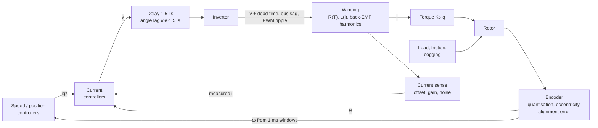
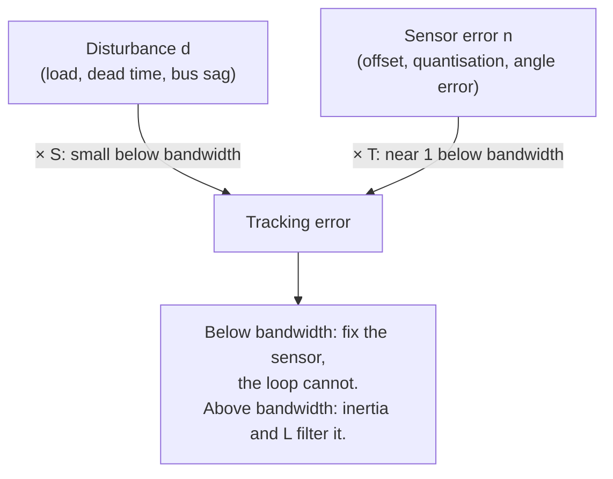

| Field     | Value                                  |
|-----------|----------------------------------------|
| Title     | Disturbances, Non-Idealities and Noise |
| Type      | theory                                 |
| Status    | draft                                  |
| Version   | 0.1.1                                  |
| Component | disturbances-and-noise                 |
| Date      | 2026-10-29                             |

> **Theory document**: Explains the mathematical and engineering principles behind a component or algorithm.
> This document is descriptive — it records the *why* and *how* at a scientific level, independent of any
> specific implementation. Equations use KaTeX ($inline$ and $$block$$). Diagrams use Mermaid.

---

## Overview

The model of the earlier chapters is clean: sinusoidal back-EMF, ideal switches, exact sensors, constant
parameters. The real drive is not, and everything that separates the two reaches the loops as a disturbance
or as noise. This chapter lists them, and for each one gives

**cause → where it enters → its frequency signature → what it does → how it is reduced → e-foc today.**

Two facts organise the whole chapter:

1. **Disturbances are rejected through $S$, noise passes through $T$** ([closed-loop control](closed-loop-control.md)
   §2). A disturbance below the bandwidth is largely removed; a sensor error below the bandwidth is
   faithfully reproduced as a real error, because the loop believes its sensor.
2. **The dq frame moves frequencies.** A phase-current component at $h$ times the electrical frequency
   appears in dq at $(h - 1) f_e$ if it rotates with the fundamental and at $(h + 1) f_e$ if it rotates
   against it. That is why an offset shows up at $1\times f_e$, a gain mismatch at $2\times$, and dead time
   and back-EMF harmonics at $6\times$. A ripple's frequency names its cause (§7).

---

## Prerequisites

[Motor model](motor-model.md), [closed-loop control](closed-loop-control.md),
[the numbers that matter](numbers-to-know.md).

| Symbol         | Meaning                                             | Unit |
|----------------|-----------------------------------------------------|------|
| $f_e$, $f_m$   | Electrical and mechanical frequency, $f_e = p\,f_m$ | Hz   |
| $h$            | Harmonic order in the phase quantities              | —    |
| $T_L$          | Load torque                                         | N·m  |
| $o_a, o_b$     | Current-sensor offsets                              | A    |
| $\varepsilon$  | Relative current-sensor gain error                  | —    |
| $t_d$          | Effective dead time at the switch node              | s    |
| $\Delta\theta$ | Electrical angle error                              | rad  |
| $q$            | Encoder angle quantum $2\pi/N_{enc}$                | rad  |
| $T_w$          | Speed-estimate window, 1 ms                         | s    |
| $\sigma_i$     | Current-sensor noise (RMS)                          | A    |

---

## Mathematical Foundation

### 1. Where Disturbances and Noise Enter

The diagram in *Block Diagrams* places every item of this chapter on the cascade. They fall into four groups:

| Group            | Enters at                        | Examples                                                                         |
|------------------|----------------------------------|----------------------------------------------------------------------------------|
| Mechanical (§2)  | The torque balance               | Load, external torque, friction, cogging, inertia change                         |
| Electrical (§3)  | The voltage reaching the winding | Dead time, back-EMF harmonics, saturation, temperature, bus voltage, PWM ripple  |
| Measurement (§4) | The feedback signals             | Current offset, gain, noise; encoder quantisation, eccentricity; alignment error |
| Digital (§5)     | The loop itself                  | Delay, aliasing, limit cycles                                                    |

**Frequency translation.** Write a phase-current harmonic of order $h$ and amplitude $I_h$ as a space vector. A
positive-sequence harmonic (phases following each other a, b, c) rotates forward,
$I_h e^{jh\theta_e}$; a negative-sequence one rotates backwards, $I_h e^{-jh\theta_e}$. The Park transform
multiplies by $e^{-j\theta_e}$:

$$
I_h e^{j h\theta_e} \;\to\; I_h e^{j(h-1)\theta_e}, \qquad
I_h e^{-j h\theta_e} \;\to\; I_h e^{-j(h+1)\theta_e}
$$

In a balanced three-phase system the 5th harmonic is negative-sequence and the 7th positive-sequence, so both
land at $6 f_e$ in dq; the 11th and 13th at $12 f_e$. A constant (order 0) becomes $1 f_e$; a negative-sequence
fundamental becomes $2 f_e$.

### 2. Mechanical Disturbances

**Load and external torque.** The plant splits the shaft torque into a load that opposes motion and an
external torque with a fixed sign, $T_L = T_{load}\operatorname{sgn}(\omega_m) + T_{ext}$
(`documentation/theory/foc-plant-models.md` §2). Both enter at the torque balance and are rejected by the
speed loop. For the implementation's speed PI, $K_p = 2J\omega_{bw}/K_t$ with its integral zero at
$\omega_{bw}/4$ (`documentation/theory/speed-loop-pi.md`), the closed loop is
$s^2 + 2\omega_{bw}s + \tfrac{1}{2}\omega_{bw}^2$ with roots $-0.293\,\omega_{bw}$ and $-1.707\,\omega_{bw}$. A
torque step $T_L$ makes the speed dip by

$$
\Delta\omega(t) = \frac{T_L}{1.414\,J\,\omega_{bw}}\left(e^{-0.293\,\omega_{bw} t} - e^{-1.707\,\omega_{bw} t}\right),
\qquad
\Delta\omega_{max} = 0.41\,\frac{T_L}{J\,\omega_{bw}} \ \text{at}\ t = \frac{1.25}{\omega_{bw}}
$$

and recover with the slow root. The dip scales with $1/(J\,\omega_{bw})$: a light rotor needs a fast speed loop,
or an explicit disturbance estimate (ADRC, `speed-loop-adrc.md`).

**Friction.** Viscous friction $B_f\omega_m$ is part of the model and is identified. Coulomb friction, a
constant torque opposing motion, and the Stribeck rise in breakaway torque near standstill are not linear:
the rotor sticks until the drive overcomes breakaway, then slips. A position loop with integral action hunts
around the setpoint; at low speed the velocity ripples. Feed-forward of the friction level removes most of it.
*e-foc today:* the mechanical estimator fits a Coulomb term
internally but does not output it (`documentation/design/service-mechanical-ident.md`); the calibration record
has a field for it that stays zero, and no cascade applies a friction feed-forward.

**Cogging.** The magnets' attraction to the stator teeth gives a torque, independent of current, that repeats
$N_{cog} = \operatorname{lcm}(N_s, 2p)$ times per mechanical revolution for $N_s$ slots
([physical picture](motor-physics.md) §8). Its frequency is

$$
f_{cog} = N_{cog}\, f_m = \frac{N_{cog}}{p}\, f_e
$$

The bench motor, 12 slots and 8 poles, has 24 detents 4 mN·m deep (`documentation/design/software-in-the-loop.md`
Part K): $6 f_e$, the same frequency as dead time. At speed the speed loop and the inertia filter it; near
standstill it decides where the rotor can rest, and a position setpoint between two detents is held only if
the loop is stiffer than the cogging. *e-foc today:* compensated by a 48-bin map over one electrical period,
fed forward as current (`documentation/design/service-cogging-compensation.md`).

**Inertia change.** A load coupled to the shaft adds inertia. A speed loop tuned for $\hat{J}$ on a shaft with
inertia $J$ has its bandwidth scaled by $\hat{J}/J$, but not its load dip: rejection is set by the loop's
stiffness $K_t K_p$, which does not depend on $J$. Doubling the inertia under the implementation's speed PI turns
the roots $-0.29$ and $-1.71\,\omega_{bw}$ into a double root at $-0.5\,\omega_{bw}$. Simulated for the Teknic at
100 rad/s with a 20 mN·m step, the dip falls from 11.5 to 10.4 rad/s and its peak moves from 12.5 to 20 ms; the
reference response slows to half the bandwidth. The dip formula above holds for $J = \hat{J}$.

### 3. Electrical Non-Idealities

**Dead time and switch drops.** Between one switch of a leg turning off and the other turning on, both are
off and the phase current alone decides the switch-node voltage. At large current the node is clamped at once
by a body diode, and the leg's average voltage is off by

$$
\Delta v = -\operatorname{sgn}(i)\,(V_{dc} + 2V_f)\,\frac{t_d}{T}
$$

a loss for current out of the leg, a gain for current into it. At small current the node is still swinging when the complement turns on, the loss is
proportional to the current and looks like extra resistance (`documentation/design/software-in-the-loop.md`
Part L). Because the loss follows the sign of each phase current, it is a square wave in each phase: a
fundamental component that reduces the voltage and odd harmonics, the 5th and 7th of which give a
**$6 f_e$ ripple** in dq. Near each current zero crossing the current flattens ("zero-crossing distortion").
On E-FOC-HARDWARE the effective loss is 70 ns against a 500 ns commanded band: 34 mV at 24 V, 56 mV at 40 V
per leg. *e-foc today:* every duty is corrected for the board's loss, with a ramp through the 0.2 A knee
(`documentation/design/service-dead-time-compensation.md`). The switch-level picture is in
[the power stage](power-stage.md) §4.

**Back-EMF harmonics.** A motor whose magnet flux is not perfectly sinusoidal has 5th, 7th, … harmonics in its
back-EMF. With sinusoidal currents they produce torque ripple at $6 f_e$, $12 f_e$. *e-foc today:* not
compensated; the model assumes a sinusoidal back-EMF.

**Inductance saturation.** At high current the iron saturates and $L_s$ falls. A PI tuned with
$K_p = \hat{L}_s\,\omega_{bw}$ then crosses over at $\omega_{bw}\hat{L}_s/L_s$: **faster** than designed, which
spends phase margin against the loop delay. A deadbeat law, which inverts $L_s$, overshoots.

**Temperature.** Copper resistance rises about 0.39 %/K: a winding 80 K above the temperature it was
identified at has 31 % more resistance. NdFeB magnet flux falls about 0.1 %/K (ferrite about 0.2 %/K), so
torque per ampere and back-EMF fall with it. Integral action absorbs both in the current and speed loops; a
torque command converted to current with a cold $K_t$ delivers less torque on a hot motor, and model-based laws
lose the accuracy of their model. *e-foc today:* the online estimator follows $R_s$
(`documentation/design/service-electrical-ident.md`); the simulator models $R_s$ and $L_s$ against winding
temperature but not $\psi_f$ (`core/foc/model/ThermalModel.cpp`).

**Bus voltage.** The modulator works in per-unit of $V_{dc}/\sqrt3$, and the current-loop gains are normalised
by $V_{dc}$. If the bus sags under load, each per-unit command produces proportionally less voltage: the
effective loop gain, the bandwidth and every voltage feed-forward fall by $V_{actual}/V_{assumed}$, and the top
speed falls with it. *e-foc today:* $V_{dc}$ is read once at boot
(`targets/sync_foc_sensored/main/instantiations/Logic.cpp`) and used for the normalisation and the
identification; the hardware comparators still trip on the live bus (18 V and 58 V on E-FOC-HARDWARE).

**PWM current ripple.** Within each period the phase current ripples around its average. The peak-to-peak
ripple of phase a, over all angles, simulated for centre-aligned common-mode-injection SVM at 20 kHz:

| Modulation $m$ | Anaheim, 24 V, 0.64 mH | Teknic, 40 V, 0.20 mH |
|----------------|------------------------|-----------------------|
| 0.1            | 0.05 A                 | 0.27 A                |
| 0.3            | 0.12 A                 | 0.64 A                |
| 0.6            | 0.19 A                 | 1.00 A                |
| 0.9            | 0.28 A                 | 1.50 A                |

The ripple is at the switching frequency, far above every bandwidth, so the loops do not act on it, and
the mechanics filter it out. It costs copper loss and, sampled at the wrong instant, would alias. Sampling
at the centre of the low-side window, where a symmetric ripple crosses its mean, reads the average current
without a filter. The low-inductance Teknic ripples five times more than the Anaheim.

### 4. Measurement Errors

**Current offset.** A sensor offset adds a constant vector $\mathbf{o}$ to the measured current in $\alpha\beta$.
Park rotates it:

$$
\mathbf{i}_{dq,meas} = \mathbf{i}_{dq} + \mathbf{o}\, e^{-j\theta_e}
$$

a ripple at **$1 f_e$** of amplitude $|\mathbf{o}|$. Inside the current-loop bandwidth the loop makes the
measured current follow the reference, so the real current carries the opposite ripple and the torque ripples
by $K_t |\mathbf{o}|$ at $f_e$. The bench board's raw offsets were +27, −18 and +54 mA, a 42 mA vector after
the Clarke transform and 1.6 mN·m of ripple on the Teknic. *e-foc today:* measured at calibration with the rotor
at rest, as the mean of two 2000-sample windows that agree within 10 mA (noise below 1 mA), and subtracted from
every sample (`documentation/design/service-current-offsets.md`). Where
the offsets come from, and how they drift, is in [the sensing chain](sensing-chain.md) §3.

**Current gain mismatch.** If phase a reads $(1 + \varepsilon)$ times its current, the three-sensor Clarke
form the firmware evaluates ([FOC](foc.md) §1) gives an error vector on the $\alpha$ axis only:

$$
\Delta\mathbf{i} = \tfrac{2}{3}\,\varepsilon\, I \cos\theta_e
= \frac{\varepsilon I}{3}\left(e^{j\theta_e} + e^{-j\theta_e}\right)
\;\xrightarrow{\ \text{Park}\ }\;
\frac{\varepsilon I}{3}\left(1 + e^{-j2\theta_e}\right)
$$

a constant error of $\varepsilon I/3$ and, from the backwards-rotating part, a ripple of the same amplitude at
**$2 f_e$**. *e-foc today:* not calibrated; the hardware-characterisation plan includes a per-phase gain check
(`documentation/design/hardware-characterisation.md` Part B).

**Current noise and quantisation.** The sense chain carries 31–39 mA RMS per averaged sample, against a 4 mA
LSB. Inside the bandwidth the loop turns it into real current noise; at all frequencies the proportional
gain turns it into voltage-command noise $\approx L_s\,\omega_{bw}\,\sigma_i$, which e-foc bounds at 0.08 V RMS
when it chooses the bandwidth (`documentation/design/controller-selection.md`).

**Sampling instant.** The three phases are converted one after another after the centre trigger; the last is
read 5.25 µs later. A late reading falls outside the low-side window of a leg at high duty: with a longer
sample-and-hold the last phase read 10–34 % low. With the shortest sample-and-hold all three read within 2.5 %
up to 69 % duty (`documentation/architecture/system.md`).

**Encoder quantisation.** One count is $q = 2\pi/4000$ = 1.57 mrad mechanical, 0.36° electrical: negligible for
the transforms. Its effect is on speed. The speed estimate is the difference of two floored angle readings over
$T_w$ = 1 ms; each floor error is uniform over one count, so the difference has a standard deviation
$q/\sqrt6$ and

$$
\sigma_\omega = \frac{q}{\sqrt6\, T_w} = \frac{1.57\ \text{rad/s}}{\sqrt6} = 0.64\ \text{rad/s RMS}, \qquad
\text{peak } \pm 1.57\ \text{rad/s}
$$

The speed loop multiplies it by $K_p$: on the Teknic at 100 rad/s ($K_p$ = 0.037 A per rad/s) that is 24 mA RMS of
$i_q^*$ and 0.9 mN·m of torque noise; at 300 rad/s three times more. Longer windows trade this noise for delay;
more counts per revolution or an observer (a tracking PLL, a Kalman filter) reduce it without the delay.
*e-foc today:* the window difference is used unfiltered (`core/foc/cascade/SpeedDifferentiator.cpp`); the
identification estimators avoid end-sample speeds by using window-mean positions
(`documentation/theory/friction-inertia-estimation.md` §4.1).

**Encoder eccentricity and periodic error.** A disk mounted off-centre, or a code wheel with uneven slots,
gives an angle error that repeats once (or a few times) per mechanical revolution, $a\sin\theta_m$. Its
derivative is a speed error $a\,\omega_m\cos\theta_m$ that **grows with speed**, at $1 f_m$. *e-foc today:* not
modelled; the hardware-characterisation plan measures it (`hardware-characterisation.md` Part B).

**Alignment offset error.** An error $\Delta\theta$ in the electrical zero rotates the measured dq frame
against the real one. The loop puts the measured current on the q-axis, so the real current is
$i_q = I\cos\Delta\theta$, $i_d = I\sin\Delta\theta$: a torque loss $1 - \cos\Delta\theta$ and a d current
$I\sin\Delta\theta$. Five electrical degrees cost 0.4 % of torque but 8.7 % of the current on the wrong axis; one
mechanical degree is four electrical degrees on a $p = 4$ motor (`documentation/theory/alignment.md` §6).

### 5. Digital Effects

**Delay.** The current loop acts 1.5 periods after it samples ([closed-loop control](closed-loop-control.md)
§7). Besides the phase it costs at crossover, the rotor turns during the delay: the voltage computed with the
sampled angle is applied, on average, $\omega_e \cdot 1.5\,T_s^i$ late. On the Teknic at 6000 rpm that is
10.8° electrical, and since the applied vector is rotated against the rotor by that angle the error is about
$|V|\,\Delta\theta = 19.0\ \text{V} \times 0.19 = 3.6$ V, mostly on the d-axis. The integrators absorb it as a
speed-proportional disturbance; a feed-forward law that assumes the voltage lands where it was computed is off
by it. A common remedy is to rotate the inverse Park by an advanced angle $\theta_e + 1.5\,\omega_e T_s^i$.
*e-foc today:* the inverse Park uses the sampled angle (`core/foc/cascade/CascadeWithSpeedLoop.cpp`); the
deadbeat law models the one-period duty delay explicitly (`current-loop-deadbeat.md`).

**Aliasing.** A sampled signal cannot tell a component at $f$ from one at $f \pm k f_s$. Centre sampling
keeps the PWM ripple out of the current samples. Where a slower consumer takes every $n$-th sample
(identification at 10 kHz from 20 kHz), the decimation drops samples without averaging them
(`documentation/design/platform-phase-current-rate.md`), so content above the new Nyquist frequency folds
down.

**Limit cycles.** Quantisation, a dead band or an unmodelled delay inside a high-gain loop can sustain an
oscillation with no input. The deadbeat law, which assumed the duty acts at once, did so on the rig at
3.4 kHz until it was made to predict the current for when its duty lands
(`documentation/design/software-in-the-loop.md` Part K). Integral action around Coulomb friction is the
mechanical version: hunting.

**Sine table.** 512 interpolated entries: an amplitude error of $1.9\times10^{-5}$, below every other item
here ([FOC](foc.md) §5).

### 6. Filtering: the Trade

Every filter that removes noise adds phase lag. A first-order filter with corner $\omega_f$ costs
$\arctan(\omega_c/\omega_f)$ at the loop's crossover $\omega_c$: a corner at $10\,\omega_c$ costs 5.7°, at
$3\,\omega_c$ 18°. A moving average over $N$ samples delays by $(N-1)/2$ samples. The same budget pays for
delay, filtering and inner-loop lag together, which is why e-foc samples the currents without a filter and
why the speed estimate is a bare window difference: each of them leaves the margin to the loop.

### 7. Diagnostic Signatures

| Ripple seen in $i_d$, $i_q$, torque or speed at … | Likely cause                                                        |
|---------------------------------------------------|---------------------------------------------------------------------|
| $1 f_e$                                           | Current-sensor offset                                               |
| $2 f_e$                                           | Current-sensor gain mismatch; phase asymmetry                       |
| $6 f_e$, $12 f_e$                                 | Dead time; back-EMF harmonics; cogging if $N_{cog}/p = 6$           |
| $(N_{cog}/p)\, f_e$                               | Cogging                                                             |
| $1 f_m$, growing with speed                       | Encoder eccentricity or periodic code-wheel error                   |
| Proportional to speed, DC in dq                   | Uncompensated delay ($\omega_e \cdot 1.5\,T_s$); feed-forward error |
| Broadband in speed, $\pm$1.57 rad/s steps         | Encoder quantisation through the window difference                  |
| Broadband in the voltage command, audible hiss    | Current-sensor noise through a high current-loop gain               |
| A fixed tone with no input                        | Limit cycle: delay, dead band or quantisation in a high-gain loop   |
| Low-frequency hunting at standstill               | Coulomb friction or cogging against integral action                 |
| Drift over minutes                                | Temperature: $R_s$, $\psi_f$, sensor offsets                        |

---

## Block Diagrams

### Injection Points on the Cascade

### Disturbance Rejected, Noise Passed

---

## Numerical Properties

### Parameter Sensitivity

| Parameter          | Effect on control quality                                                                                        |
|--------------------|------------------------------------------------------------------------------------------------------------------|
| $R_s$ error        | Current controller steady-state error (for non-integral controllers); compensated by integral term where present |
| $L_s$ error        | Controller bandwidth deviation; no steady-state error for integral-action controllers                            |
| $\theta_e$ error   | Cross-coupling between d and q axes; reduces torque at large error                                               |
| $V_{dc}$ variation | Affects gain normalisation; e-foc reads $V_{dc}$ once at boot                                                    |
| ADC offset         | Bias on $i_d$, $i_q$ that rotates at $f_e$; calibrated at startup                                                |
| $\psi_f$ error     | Torque per ampere and back-EMF feed-forward; drifts with magnet temperature                                      |
| $J$ error          | Speed-loop bandwidth scales with $\hat{J}/J$                                                                     |

### Magnitudes on the Reference Hardware

| Item                       | Size                                                 | Frequency in dq     |
|----------------------------|------------------------------------------------------|---------------------|
| Current noise              | 31–39 mA RMS                                         | Broadband           |
| Raw current offsets        | +27, −18, +54 mA (< 1 mA after calibration)          | $1 f_e$             |
| Dead-time loss             | 34 mV (24 V) – 56 mV (40 V) per leg, 70 ns effective | $6 f_e$ and DC      |
| Cogging (bench motor)      | 4 mN·m, 24 per revolution                            | $6 f_e$             |
| Speed quantum              | 1.57 rad/s peak, 0.64 rad/s RMS                      | Broadband           |
| Delay angle at rated speed | 7.2° (Anaheim), 10.8° (Teknic)                       | DC, $\propto$ speed |
| PWM ripple                 | up to 0.28 A (Anaheim), 1.5 A (Teknic) peak-to-peak  | $f_s$               |

---

## Worked Example

The Teknic at 3000 rpm: $f_m$ = 50 Hz, $f_e$ = 200 Hz, current loop at 5000 rad/s (796 Hz), speed loop at
100 rad/s (16 Hz).

| Source                  | Frequency | Against the loops                            | Outcome                                                                        |
|-------------------------|-----------|----------------------------------------------|--------------------------------------------------------------------------------|
| Residual offset, 1 mA   | 200 Hz    | Inside the current bandwidth: reproduced     | 0.04 mN·m ripple, negligible                                                   |
| Gain mismatch, if 2 %   | 400 Hz    | Inside the current bandwidth: reproduced     | 0.7 % of $I$ at 400 Hz, the same in torque                                     |
| Dead time / cogging     | 1200 Hz   | Above the current bandwidth: partly rejected | Filtered by inertia before it reaches speed                                    |
| Eccentricity, if 1 mrad | 50 Hz     | Inside the speed bandwidth? No: above 16 Hz  | Speed error $a\omega_m$ = 0.31 rad/s, passed to torque by $K_p$                |
| Speed quantum           | Broadband | Through $K_p$ of the speed loop              | 24 mA RMS of $i_q^*$, 0.9 mN·m                                                 |
| Load step 20 mN·m       | Step      | Rejected through $S$ of the speed loop       | Dip $0.407 \times 0.02/(7.06\times10^{-6} \times 100)$ = 11.5 rad/s at 12.5 ms |

The table reads as a priority list: the speed quantum and the load dip dominate what this rotor feels, the
offset and dead time are already handled, and the gain mismatch is the largest unmeasured term.

---

## Limitations & Assumptions

- **Assumes**: linear superposition of small disturbances on the operating point; large ones (saturation,
  stick-slip) are described qualitatively.
- **Assumes**: first-order closed loops when stating "inside" or "outside" a bandwidth.
- **Simulated, not measured**: the PWM ripple table and the speed-dip formula are computed from the models;
  the bench figures are measured and cited.
- **Does not cover**: electromagnetic interference and grounding, bearing and mechanical resonances, sensor
  failures (handled by fault detection, `documentation/design/error-handling.md`).

## References

1. Jahns, T.M. & Soong, W.L. — "Pulsating torque minimization techniques for permanent magnet AC motor drives —
   a review", *IEEE Transactions on Industrial Electronics*, 43(2):321–330, 1996.
2. Choi, J.-W. & Sul, S.-K. — "Inverter output voltage synthesis using novel dead time compensation",
   *IEEE Transactions on Power Electronics*, 11(2):221–227, 1996.
3. Briz, F., Degner, M.W. & Lorenz, R.D. — "Analysis and design of current regulators using complex vectors",
   *IEEE Transactions on Industry Applications*, 36(3):817–825, 2000.
4. Holmes, D.G. & Lipo, T.A. — *Pulse Width Modulation for Power Converters*, IEEE Press / Wiley, 2003.
5. Armstrong-Hélouvry, B., Dupont, P. & Canudas de Wit, C. — "A survey of models, analysis tools and
   compensation methods for the control of machines with friction", *Automatica*, 30(7):1083–1138, 1994.
