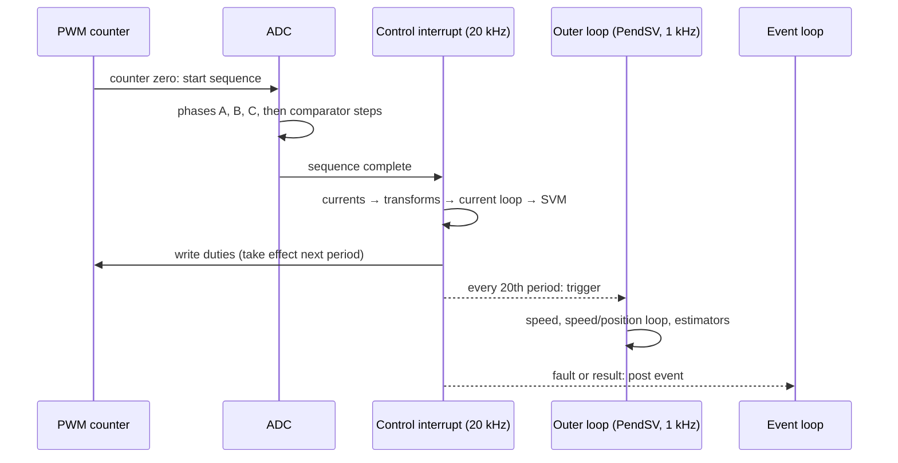
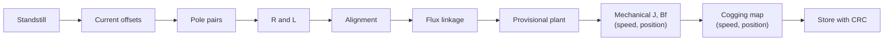

| Field     | Value                                                 |
|-----------|-------------------------------------------------------|
| Title     | From Equations to Firmware — Practical Implementation |
| Type      | theory                                                |
| Status    | draft                                                 |
| Version   | 0.1.0                                                 |
| Component | firmware-implementation                               |
| Date      | 2026-10-29                                            |

> **Theory document**: Explains the mathematical and engineering principles behind a component or algorithm.
> This document is descriptive — it records the *why* and *how* at a scientific level, independent of any
> specific implementation. Equations use KaTeX ($inline$ and $$block$$). Diagrams use Mermaid and ASCII art.

---

## Overview

The theory chapters describe continuous signals and exact arithmetic. The firmware has 50 µs, 6000 clock cycles,
a single-precision floating-point unit and a stack of fixed size, and it must give the same answer, in the same
time, every period, for as long as the motor runs. This chapter explains the practical choices that bridge the
two:

- the **execution structure**: what triggers the control interrupt, what runs in it, and what runs elsewhere;
- **timing**: the cycle budget, how it is measured, and the one-period delay the PWM hardware adds;
- **numerics** on a Cortex-M4F: what is fast, what is avoided, and why;
- the **determinism rules** of the code base and the reason for each;
- how data crosses between the three execution contexts;
- the **calibration sequence** that brings a new motor from unknown to tuned, and why its order is what it is;
- **supervision** in software, and the **verification ladder** from unit tests to the rig.

The detailed component designs are in `documentation/design/`; this chapter is the map that connects them to
the theory.

---

## Prerequisites

[Closed-loop control](closed-loop-control.md) §7, [power stage](power-stage.md), [sensing chain](sensing-chain.md).

| Symbol           | Meaning                                  | Unit   |
|------------------|------------------------------------------|--------|
| $f_{cpu}$        | CPU clock, 120 MHz                       | Hz     |
| $f_s$            | PWM and control rate, 20 kHz             | Hz     |
| $N_{cyc}$        | Cycles per control period, $f_{cpu}/f_s$ | cycles |
| $T_s^i$, $T_s^o$ | Inner and outer periods, 50 µs and 1 ms  | s      |

---

## Mathematical Foundation

### 1. Execution Structure

Three execution contexts share the CPU, by priority:

| Context                         | Rate                 | Triggered by                                              | Runs                                                       |
|---------------------------------|----------------------|-----------------------------------------------------------|------------------------------------------------------------|
| Control interrupt (highest)     | 20 kHz               | ADC sequence complete, started by the PWM at counter zero | Currents, transforms, current loop, modulation, duty write |
| PWM fault interrupt (highest)   | On a comparator trip | ADC digital comparators through the PWM fault input       | Fault latch                                                |
| Outer loop, PendSV (lowest)     | 1 kHz                | Every 20th control interrupt                              | Speed estimate, speed or position loop, online estimators  |
| Watchdog early warning (lowest) | 25 ms                | Watchdog timer                                            | Power-stage cut before the reset                           |
| Event loop (`main`)             | As events arrive     | Timers, CAN, UART, deferred interrupt work                | State machine, calibration services, CAN, CLI, NVM         |

Sources: `targets/platform_implementations/ti/implementation/PlatformFactoryImpl.hpp` (priorities),
`documentation/architecture/system.md`. CAN and UART interrupts sit in between, at normal and low priority.

**The control interrupt, in order** (`targets/platform_implementations/ti/implementation/PlatformFactoryImpl.cpp`,
`core/foc/instantiations/Runner.hpp`, `core/foc/cascade/CascadeWithSpeedLoop.cpp`):

1. Convert the three ADC codes to amperes.
2. Rebuild a phase whose duty was above the readable limit; check every phase against the 6.6 A trip.
3. Subtract the calibrated offsets.
4. Read the encoder; electrical angle $\theta_e = p\,\theta_m$; sine and cosine from the table.
5. Clarke, Park; add the cogging feed-forward to $i_q^*$; run the current controller; inverse Park; SVM.
6. Accumulate the estimator windows; every 20th period, close them and trigger the outer loop.
7. Correct each duty for dead time; keep the low-side shunts readable; write the duties.
8. Record the cycle count.

Nothing in it waits or allocates. During calibration the active service's sample callback also runs in it (the
offset measurement, for example, accumulates there), but everything that can wait is posted to the event loop: a
fault detected in the interrupt is latched and the bridge stopped there, but reported from the event loop.



### 2. Timing: Budget, Measurement and Overrun

$$
N_{cyc} = \frac{f_{cpu}}{f_s} = \frac{120\ \text{MHz}}{20\ \text{kHz}} = 6000\ \text{cycles}
$$

The inner loop may use 4500 of them (75 %); the outer loop 20 000 per millisecond. The rest is for the outer
loop, the communication interrupts and the event loop, which run only in the time the control interrupt leaves
(`documentation/requirements/performance/real-time-requirements.yaml`).

The cycle counter of the Cortex-M debug unit (DWT `CYCCNT`) timestamps every control interrupt. The platform
counts three events: an interrupt over its budget, one that missed its deadline (longer than a period), and a
re-entry, an interrupt that started before the previous one finished; a GPIO pin can also be toggled for a scope.
The measurement covers the application callback inside the interrupt (encoder read, control law, PWM write) and
leaves out the hardware's interrupt entry and exit, for which the requirement reserves the remaining quarter of the
period (`documentation/design/error-handling.md`). Measured on silicon, the callback takes **1074–1353 cycles**
(9–11 µs, 18–23 % of the period), of which the FOC calculation is 739–860. The emulator has no cycle counter; it reads
an instruction-counted timer whose period is 1250 ticks, with the same three-quarter budget, 937 ticks
(`documentation/performance-optimization/README.md`, `documentation/design/software-in-the-loop.md`).

### 3. The One-Period Duty Delay

The PWM's compare registers are double-buffered and load at the counter's zero, all three legs together (global
update), so a duty never changes in the middle of a period and the legs stay synchronised. The cost is a period of
delay:

```text
 counter zero         counter zero         counter zero
     |    period k        |    period k+1      |
     v                    v                    v
     S---compute---W      .                    .
     ^ sample            ^ duty written in k is loaded here and acts in k+1
     |<----------- 1 period ---------->|<-- held for a period: ½ period more on average -->|
```

The platform states the delay (`DutyUpdateDelayPeriods() = 1` on TI) so that code which models the plant can
account for it: the deadbeat current law predicts the current at the instant its duty lands, and the estimators
pair each current change with the voltage that caused it (`documentation/theory/current-loop-deadbeat.md`,
`documentation/design/service-electrical-ident.md`). Together with the hold it gives the 1.5-period loop delay of
[closed-loop control](closed-loop-control.md) §7. The inverse Park still uses the sampled angle
([disturbances and noise](disturbances-and-noise.md) §5).

### 4. Numerics on a Cortex-M4F

The EK-TM4C1294XL's Cortex-M4F has a single-precision floating-point unit. That fixes the arithmetic:

| Operation                                 | Cost (cycles)         | Use in the hot path                                                |
|-------------------------------------------|-----------------------|--------------------------------------------------------------------|
| `float` add, multiply, fused multiply-add | 1–3                   | Everywhere                                                         |
| `float` divide, square root               | 14                    | Avoided: reciprocals precomputed when parameters change            |
| `sinf`, `cosf`                            | 50–200                | Never: a 512-entry table with linear interpolation, ≈ 1.9e-5 error |
| `double` anything                         | software-emulated     | Never                                                              |
| Virtual call                              | 6–20, and no inlining | Not in the hot path: `Calculate` is bound statically               |

Source: `documentation/performance-optimization/README.md`. Further choices:

- **Compiler flags.** Embedded builds use `-ffast-math -fno-finite-math-only` (`cmake/CompilerOptimizations.cmake`):
  reassociation and contraction into fused multiply-adds are allowed, but infinities and NaNs keep their meaning,
  so a check for them still works where one is made. Hot functions defined in headers are forced inline; nothing
  uses per-function optimisation pragmas, which would block inlining.
- **Per-unit scaling.** Voltages are carried as fractions of $V_{dc}/\sqrt3$, so the modulator's limit is the unit
  circle and gains are dimensionless where they meet it ([current-loop-pi.md](current-loop-pi.md), *Gain
  Normalisation*).
- **Incremental controllers.** The PI laws compute a change from the last applied output, which avoids a large
  integrator state, starts bumplessly, and makes anti-windup a matter of committing the applied value.
- **Angles** are wrapped to $[-\pi, \pi)$, where `float` resolves $2.4\times10^{-7}$ rad; nothing accumulates an
  unbounded angle or time in a `float`.
- **No validation per sample.** Checking every intermediate for NaN would cost the budget; validation happens where
  data enters (a parameter set, an identification result), with a check of the exponent bits that survives
  `-ffast-math` (`documentation/architecture/system.md`).

### 5. Determinism Rules and Why

The code base forbids, in the control and platform layers (`AGENTS.md`):

| Rule                                        | Reason                                                                                                |
|---------------------------------------------|-------------------------------------------------------------------------------------------------------|
| No heap allocation                          | Allocation time is unbounded and fragmentation grows; a drive must run for years                      |
| No recursion                                | The stack depth must be bounded and known                                                             |
| No exceptions                               | Unwinding is unbounded in time and large in code; results are status values or `std::optional`        |
| No virtual dispatch in the hot path         | Indirect calls cost cycles and prevent inlining                                                       |
| Bounded containers, `std::array`            | Size known at compile time, no allocation                                                             |
| Protected non-virtual interface destructors | A virtual destructor pulls in deleting-destructor code: about 18 KB on the TM4C123                    |
| Runtime controller choice by `std::variant` | Selecting an algorithm without heap or virtual calls (`documentation/design/controller-selection.md`) |

### 6. Sharing Data Between Rates

Each context writes what another reads, without locks (a lock in an interrupt can deadlock):

- **Control interrupt ↔ outer loop**: single-writer, single-reader **triple buffers**. The writer always has a free
  slot that the reader does not hold, so neither side waits and the reader always gets a complete, consistent
  value (`core/foc/cascade/TripleBuffer.hpp`). The estimator snapshots cross from the control interrupt to the outer
  loop this way, and the torque-mode set point from the event loop to the control interrupt. A single 32-bit value
  needs no buffer: the speed loop's current reference is one `volatile float`, which the Cortex-M writes and reads in
  one access (`core/foc/cascade/CascadeWithSpeedLoop.hpp`).
- **Interrupts → event loop**: the interrupt latches a flag or a result and posts a closure to the event dispatcher;
  the service that owns the result handles it in thread context. A closure that may outlive its owner holds a weak
  reference (`documentation/design/async-callback-lifetime.md`).
- **Event loop → control**: new parameters (gains, a motor model, a cogging map) are prepared in the event loop,
  with the divisions and table expansions done there, and written into the controllers when the drive reaches
  `Ready` or while it is stopped (`documentation/design/controller-selection.md`).

### 7. Bring-Up: the Calibration Sequence

A new motor is unknown: its offsets, pole pairs, resistance, inductance, rotor angle, flux linkage, inertia,
friction and cogging. The calibration measures them in an order where each step needs only what the earlier ones
produced (`documentation/design/state-machine.md`, *Calibration Sequence*):

| Step                                      | What it does                                                                                                        | Needs                                                                    |
|-------------------------------------------|---------------------------------------------------------------------------------------------------------------------|--------------------------------------------------------------------------|
| 0. Standstill                             | Waits until the encoder is still within 2 mrad for 100 ms                                                           | Nothing                                                                  |
| 1. Current offsets                        | All legs at 50 %; mean of two 2000-sample windows that agree within 10 mA (a third if they do not); applied at once | A still rotor: a turning one drives current through the shorted windings |
| 2. Pole pairs                             | Turns an open-loop vector five electrical revolutions; $p$ from the encoder                                         | Correct currents                                                         |
| 3. Resistance, inductance                 | DC step for $R_s$; 700 Hz injection and a Goertzel filter for $L_s$                                                 | Offsets; dead-time compensation                                          |
| 4. Alignment                              | Holds a d-axis current at $\theta_e = 0$ until the rotor settles; sets the zero                                     | Pole pairs, a current level                                              |
| 5. Flux linkage                           | Spins to 40 rad/s, coasts at zero current, fits $v_q$ against $\omega_e$                                            | Alignment, a current loop from $R_s$, $L_s$                              |
| 6. Provisional plant                      | Applies the electrical model and a cautious speed loop                                                              | Steps 3–5                                                                |
| 7. Mechanical (speed and position modes)  | Alternating speed steps; RLS for $J$, $B_f$; two agreeing runs                                                      | $K_t$ from the flux linkage, a speed loop                                |
| 8. Cogging map (speed and position modes) | 10 rad/s both ways; 48-bin map                                                                                      | $J$ for the inertia correction, the tuned speed loop                     |
| 9. Store                                  | Calibration record with magic, layout version and CRC-32; read back and verified                                    | All of the above                                                         |

Any failed step ends in `Fault`; a missing cogging map does not. A layout change of the record (version 3 to 4 when
the map was added) makes every stored calibration invalid and forces a new one (`documentation/design/service-nvm.md`).

### 8. Supervision in Software

| Monitor              | Detects                                                                           | Rate / window                                                                                                                  | Action                                                                                                                     |
|----------------------|-----------------------------------------------------------------------------------|--------------------------------------------------------------------------------------------------------------------------------|----------------------------------------------------------------------------------------------------------------------------|
| Over-current         | A rebuilt phase current above 6.6 A                                               | Every control period                                                                                                           | PWM disabled, all gates off, latched                                                                                       |
| Encoder plausibility | Effort without motion: a stuck or lost encoder, or a rotor held against the drive | Every 10 ms over 100 ms by default, drive-wide settings over CAN                                                               | `encoderLoss` fault, or `stall` when the encoder saw the rotor pushed against the drive; stall reporting can be turned off |
| Control-loop metrics | Overruns, missed deadlines, re-entries                                            | Every control period                                                                                                           | Counted and reported                                                                                                       |
| Watchdog             | A stalled event loop or interrupt                                                 | 25 ms early warning, 100 ms expiry                                                                                             | Event-loop stall: power stage cut, then reset; a hung interrupt starves the lowest-priority early warning: reset only      |
| Fault clearing       | Repeated faults                                                                   | At most 3 clears, budget restored after 10 s (a 250 ms dwell where the platform reports protection status; TI reports unknown) | Stays in `Fault`                                                                                                           |

Sources: `core/supervision/EncoderPlausibilityMonitor.hpp`, `core/platform_abstraction/ControlLoopMetrics.hpp`,
`documentation/design/fault-supervision.md`, `documentation/design/watchdog.md`, `documentation/design/error-handling.md`. The hardware protection paths are in
[power stage](power-stage.md) §7.

### 9. The Verification Ladder

Each level catches what the one below it cannot:

| Level                    | Runs                                                                                                                                                                          | Catches                                           |
|--------------------------|-------------------------------------------------------------------------------------------------------------------------------------------------------------------------------|---------------------------------------------------|
| Unit tests (host)        | Each component against strict mocks                                                                                                                                           | Logic, arithmetic, state handling                 |
| Model in the loop (host) | The application logic against the motor model                                                                                                                                 | Wiring of services, closed-loop behaviour         |
| Software in the loop     | The target binary in an emulator, against a plant with dead time, switch-node physics, sense-chain timing, duty delay, cogging, friction, encoder counts and a sagging supply | Timing, integer and float effects, non-idealities |
| Hardware in the loop     | The EK-TM4C1294XL with E-FOC-HARDWARE on the rig                                                                                                                              | Everything the plant does not model               |

The plant grows from the rig: the one-period duty delay, found when the deadbeat law limit-cycled on hardware at
3.4 kHz, is now a plant field, and a law that ignores it fails in simulation first
(`documentation/design/software-in-the-loop.md` Part K, `documentation/design/integration-testing.md`).

---

## Block Diagrams

### Calibration Order



---

## Numerical Properties

| Property                   | Value                               |
|----------------------------|-------------------------------------|
| Cycles per control period  | 6000                                |
| Inner-loop budget          | 4500 cycles (75 %)                  |
| Measured control interrupt | 1074–1353 cycles (18–23 %)          |
| Outer-loop budget          | 20 000 cycles per 1 ms              |
| Duty delay                 | 1 period                            |
| Arithmetic                 | `float` (single precision) only     |
| Sine table                 | 512 entries, 2 KiB, interpolated    |
| Calibration record         | 108 bytes, layout version 4, CRC-32 |
| Watchdog                   | 25 ms early warning, 100 ms expiry  |

---

## Worked Example

**Could e-foc run its PWM at 40 kHz?** The period halves to 25 µs and $N_{cyc}$ to 3000; the 75 % budget is 2250
cycles. The measured 1353 cycles of the callback fit, at 45 % of the period, with the interrupt entry and exit on
top of that. The loop delay halves to 37.5 µs, which doubles the
current-loop bandwidth the delay allows ([closed-loop control](closed-loop-control.md) §7) to about
$2\times10^4$ rad/s, and halves the PWM current ripple. Against that: switching losses double
([power stage](power-stage.md) §5), the fixed effective dead time becomes 0.28 % of the period instead of 0.14 %,
the low-side window shrinks with the period while the ADC sequence does not, so the readable duty falls (the last
phase holding at 5.25 µs allows $1 - 2 \times 5.25/25 = 58\,\%$ before settling), and the outer-loop prescaler
becomes 40. The window, not the CPU, is the binding constraint.

---

## Limitations & Assumptions

- **Platform-specific**: priorities, the ADC trigger and the duty delay are those of the TI platform; another MCU
  states its own through the platform interface.
- **Not verifiable here**: the TI driver code (dead-time cycle calculation, QEI filter, ADC clock setup) lives in a
  submodule not checked out with the firmware; its behaviour is taken from the platform code and the design
  documents.
- **Does not cover**: the build system, the bootloader and firmware update, and the desktop tools.

## References

1. Yiu, J. — *The Definitive Guide to ARM Cortex-M3 and Cortex-M4 Processors*, 3rd ed., Newnes, 2014.
2. ARM — *Cortex-M4 Technical Reference Manual*, and *ARMv7-M Architecture Reference Manual* (DWT, FPU, NVIC).
3. Texas Instruments — *TM4C1294NCPDT Microcontroller Data Sheet* (PWM, ADC, QEI chapters).
4. Kopetz, H. — *Real-Time Systems: Design Principles for Distributed Embedded Applications*, 2nd ed., Springer,
   2011.
