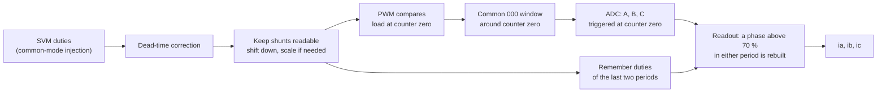

| Field     | Value                                                              |
|-----------|--------------------------------------------------------------------|
| Title     | Low-Side Shunt Current Sensing and How to Configure the PWM for It |
| Type      | theory                                                             |
| Status    | draft                                                              |
| Version   | 0.1.0                                                              |
| Component | low-side-current-sensing                                           |
| Date      | 2026-10-29                                                         |

> **Theory document**: Explains the mathematical and engineering principles behind a component or algorithm.
> This document is descriptive — it records the *why* and *how* at a scientific level, independent of any
> specific implementation. Equations use KaTeX ($inline$ and $$block$$). Diagrams use Mermaid and ASCII art, and
> the animated figure is generated by `documentation/tools/generate-animations.py`.

---

## Overview

A shunt under each low-side switch is the cheapest way to measure motor currents: it sits at ground, so a plain
amplifier reads it. The price is that **it sees its phase current only while the low side conducts**. Current
sensing then stops being only an analog problem and becomes a timing problem shared by the PWM, the modulator
and the ADC. Configured right, the drive gets an exact average current every period with no filter. Configured
wrong, it reads zeros at high duty, or reads at the wrong instant.

This chapter explains:

- what the shunt sees in each state of its leg;
- why **centre-aligned PWM** with the trigger at the **counter's zero** gives a window in which all three shunts
  read at once, with no switching edge inside it;
- how long that window must be, and what happens when it is too short at high modulation;
- why shifting all three duties down is free, and how far it extends the readable range
  (modulation 0.4 → 0.7 for all three phases);
- the subtler problems: a window that straddles two periods, a total-current shunt that reads zero, sampling skew
  between phases;
- a **configuration checklist** for the PWM and the ADC, with what e-foc does on the EK-TM4C1294XL and
  E-FOC-HARDWARE.

---

## Prerequisites

[Power stage](power-stage.md) §4 (dead time), [sensing chain](sensing-chain.md), [FOC](foc.md) §4 (SVM).

| Symbol                      | Meaning                                                            | Unit |
|-----------------------------|--------------------------------------------------------------------|------|
| $d_k$                       | Duty of leg $k$: fraction of the period its high side is on        | —    |
| $T$                         | PWM period, 50 µs                                                  | s    |
| $m$                         | Modulation: reference voltage as a fraction of $V_{dc}/\sqrt3$     | —    |
| $t_{db}$                    | Dead band                                                          | s    |
| $t_{settle}$                | Amplifier settling after its input steps                           | s    |
| $t_{start,k}$, $t_{hold,k}$ | Start of sampling and hold instant of phase $k$ after the trigger  | s    |
| $d_{read}$                  | Highest duty at which a phase still reads (70 % on E-FOC-HARDWARE) | —    |

---

## Mathematical Foundation

### 1. What a Low-Side Shunt Sees

The shunt is in series with the low-side MOSFET's source, so it carries whatever flows through that device,
channel or body diode, and nothing else. For phase current $i_k$, positive out of the leg into the motor:

| Leg state    | $i_k > 0$ (out of the leg)                        | $i_k < 0$ (into the leg)                       |
|--------------|---------------------------------------------------|------------------------------------------------|
| High side on | Through $Q_H$: **shunt reads 0**                  | Through $Q_H$: **shunt reads 0**               |
| Dead time    | Through the low-side diode: **shunt reads $i_k$** | Through the high-side diode: **shunt reads 0** |
| Low side on  | Through $Q_L$ (reverse): **shunt reads $i_k$**    | Through $Q_L$: **shunt reads $i_k$**           |

The shunt voltage changes sign with the current, so the amplifier offsets its output to mid-rail and reads both
directions ([sensing chain](sensing-chain.md) §2). The rule that matters: **sample a phase only while its low side
is on.**

### 2. Centre-Aligned PWM and the Common Window

With a centre-aligned (up-down) counter, each leg's high side is on while the counter is above that leg's compare
level, around the counter's top, and its low side is on while the counter is below it, around the counter's zero.
All three legs are therefore low together around the zero: the inverter applies the zero vector **000**, every
low side conducts, and **all three shunts read at the same time**. This common window is

$$
T_{win} = (1 - d_{max})\,T, \qquad \text{centred on the counter's zero}
$$


Three properties make this the right place to sample:

- **No edge happens inside it.** Every leg's falling edge comes before the window opens and every rising edge
  after it closes, so neither the switching noise of another leg nor a node transition lands in a conversion.
- **The ripple is symmetric about it.** In centre-aligned PWM the switching ripple of each phase current is
  symmetric about the window's centre, so a sample there equals the current's average over the period
  ([disturbances and noise](disturbances-and-noise.md) §3). No filter, no delay, no aliasing of the ripple.
- **It is at a fixed instant.** The counter's zero is a hardware event the ADC can be triggered from, with no
  software jitter.

**Polarity matters.** If the outputs were configured the other way round, high side on around the counter's
zero, the common interval at zero would be **111**: every high side on, every shunt reading zero. The trigger
must land in the 000 interval, whatever the timer calls it.

Edge-aligned PWM is worse on every count: all legs switch together at the period start, the low intervals end at
different times, and the common low interval sits right after other legs' edges.

### 3. How Long the Window Must Be

Inside a leg's low-side interval, from the opening edge to the closing edge:

```text
   high on |db|<------------- low side on (shunt reads) ------------->|  high on
           |  |  settle  |   conversions of A, B, C after the trigger |
 ----------+--+----------+------------------0--------------------------+-----------
  -(1-d)T/2              ^                  ^ counter zero: trigger    (1-d)T/2
                   amplifier settled                     last hold must land before here
```

Two conditions, for each phase $k$:

$$
t_{hold,k} \le \frac{(1 - d_k)\,T}{2}, \qquad
t_{db} + t_{settle} \le \frac{(1 - d_k)\,T}{2} + t_{start,k}
$$

The first keeps the last conversion inside the window; the second gives the amplifier time to settle after the
low side turned on (the dead band delays that turn-on for a current flowing into the leg). Solving for the duty,

$$
d_k \le 1 - \frac{2\,\max\left(t_{hold,k},\ t_{db} + t_{settle} - t_{start,k}\right)}{T}
$$

On E-FOC-HARDWARE the last phase holds 5.25 µs after the trigger, the dead band is 0.5 µs and the amplifier settles
in about 1.7 µs ([sensing chain](sensing-chain.md) §5): the first condition binds, at $d \le 79\,\%$. The board's
limit is set from measurement at $d_{read} = 70\,\%$, which also covers ringing and the amplifier's recovery
(`documentation/design/hardware-characterisation.md` Part F).

### 4. When the Window Is Too Short

**One phase hidden.** In a wye winding $i_a + i_b + i_c = 0$, so two shunts are enough. The phase with the
highest duty has the shortest window, so it is the one to give up, and it is rebuilt from the other two:

$$
i_{hidden} = -\left(i_{other,1} + i_{other,2}\right)
$$

The rebuilt phase carries the noise of two samples ($\sqrt2$ times one) and their gain errors, and which phase is
hidden changes every 60° of the reference, so the error signature shifts with it. It is a good fallback, not free.

**Offsets and the rebuild.** The order of the two corrections matters. If the hidden phase is rebuilt from samples
whose offsets are already removed, its offset is the negated sum of the other two's residuals, below a milliampere
after calibration. *e-foc today* rebuilds first, from the raw samples, and subtracts the calibrated offsets
afterwards (`targets/platform_implementations/ti/implementation/PlatformFactoryImpl.cpp`, then
`core/services/inverter_compensation/InverterCompensation.hpp`). The rebuilt phase then comes out biased by the sum
of all three calibrated offsets, $-(o_a + o_b + o_c)$: with the bench's +27, −18 and +54 mA, −63 mA, on whichever
phase is hidden. Subtracting the offsets before the rebuild would remove it.

**Two phases hidden.** In the directions where two phases share the highest duty ($\theta = 60^\circ, 180^\circ,
300^\circ$ for common-mode injection), both windows shrink together and only one phase remains: nothing can be
rebuilt. The only remedy is less voltage. There, the two high duties sit $0.866\,m$ above the lowest, so keeping
the middle one readable requires

$$
0.866\, m \le d_{read} \quad\Rightarrow\quad m \le \frac{0.70}{0.866} = 0.81
$$

A vector that turns at constant length stays undistorted only up to $0.81\,V_{dc}/\sqrt3$ on this board
([numbers that matter](numbers-to-know.md) §4).

### 5. Shifting the Duties: Common Mode Is Free

A wye motor without a neutral connection responds only to the **line-to-line** voltages. Adding the same amount to
all three duties moves the neutral point's voltage and changes no current. The modulator may therefore move the
three duties down until the lowest reaches zero, and every low-side window grows by the same amount, at no cost in
voltage.

e-foc applies this only when needed (`core/platform_abstraction/LowSideShuntWindow.hpp`,
`KeepLowSideShuntsReadable`):

1. If the highest duty is at most 70 %, write the duties unchanged.
2. Otherwise shift all three down by $\min(d_{max} - 70\,\%,\ d_{min})$.
3. If the middle duty is still above 70 %, or the highest above 95 % (the bootstrap limit,
   [power stage](power-stage.md) §3), scale the three about the lowest so the binding one meets its limit. This keeps
   the vector's direction and shortens it.

How far each strategy reads, computed over a full electrical turn:

| Modulation $m$ | Plain SVM (min-max injection) | Shifted when needed (e-foc) | Clamped low (DPWM-min) |
|----------------|-------------------------------|-----------------------------|------------------------|
| up to 0.40     | All three readable            | All three readable          | All three readable     |
| 0.40 – 0.46    | One phase hidden              | All three readable          | All three readable     |
| 0.46 – 0.70    | Two hidden in places          | **All three readable**      | All three readable     |
| 0.70 – 0.81    | Two hidden in places          | One hidden                  | One hidden             |
| above 0.81     | Two hidden in places          | Scaled in those directions  | Two hidden in places   |

At $m = 0.6$ and $\theta = 30^\circ$, for example, plain SVM writes 80 %, 50 %, 20 %: phase A unreadable. Shifted, the
same voltages are 70 %, 40 %, 10 %, all three readable.

Shifting when needed and clamping the lowest phase to zero all the time (discontinuous PWM) read over the same
range. They differ elsewhere:

| Strategy                    | Switching                                                          | Current ripple at low modulation    | Common-mode voltage                                     |
|-----------------------------|--------------------------------------------------------------------|-------------------------------------|---------------------------------------------------------|
| Plain SVM                   | All legs switch every period                                       | Lowest                              | Smooth                                                  |
| Shifted when needed (e-foc) | All legs switch, except one at 0 % while shifted                   | As plain SVM until the shift starts | Continuous, with kinks where the shift starts and stops |
| Clamped low (DPWM-min)      | The clamped leg stops switching: about a third less switching loss | Higher                              | Steps every 120°                                        |

Two side effects of shifting are worth knowing. It always helps the bootstrap, because the low sides conduct longer.
And it moves the neutral point's voltage, which a motor does not feel but its bearings and the EMC filter can.

### 6. The Window Straddles Two Periods

The compare registers load at the counter's zero, the same instant the ADC is triggered
([firmware implementation](firmware-implementation.md) §3). The low-side pulse around that instant is formed by
two different duties: its first half by the falling edge of the period that is ending, its second half by the
rising edge of the period that is starting.

```text
          period k-1 (duty d_old)        |         period k (duty d_new)
   high on ___________                   |                   ___________ high on
                      \_____ low side ___|____ low side _____/
                       (1-d_old)T/2      0      (1-d_new)T/2
                                         ^ trigger, compares load
```

A phase is safely readable only if **both** duties leave it a window: the new one for the conversions after the
trigger, the old one for the settling before it. e-foc's `LowSideShuntReadout` therefore keeps the duties of the
last two periods, and treats a phase as hidden if either was above the limit
(`documentation/architecture/system.md`).

### 7. The Total-Current Shunt Reads Zero at the Zero Vector

A shunt in the common return of the three low sides carries their sum. During 000 that sum is
$i_a + i_b + i_c = 0$: sampled at the counter's zero it reads nothing, whatever the motor draws. It reads a phase
current only during an active vector, which is how single-shunt drives work: two samples per period, at instants
placed inside the active vectors, give two phase currents. On E-FOC-HARDWARE the total-current shunt feeds an
over-current comparator that is evaluated at the counter's zero, so it cannot see a bus over-current; the
per-phase software check is the protection that works ([power stage](power-stage.md) §7).

### 8. Sampling Skew and Simultaneous Sampling

One ADC converts the three phases one after another; on E-FOC-HARDWARE the last holds 5.25 µs after the first is
triggered. During 000 each current moves at $-(e_k + R_s i_k)/L_s$, so a phase read late is off its period mean by
that slope times the delay: up to 71 mA on the Anaheim and 0.40 A on the Teknic at rated speed
([sensing chain](sensing-chain.md) §6). Remedies, none of them in e-foc today:

- **Sample two phases at once** on two converters (the TM4C1294 has ADC0 and ADC1; e-foc uses ADC1 for the bus
  voltage) and rebuild the third.
- **Centre the burst** on the window: trigger from a compare event slightly before the counter's zero, so the
  conversions straddle the centre. This also halves the time the last conversion needs after the centre, which
  raises the readable duty.
- **Correct the skew** with the known slope: the back-EMF and the measured currents give it.

### 9. Configuration Checklist

| Setting               | Recommendation                                                                    | Why                                                                | e-foc on EK-TM4C1294XL + E-FOC-HARDWARE      |
|-----------------------|-----------------------------------------------------------------------------------|--------------------------------------------------------------------|----------------------------------------------|
| Counter mode          | Centre-aligned (up-down)                                                          | One common window, symmetric ripple, no edge inside                | Centre-aligned                               |
| Output polarity       | High side on around the counter's top                                             | The common interval at zero must be 000, not 111                   | As recommended                               |
| Compare update        | Shadowed, loaded at the counter's zero, all legs together                         | No duty change mid-period; legs stay in step                       | Global update at zero; one-period duty delay |
| Dead band             | In hardware, as short as the driver and switches allow, never shorter             | It eats the window and adds a voltage error                        | 500 ns; 70 ns effective loss, compensated    |
| ADC trigger           | Hardware, from the PWM at the counter's zero, or from a compare just before it    | Jitter-free and inside the window                                  | Generator 1 at the counter's zero            |
| Conversion order      | Fixed with a rebuilt hidden phase, or dynamic with the highest-duty phase dropped | The highest-duty phase has the shortest window                     | A, B, C fixed, hidden phase rebuilt          |
| Sample-and-hold       | Shortest that still charges the sampling capacitor from the amplifier             | Longer pushes the last conversion out of the window                | 4 clocks                                     |
| Averaging             | Hardware ×2 if the window allows                                                  | Less noise, more time                                              | ×2                                           |
| Readable-duty limit   | Measured on the board, with margin                                                | Settling, ringing and recovery are board properties                | 70 %                                         |
| Maximum duty          | From the gate driver's bootstrap                                                  | The high side loses its gate otherwise                             | 95 %                                         |
| Duty post-processing  | Shift down when needed; scale along the vector only if two phases are hidden      | Common mode is free; voltage only when unavoidable                 | `KeepLowSideShuntsReadable`                  |
| Hidden-phase decision | From both periods the window spans                                                | The window straddles a duty update                                 | `LowSideShuntReadout`                        |
| PWM frequency         | Chosen with the window in mind                                                    | The window's absolute length scales with the period                | 20 kHz                                       |
| Offset calibration    | All legs at 50 %, rotor still, confirmed by a second window                       | Widest windows, zero winding voltage; a disturbed window is caught | At every calibration, two agreeing windows   |
| Fault inputs          | Comparators wired to the PWM's fault input                                        | Shutdown without software                                          | Bus over- and under-voltage                  |

---

## Block Diagrams

### From Modulator to Measured Currents



---

## Numerical Properties

| Property                          | Value on E-FOC-HARDWARE at 20 kHz               |
|-----------------------------------|-------------------------------------------------|
| Common window                     | $(1 - d_{max})\,T$: 15 µs at 70 %, 5 µs at 90 % |
| Last conversion after the trigger | 5.25 µs                                         |
| Readable duty                     | 79 % from timing alone; 70 % measured and used  |
| All three phases readable         | up to $m$ = 0.40 plain, 0.70 shifted            |
| Two phases readable everywhere    | up to $m$ = 0.46 plain, 0.81 shifted            |
| Phase-to-phase sampling skew      | up to about 4 µs                                |
| At 40 kHz                         | readable duty from timing alone falls to 58 %   |

---

## Worked Example

**How much speed does the shift buy the Anaheim at 24 V?** With plain SVM and the same 70 % limit, two phases
hide once $m > 0.2/0.433 = 0.46$, so an undistorted vector is limited to $0.46 \times 13.86 = 6.4$ V. With the shift
the limit is $m = 0.81$, 11.2 V ([numbers that matter](numbers-to-know.md) §4). At 3 A, solving the steady-state
voltage equation of [the motor model](motor-model.md) §9 with each limit gives a top speed of about 2170 rpm
without the shift and 4160 rpm with it: the shift nearly doubles the usable speed. In simulation the bench motor
went from stopping near 356 rad/s to holding 460 rad/s once the shift and the rebuild were in place
(`documentation/architecture/system.md`).

---

## Limitations & Assumptions

- **Assumes**: a wye winding with no neutral connection; with a neutral, common mode is not free and all three
  currents must be measured.
- **Assumes**: three low-side shunts. Two-shunt and single-shunt drives follow the same timing rules with fewer
  options.
- **Derived**: the readable ranges per strategy are computed from the duty laws, the 70 % limit and the 95 % cap;
  the speeds in the worked example are steady-state estimates.
- **Not implemented**: simultaneous sampling, a centred conversion burst, and skew correction.

## References

1. Texas Instruments — *TM4C1294NCPDT Microcontroller Data Sheet*, PWM and ADC chapters.
2. Holmes, D.G. & Lipo, T.A. — *Pulse Width Modulation for Power Converters*, IEEE Press / Wiley, 2003 (chapter on
   discontinuous PWM and common-mode freedom).
3. Blaabjerg, F., Pedersen, J.K., Jaeger, U. & Thoegersen, P. — "Single current sensor technique in the DC link of
   three-phase PWM-VS inverters: a review and a novel solution", *IEEE Transactions on Industry Applications*,
   33(5):1241–1249, 1997.
4. Hava, A.M., Kerkman, R.J. & Lipo, T.A. — "Simple analytical and graphical methods for carrier-based PWM-VSI
   drives", *IEEE Transactions on Power Electronics*, 14(1):49–61, 1999.
