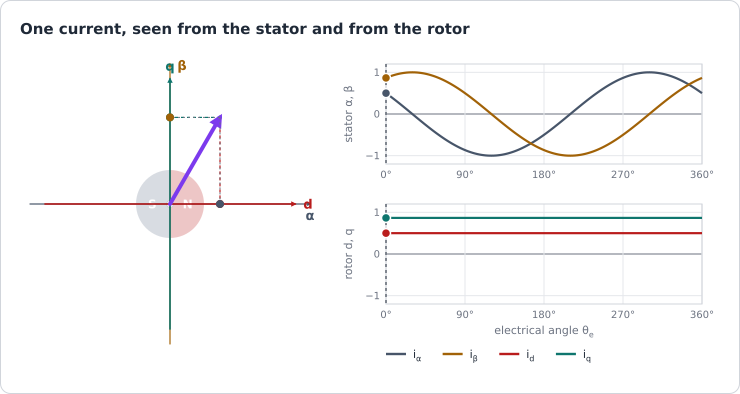
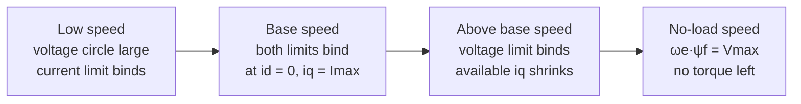
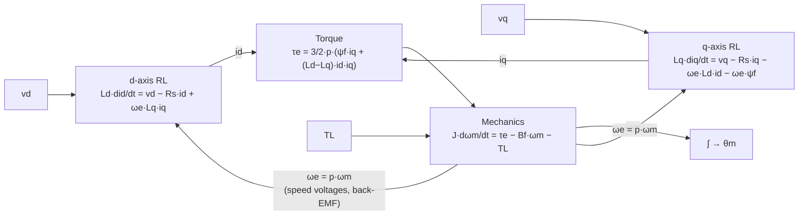
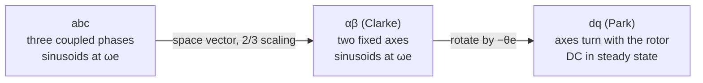

| Field     | Value                                                          |
|-----------|----------------------------------------------------------------|
| Title     | PMSM Mathematical Model — From Phase Equations to the dq Frame |
| Type      | theory                                                         |
| Status    | draft                                                          |
| Version   | 0.1.0                                                          |
| Component | motor-model                                                    |
| Date      | 2026-10-29                                                     |

> **Theory document**: Explains the mathematical and engineering principles behind a component or algorithm.
> This document is descriptive — it records the *why* and *how* at a scientific level, independent of any
> specific implementation. Equations use KaTeX ($inline$ and $$block$$). Diagrams use Mermaid, ASCII art,
> and the generated animations of `documentation/animations/`.

---

## Overview

The [physical picture](motor-physics.md) gave two facts: torque comes from current placed ahead of the
rotor, and voltage comes from speed. This chapter writes them as equations and changes coordinates until
they are simple enough to control.

The path is:

1. three **phase voltage equations**, coupled through the rotor angle;
2. one **space vector** that carries all three phases;
3. the **Clarke transform** to a fixed two-axis frame $\alpha\beta$, where currents are still sinusoids;
4. the **Park transform** to a frame $dq$ that turns with the rotor, where in steady state every current
   and voltage is constant.

The result is the model every controller in this booklet is designed against:

$$
v_d = R_s i_d + L_d \frac{di_d}{dt} - \omega_e L_q i_q, \qquad
v_q = R_s i_q + L_q \frac{di_q}{dt} + \omega_e L_d i_d + \omega_e \psi_f
$$

$$
\tau_e = \tfrac{3}{2} p \left[\psi_f i_q + (L_d - L_q)\, i_d i_q\right], \qquad
J \frac{d\omega_m}{dt} = \tau_e - B_f \omega_m - T_L
$$

with its operating limits: a current circle and a voltage circle that shrinks with speed.

---

## Prerequisites

[The Permanent-Magnet Motor — Physical Picture](motor-physics.md): flux linkage, back-EMF, the rotating
field, and the torque angle.

| Symbol                 | Meaning                                                                  | Unit             |
|------------------------|--------------------------------------------------------------------------|------------------|
| $R_s$                  | Stator resistance per phase                                              | Ω                |
| $L_\sigma$, $L_m$      | Leakage and magnetising inductance of one phase                          | H                |
| $L_s$                  | Synchronous inductance per phase, $L_\sigma + \tfrac{3}{2}L_m$           | H                |
| $L_d$, $L_q$           | d- and q-axis inductance ($L_d = L_q = L_s$ for a surface-mounted rotor) | H                |
| $\psi_f$               | Peak magnet flux linkage per phase                                       | Wb               |
| $p$                    | Pole pairs                                                               | —                |
| $\theta_e$, $\omega_e$ | Electrical rotor angle and speed                                         | rad, rad/s       |
| $\theta_m$, $\omega_m$ | Mechanical rotor angle and speed                                         | rad, rad/s       |
| $\mathbf{x}$           | Space vector of a three-phase quantity                                   | —                |
| $a$                    | $e^{j2\pi/3}$, the $120^\circ$ rotation                                  | —                |
| $J$, $B_f$             | Rotor inertia and viscous friction                                       | kg·m², N·m·s/rad |
| $T_L$                  | Load torque (disturbance)                                                | N·m              |
| $V_{max}$, $I_{max}$   | Voltage and current limits of the drive                                  | V, A             |

---

## Mathematical Foundation

### 1. Phase Voltage Equations

Each phase is a resistance in series with a coil whose flux linkage $\psi_k$ changes:

$$
v_k = R_s i_k + \frac{d\psi_k}{dt}, \qquad k \in \{a, b, c\}
$$

The linkage of phase a has four contributions: its own current, the currents of the two other phases
through their mutual inductance, and the rotor magnet:

$$
\psi_a = L_{aa}\, i_a + M\, i_b + M\, i_c + \psi_f \cos\theta_e
$$

For three identical windings whose axes are $120^\circ$ apart, the self inductance is a leakage part plus a
magnetising part, $L_{aa} = L_\sigma + L_m$, and the mutual inductance is the magnetising part projected
through $\cos 120^\circ$: $M = -\tfrac{1}{2} L_m$. In a wye winding $i_b + i_c = -i_a$, so

$$
\psi_a = (L_\sigma + L_m)\, i_a - \tfrac{1}{2}L_m (i_b + i_c) + \psi_f \cos\theta_e
= \underbrace{\left(L_\sigma + \tfrac{3}{2}L_m\right)}_{L_s} i_a + \psi_f \cos\theta_e
$$

The mutual coupling folds into one **synchronous inductance** $L_s$ per phase. It is what a line-to-line
measurement with the third terminal open sees, halved: $L_{LL} = 2 L_s$, the conversion used for the
reference motors in `documentation/theory/foc-plant-models.md`. Differentiating, with
$d\theta_e/dt = \omega_e$:

$$
v_a = R_s i_a + L_s \frac{di_a}{dt} + e_a, \qquad e_a = -\omega_e \psi_f \sin\theta_e
$$

$$
v_b = R_s i_b + L_s \frac{di_b}{dt} + e_b, \qquad e_b = -\omega_e \psi_f \sin\!\left(\theta_e - \tfrac{2\pi}{3}\right)
$$

$$
v_c = R_s i_c + L_s \frac{di_c}{dt} + e_c, \qquad e_c = -\omega_e \psi_f \sin\!\left(\theta_e + \tfrac{2\pi}{3}\right)
$$

Three equations, but only two independent currents, and back-EMFs that depend on the rotor angle. To keep
the torque steady the currents must be sinusoids that track $\theta_e$: a regulator would have to follow a
moving target at up to hundreds of hertz. The next three steps remove that.

### 2. Space Vectors

Collect the three phases of any quantity $x$ (voltage, current, flux linkage) into one complex number:

$$
\mathbf{x} = \tfrac{2}{3}\left(x_a + a\, x_b + a^2 x_c\right), \qquad a = e^{j2\pi/3}
$$

Each phase is placed along its own winding axis, exactly as the fields were added in
[the physical picture](motor-physics.md) §4. For the balanced currents
$i_k = I\cos(\theta_e - k\,2\pi/3)$ the same algebra gives

$$
\mathbf{i} = I\, e^{j\theta_e}
$$

The factor $\tfrac{2}{3}$ removes the $\tfrac{3}{2}$ of the field sum, so that the vector's length equals
the peak of one phase. This is the **amplitude-invariant** scaling: a 5 A peak phase current is a 5 A
vector. The phases are recovered by projecting back onto the winding axes,
$x_k = \operatorname{Re}\{\mathbf{x}\, a^{-k}\}$, which holds whenever $x_a + x_b + x_c = 0$.

The three voltage equations become one:

$$
\mathbf{v} = R_s \mathbf{i} + L_s \frac{d\mathbf{i}}{dt} + j\,\omega_e \psi_f\, e^{j\theta_e}
$$

The last term is the derivative of the magnet's flux vector $\psi_f e^{j\theta_e}$; its real part is the
$e_a$ of §1.

### 3. Clarke Transform — the Fixed $\alpha\beta$ Frame

The real and imaginary parts of the space vector are two orthogonal components fixed to the stator, with
$\alpha$ along phase A:

$$
\begin{pmatrix} x_\alpha \\ x_\beta \end{pmatrix}
= \frac{2}{3}
\begin{pmatrix} 1 & -\tfrac{1}{2} & -\tfrac{1}{2} \\[4pt]
                0 & \dfrac{\sqrt{3}}{2} & -\dfrac{\sqrt{3}}{2} \end{pmatrix}
\begin{pmatrix} x_a \\ x_b \\ x_c \end{pmatrix}
$$

This is the Clarke transform. The component it drops, $x_0 = \tfrac{1}{3}(x_a + x_b + x_c)$, is zero for a
wye winding without a neutral connection, so nothing is lost. The three-current form the firmware evaluates,
and the two-sensor simplification, are in the [FOC chapter](foc.md) §1.

With amplitude-invariant scaling, power is not preserved one-to-one; the instantaneous power into the motor
is

$$
P = v_a i_a + v_b i_b + v_c i_c = \tfrac{3}{2}\left(v_\alpha i_\alpha + v_\beta i_\beta\right)
$$

The $\tfrac{3}{2}$ is the price of keeping the vector lengths equal to phase peaks, and it reappears in the
torque. (The alternative, *power-invariant* scaling by $\sqrt{2/3}$, removes the $\tfrac{3}{2}$ from power
but makes a 5 A phase current a 6.12 A vector.)

In the $\alpha\beta$ frame the motor is

$$
v_\alpha = R_s i_\alpha + L_s \frac{di_\alpha}{dt} - \omega_e \psi_f \sin\theta_e, \qquad
v_\beta = R_s i_\beta + L_s \frac{di_\beta}{dt} + \omega_e \psi_f \cos\theta_e
$$

Two equations instead of three, decoupled from each other, but the back-EMF and the currents needed for a
steady torque are still sinusoids at $\omega_e$.

### 4. Park Transform — the Rotating $dq$ Frame

Look at the same space vector from a frame that turns with the rotor. Rotate it back by $\theta_e$:

$$
\mathbf{x}_{dq} = x_d + j\, x_q = \mathbf{x}\, e^{-j\theta_e}
$$

$$
\begin{pmatrix} x_d \\ x_q \end{pmatrix}
= \begin{pmatrix} \cos\theta_e & \sin\theta_e \\ -\sin\theta_e & \cos\theta_e \end{pmatrix}
\begin{pmatrix} x_\alpha \\ x_\beta \end{pmatrix}
$$

The **d-axis** points along the rotor's north pole, the magnet flux. The **q-axis** is $90^\circ$ ahead of it,
the direction of maximum torque. A current vector that turns with the rotor at a fixed angle has constant
$d$ and $q$ components.



**The dq voltage equations.** Substitute $\mathbf{i} = \mathbf{i}_{dq} e^{j\theta_e}$ into the
space-vector equation of §2. The product rule is the whole derivation:

$$
\frac{d\mathbf{i}}{dt} = \left(\frac{d\mathbf{i}_{dq}}{dt} + j\omega_e\, \mathbf{i}_{dq}\right) e^{j\theta_e}
$$

so, after dividing every term by $e^{j\theta_e}$,

$$
\mathbf{v}_{dq} = R_s \mathbf{i}_{dq} + L_s \frac{d\mathbf{i}_{dq}}{dt} + j\omega_e L_s\, \mathbf{i}_{dq}
+ j\omega_e \psi_f
$$

Splitting real and imaginary parts, with $j\,\omega_e L_s (i_d + j i_q) = -\omega_e L_s i_q + j\,\omega_e L_s i_d$:

$$
\boxed{
v_d = R_s i_d + L_s \frac{di_d}{dt} - \omega_e L_s i_q, \qquad
v_q = R_s i_q + L_s \frac{di_q}{dt} + \omega_e L_s i_d + \omega_e \psi_f
}
$$

- The **$\omega_e L_s$ terms** are *speed voltages*. They come from the frame turning, through the product
  rule, and couple the two axes: current on one axis induces voltage on the other.
- The **$\omega_e \psi_f$ term** is the back-EMF. In this frame it sits on the q-axis only and is a constant
  at constant speed.
- Everything else is two RL circuits. At constant speed and current all quantities are DC, which is what
  makes ordinary PI regulators sufficient.

**Salient rotor.** When the inductance depends on the direction, write the linkages per axis,
$\psi_d = L_d i_d + \psi_f$ and $\psi_q = L_q i_q$. The same derivation gives

$$
v_d = R_s i_d + \frac{d\psi_d}{dt} - \omega_e \psi_q, \qquad
v_q = R_s i_q + \frac{d\psi_q}{dt} + \omega_e \psi_d
$$

$$
v_d = R_s i_d + L_d \frac{di_d}{dt} - \omega_e L_q i_q, \qquad
v_q = R_s i_q + L_q \frac{di_q}{dt} + \omega_e L_d i_d + \omega_e \psi_f
$$

which reduces to the boxed pair for $L_d = L_q = L_s$.

### 5. Power and Torque

Write the input power in dq ($\tfrac{3}{2}$ from §3; the rotation does not change lengths) and insert the
voltage equations:

$$
P = \tfrac{3}{2}\left(v_d i_d + v_q i_q\right)
= \underbrace{\tfrac{3}{2} R_s\left(i_d^2 + i_q^2\right)}_{\text{copper loss}}
+ \underbrace{\tfrac{3}{2}\left(i_d \frac{d\psi_d}{dt} + i_q \frac{d\psi_q}{dt}\right)}_{\text{stored magnetic energy}}
+ \underbrace{\tfrac{3}{2}\,\omega_e\left(\psi_d i_q - \psi_q i_d\right)}_{\text{converted to mechanical}}
$$

The last term is the power crossing the air gap, $\tau_e\,\omega_m$. With $\omega_e = p\,\omega_m$:

$$
\tau_e = \tfrac{3}{2}\, p \left(\psi_d i_q - \psi_q i_d\right)
= \tfrac{3}{2}\, p \left[\psi_f\, i_q + (L_d - L_q)\, i_d\, i_q\right]
$$

The first term is the **magnet torque**, the second the **reluctance torque** of a salient rotor. For the
surface-mounted motors e-foc targets, $L_d = L_q$ and

$$
\boxed{\tau_e = \tfrac{3}{2}\, p\, \psi_f\, i_q = K_t\, i_q}
$$

the same torque constant [the physical picture](motor-physics.md) §6 found from the back-EMF. Torque is
linear in $i_q$ and independent of $i_d$, so $i_d^* = 0$ gives the most torque per ampere (MTPA): any
$i_d$ only adds copper loss. For an interior rotor ($L_d < L_q$) a negative $i_d$ adds reluctance torque
and MTPA moves away from the q-axis; that case is outside e-foc's scope.

### 6. Mechanical Equation

The rotor and its load obey Newton's second law for rotation:

$$
J \frac{d\omega_m}{dt} = \tau_e - B_f\, \omega_m - T_L, \qquad
\frac{d\theta_m}{dt} = \omega_m, \qquad \theta_e = p\,\theta_m
$$

$B_f\,\omega_m$ is viscous friction. $T_L$ collects everything else the shaft sees: a load that opposes motion
and an external torque with a fixed sign, split in `documentation/theory/foc-plant-models.md` §2, plus
Coulomb friction and cogging (see [disturbances and noise](disturbances-and-noise.md)).

### 7. The Complete Model in State-Space Form

With state $(i_d, i_q, \omega_m, \theta_m)$, inputs $(v_d, v_q)$ and disturbance $T_L$:

$$
\frac{di_d}{dt} = \frac{1}{L_d}\left(-R_s i_d + p\,\omega_m L_q i_q + v_d\right)
$$

$$
\frac{di_q}{dt} = \frac{1}{L_q}\left(-R_s i_q - p\,\omega_m L_d i_d - p\,\omega_m \psi_f + v_q\right)
$$

$$
\frac{d\omega_m}{dt} = \frac{1}{J}\left(\tfrac{3}{2} p\left[\psi_f i_q + (L_d - L_q) i_d i_q\right] - B_f\,\omega_m - T_L\right),
\qquad \frac{d\theta_m}{dt} = \omega_m
$$

Two properties of this model shape the whole control structure:

- **It is nonlinear**, but only through products of speed and current. Treat $\omega_m$ as a slowly varying
  parameter and the electrical part is linear.
- **It has two time scales.** The electrical time constant $L_s/R_s$ is 0.56 ms (Teknic) to 1.58 ms
  (Anaheim); the mechanical time constant $J/B_f$ is about half a second for both. The currents settle long
  before the speed moves, which is what justifies controlling current in an inner loop and speed in an outer
  one ([closed-loop control](closed-loop-control.md)).

The linear per-loop plants and their discrete-time versions are derived in
`documentation/theory/foc-plant-models.md`.

### 8. Steady State and the Vector Diagram

At constant speed and current the derivatives vanish. For $L_d = L_q = L_s$ and the MTPA choice $i_d = 0$:

$$
V_d = -\omega_e L_s I_q, \qquad V_q = R_s I_q + \omega_e \psi_f
$$

```text
                    q
                    ^
     V              |
      \             |   Vq = Rs·Iq + ωe·ψf
        \           |
          \         ^   I = j·Iq   (current on the q-axis)
            \       |
              \     |
                \   |
                  \ |
  ------------------+--------------------> d   (rotor north pole)
        <-----------+
         Vd = −ωe·Ls·Iq                    (not to scale)
```

The applied voltage leads the current and grows with speed through two terms: the back-EMF $\omega_e\psi_f$,
which dominates, and the inductive drop $\omega_e L_s I_q$, which tilts the vector towards $-d$. A current
controller has to produce this voltage; the voltage it cannot produce is the limit of the next section.

### 9. Operating Envelope

The drive imposes two limits on the dq vectors:

$$
i_d^2 + i_q^2 \le I_{max}^2, \qquad v_d^2 + v_q^2 \le V_{max}^2 = \left(\frac{V_{dc}}{\sqrt{3}}\right)^2
$$

$V_{max}$ is the radius of the largest circle inside the inverter's voltage hexagon, the linear range of the
space-vector modulator ([FOC chapter](foc.md) §4). In steady state, neglecting $R_s$, the voltage limit
becomes a condition on the current:

$$
\left(L_s i_d + \psi_f\right)^2 + \left(L_s i_q\right)^2 \le \left(\frac{V_{max}}{\omega_e}\right)^2
$$

a circle centred at $i_d = -\psi_f/L_s$ whose radius shrinks as speed rises. The operating point must lie
inside both circles.



- **Below base speed** the full current, hence the full torque $K_t I_{max}$, is available.
- **Base speed** is where the voltage needed at $i_q = I_{max}$ reaches $V_{max}$:
  $\omega_{e,base} = V_{max} / \sqrt{\psi_f^2 + (L_s I_{max})^2}$ without $R_s$.
- **Above it**, with $i_d = 0$, the largest q current is
  $i_{q,max}(\omega_e) = \sqrt{(V_{max}/\omega_e)^2 - \psi_f^2}\,/\,L_s$ and falls to zero at
  $\omega_e = V_{max}/\psi_f$.
- **Field weakening** would go further by injecting negative $i_d$, moving the current towards the centre of
  the voltage circle. e-foc does not implement it; its cascades keep $i_d^* = 0$, apart from a ±2.5 % of
  $I_{max}$, 50 Hz square wave they inject for 4 s in every 60 s while the online electrical estimator runs
  (`core/foc/cascade/CascadeWithSpeedLoop.cpp`).

Keeping $R_s$, the exact speed limit at a q current $I$ solves
$(R_s I + \omega_e \psi_f)^2 + (\omega_e L_s I)^2 = V_{max}^2$. The worked example applies it.

---

## Block Diagrams

### The Model as a Signal Flow



### Chain of Coordinate Changes



---

## Numerical Properties

| Property                 | Value / Condition                                                                      |
|--------------------------|----------------------------------------------------------------------------------------|
| Model order              | 4 states: $i_d, i_q, \omega_m, \theta_m$                                               |
| Nonlinearity             | Bilinear: products $\omega_e i_d$, $\omega_e i_q$, and $i_d i_q$ when $L_d \ne L_q$    |
| Electrical time constant | $L_s/R_s$: 1.58 ms (Anaheim), 0.56 ms (Teknic)                                         |
| Mechanical time constant | $J/B_f$: 0.48 s (Anaheim), 0.47 s (Teknic), with the assumed $B_f$                     |
| Scaling                  | Amplitude-invariant: vector length = phase peak; power and torque carry $\tfrac{3}{2}$ |
| Validity of $L_d = L_q$  | Surface-mounted rotors; both reference motors                                          |

Envelope of the reference motors, from the exact steady-state voltage equation with $R_s$, at the rated bus:

| Operating point                      | Anaheim BLY172S-24V-4000 (24 V) | Teknic M-2310P-LN-04K (40 V) |
|--------------------------------------|---------------------------------|------------------------------|
| $V_{max} = V_{dc}/\sqrt3$            | 13.9 V                          | 23.1 V                       |
| No-load speed limit ($I = 0$)        | 6080 rpm                        | 8610 rpm                     |
| Speed limit at 3 A (board rating)    | 5260 rpm                        | 8180 rpm                     |
| Speed limit at rated torque          | 4950 rpm (3.89 A)               | 7490 rpm (7.14 A)            |
| Speed limit at the model's $I_{max}$ | 3090 rpm (10 A)                 | 5270 rpm (20 A)              |

---

## Worked Example

Teknic M-2310P-LN-04K at its rated point: 6000 rpm, 0.274 N·m, 40 V bus.

**Step 1 — current.** $K_t = \tfrac{3}{2} \cdot 4 \cdot 0.0064 = 38.4$ mN·m/A, so
$I_q = 0.274 / 0.0384 = 7.14$ A, with $I_d = 0$.

**Step 2 — speed.** $\omega_m = 628.3$ rad/s, $\omega_e = 2513$ rad/s.

**Step 3 — steady-state voltages.**

$$
V_d = -\omega_e L_s I_q = -2513 \times 0.0002 \times 7.14 = -3.59\ \text{V}
$$

$$
V_q = R_s I_q + \omega_e \psi_f = 0.36 \times 7.14 + 2513 \times 0.0064 = 2.57 + 16.08 = 18.65\ \text{V}
$$

**Step 4 — headroom.** $|V| = \sqrt{3.59^2 + 18.65^2} = 19.0$ V against $V_{max} = 23.1$ V: 82 % of the linear
range. The back-EMF alone is 70 % of it. The voltage vector leads the q-axis by
$\arctan(3.59/18.65) = 10.9^\circ$.

**Step 5 — the Anaheim at the board's 3 A.** Its torque is 77 % of its rated 0.127 N·m:

$$
\tau_e = \tfrac{3}{2} \cdot 4 \cdot 0.00544 \cdot 3 = 0.098\ \text{N·m}
$$

---

## Limitations & Assumptions

- **Assumes**: sinusoidal back-EMF and winding distribution; harmonics are disturbances
  ([disturbances and noise](disturbances-and-noise.md)).
- **Assumes**: linear magnetics. $L_d$, $L_q$ and $\psi_f$ do not depend on current; in a real motor they fall
  as the iron saturates at high current.
- **Assumes**: constant parameters. $R_s$ and $\psi_f$ drift with temperature.
- **Assumes**: balanced three-phase windings and supply, $i_a + i_b + i_c = 0$. An open phase invalidates
  the two-sensor Clarke reduction.
- **Assumes**: the electrical angle $\theta_e$ is known exactly (encoder plus alignment offset). An angle
  error mixes $d$ and $q$ and reduces torque.
- **Assumes**: surface-mounted rotor in e-foc's controllers ($L_d = L_q$); the salient equations above are
  for reference.
- **Does not cover**: iron losses, field weakening (not implemented), sensorless angle estimation (e-foc uses
  an encoder).

## References

1. Krishnan, R. — *Permanent Magnet Synchronous and Brushless DC Motor Drives*, CRC Press, 2010.
2. Novotny, D.W. & Lipo, T.A. — *Vector Control and Dynamics of AC Drives*, Oxford University Press, 1996.
3. Bose, B.K. — *Modern Power Electronics and AC Drives*, Prentice Hall, 2002.
4. Park, R.H. — "Two-reaction theory of synchronous machines", *AIEE Transactions*, vol. 48, 1929.
5. Clarke, E. — *Circuit Analysis of A-C Power Systems*, vol. 1, Wiley, 1943.
