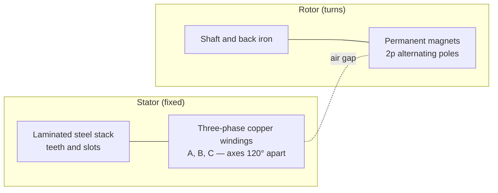
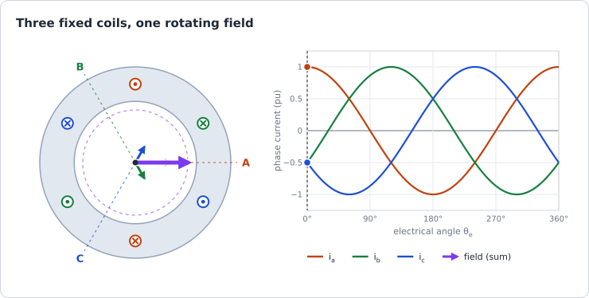
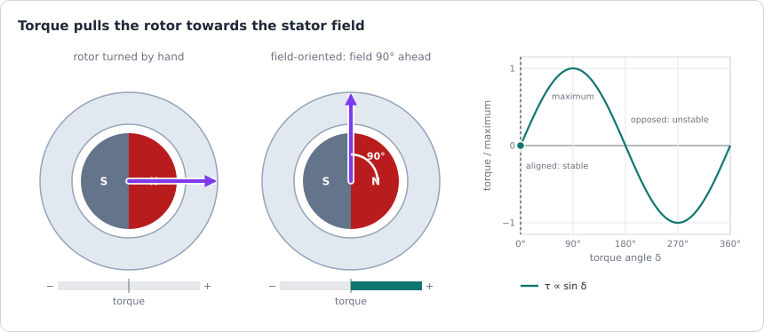
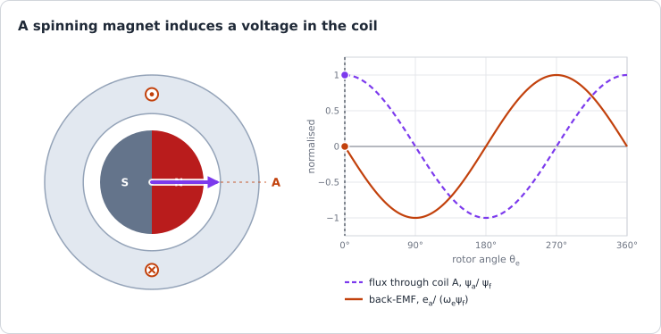
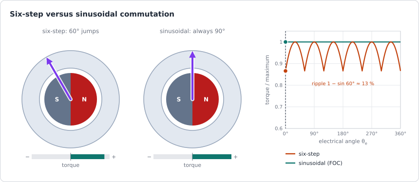
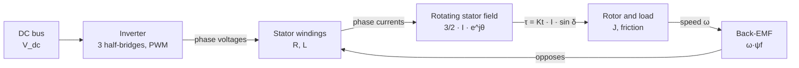
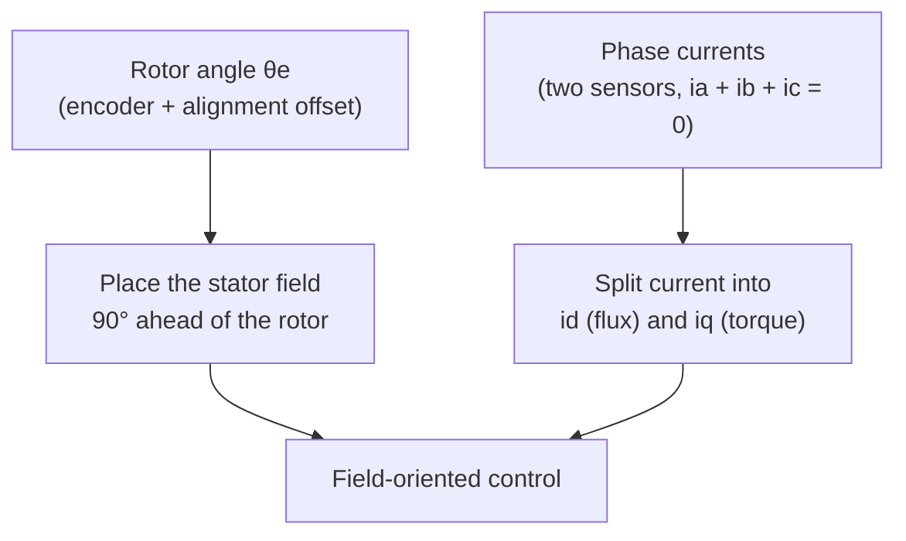

| Field     | Value                                         |
|-----------|-----------------------------------------------|
| Title     | The Permanent-Magnet Motor — Physical Picture |
| Type      | theory                                        |
| Status    | draft                                         |
| Version   | 0.1.0                                         |
| Component | motor-physics                                 |
| Date      | 2026-10-29                                    |

> **Theory document**: Explains the mathematical and engineering principles behind a component or algorithm.
> This document is descriptive — it records the *why* and *how* at a scientific level, independent of any
> specific implementation. Equations use KaTeX ($inline$ and $$block$$). Diagrams use Mermaid, and the
> animated figures are generated by `documentation/tools/generate-animations.py`.

---

## Overview

This chapter is the start of the theory part. It explains what is inside a permanent-magnet synchronous
motor (PMSM) and why it turns, using only the physics a motor-control engineer needs: a coil carrying
current makes a magnetic field, a magnet in a field feels a torque, and a moving magnet induces a voltage
in a coil.

Two results carry through every later chapter:

1. **Torque comes from current.** Three fixed coils fed with three sinusoidal currents produce one magnetic
   field of constant strength that rotates. The rotor magnet is pulled towards that field with a torque
   proportional to $\sin\delta$, where $\delta$ is the angle between them. Holding the field $90^\circ$
   ahead of the rotor gives the most torque per ampere. That is the whole idea of field-oriented control.
2. **Voltage comes from speed.** The spinning magnet induces a back-EMF in every coil, proportional to the
   speed. It opposes the supply, and it is what eventually limits how fast the motor can run.

The [motor model](motor-model.md) turns these two facts into equations.

---

## Prerequisites

Calculus and basic circuit theory (Kirchhoff's laws, an inductor's $v = L\,di/dt$). Nothing about motors is
assumed.

| Symbol               | Meaning                                                           | Unit         |
|----------------------|-------------------------------------------------------------------|--------------|
| $N$                  | Turns of a coil                                                   | —            |
| $i_a, i_b, i_c$      | Phase currents                                                    | A            |
| $\mathcal{F}$        | Magnetomotive force $N i$                                         | A·turn       |
| $B$                  | Magnetic flux density                                             | T            |
| $\Phi$               | Magnetic flux through one turn                                    | Wb           |
| $\psi$               | Flux linkage $N\Phi$                                              | Wb (Wb·turn) |
| $\psi_f$             | Peak flux linkage of one phase produced by the rotor magnets      | Wb           |
| $e$                  | Induced (back-)EMF                                                | V            |
| $p$                  | Pole pairs                                                        | —            |
| $\theta_m, \omega_m$ | Mechanical rotor angle and speed                                  | rad, rad/s   |
| $\theta_e, \omega_e$ | Electrical rotor angle and speed, $p\,\theta_m$ and $p\,\omega_m$ | rad, rad/s   |
| $\delta$             | Torque angle: from the rotor's north pole to the stator field     | rad          |
| $\tau$               | Electromagnetic torque                                            | N·m          |
| $V_{dc}$             | DC bus voltage                                                    | V            |

---

## Mathematical Foundation

### 1. Anatomy

**Stator.** A stack of thin, insulated silicon-steel laminations. Each lamination is punched with *teeth*
that guide magnetic flux across the air gap and *slots* that hold the copper. The stack is laminated
because steel conducts: a solid core would carry eddy currents induced by the changing flux and heat up.

**Windings.** Three identical windings, the phases A, B and C, are placed so that their magnetic axes are
$120^\circ$ apart (in electrical degrees, see Section 3). Both reference motors in
`documentation/theory/foc-plant-models.md` are **wye** (star) connected: one end of each phase is joined at
a neutral point that is not brought out. Kirchhoff's current law at that point gives

$$
i_a + i_b + i_c = 0
$$

which is why two current sensors are enough to know all three currents. In a **delta** connection the
phases form a triangle; it is converted to an equivalent wye for analysis. Windings are either
*concentrated* (each coil wound around one tooth: short end turns, cheap, rich in harmonics) or
*distributed* (each coil spans several slots: closer to sinusoidal). The model in this booklet assumes the
result is sinusoidal (Section 6).

**Rotor.** A steel shaft and back iron carrying permanent magnets, usually sintered NdFeB (ferrite in cheap
motors). The magnets alternate north and south around the rotor; a rotor with $2p$ magnet poles has $p$
**pole pairs**. Both reference motors have $p = 4$: eight poles. Magnets glued on the surface give a
**surface-mounted** (SPM) rotor; magnets buried in slots in the iron give an **interior** (IPM) rotor
(Section 8).

The animations below show the simplest possible machine: one pole pair, one coil per phase. A real motor
repeats that pattern $p$ times around its circumference, and spreads each phase over several slots.

### 2. The Magnetism You Need

**A coil makes a field.** A current $i$ through a coil of $N$ turns produces a magnetomotive force
$\mathcal{F} = N i$ that drives flux along the coil's axis. Its direction follows the right-hand rule: curl
the fingers of the right hand along the current and the thumb points along the field. In the figures, a dot
($\odot$) is current coming out of the page and a cross ($\otimes$) is current going in; a coil with its
dot at $90^\circ$ above its axis and its cross at $90^\circ$ below pushes flux along the axis.

In the linear range of the iron, the flux density in the air gap is proportional to the current. Doubling
the current doubles the field. Reversing the current reverses it.

**Flux and flux linkage.** The flux through one turn is $\Phi = \int B \cdot dA$. A coil of $N$ turns links
that flux $N$ times:

$$
\psi = N \Phi
$$

Flux linkage is the quantity the electrical equations use. The part a coil produces itself defines its
inductance, $\psi = L i$. The part produced by the rotor magnets is written $\psi_f$ (the *f* is for
*field*).

**A changing linkage induces a voltage.** Faraday's law:

$$
e = \frac{d\psi}{dt}
$$

A coil whose linkage changes, because its own current changes or because a magnet moves past it, develops
a voltage across its terminals. The sign is chosen so that the induced voltage opposes the change (Lenz).

**A magnet in a field feels a torque.** A compass needle turns to line up with the Earth's field. In the
same way, the rotor magnet is pulled towards alignment with the field the stator coils produce. The torque
is proportional to the strength of both fields and to the sine of the angle between them:

$$
\tau \propto |\mathcal{F}_s| \, |\mathcal{F}_r| \, \sin\delta
$$

Seen from the conductors, the same torque is the Lorentz force $F = i\,\ell \times B$ on each copper bar
lying in the magnet's field, times the radius. Both pictures give the same answer; the field picture is the
one the control uses.

**Energy is conserved.** Neglecting losses, the electrical power that the currents push against the
back-EMFs is the mechanical power at the shaft:

$$
\sum_{k \in \{a,b,c\}} e_k\, i_k = \tau\, \omega_m
$$

Section 6 uses this to derive the torque constant from the back-EMF.

### 3. Electrical and Mechanical Angle

A rotor with $p$ pole pairs presents the same magnetic picture to a coil every $1/p$ of a revolution. The
electrical quantities therefore go through one cycle every $1/p$ turn:

$$
\theta_e = p\,\theta_m, \qquad \omega_e = p\,\omega_m, \qquad f_e = p \cdot \frac{n}{60}
$$

with $n$ the speed in rpm. Everything the current controller sees (currents, voltages, back-EMF, the angle
used in the transforms) is electrical. The encoder measures the mechanical angle, and the firmware
multiplies by $p$. The Teknic motor at its rated 6000 rpm has $f_e = 4 \cdot 100 = 400$ Hz; at the 20 kHz
control rate that is 50 control periods per electrical cycle.

### 4. The Rotating Field

Feed the three phases with sinusoidal currents of equal amplitude $I$, each delayed by a third of a cycle:

$$
i_a = I\cos\theta_e, \qquad i_b = I\cos\!\left(\theta_e - \tfrac{2\pi}{3}\right), \qquad
i_c = I\cos\!\left(\theta_e - \tfrac{4\pi}{3}\right)
$$

Each coil's field stays on its own axis and only grows, shrinks and reverses with its current. Write the
field of coil $k$ as a vector in the complex plane: magnitude proportional to $i_k$, direction
$\varphi_k = k \cdot 2\pi/3$ along the coil's axis. The total field is the sum:

$$
\mathbf{b} = \sum_{k=0}^{2} I\cos(\theta_e - \varphi_k)\, e^{j\varphi_k}
$$

Expand the cosine as $\tfrac{1}{2}\left(e^{j(\theta_e-\varphi_k)} + e^{-j(\theta_e-\varphi_k)}\right)$:

$$
\mathbf{b} = \frac{I}{2}\sum_{k=0}^{2}\left(e^{j\theta_e} + e^{-j\theta_e}\, e^{j2\varphi_k}\right)
= \frac{3}{2}\, I\, e^{j\theta_e} + \frac{I}{2}\, e^{-j\theta_e}\sum_{k=0}^{2} e^{j\,4\pi k/3}
$$

The last sum adds three unit vectors $120^\circ$ apart and is zero. What is left is

$$
\boxed{\mathbf{b} = \tfrac{3}{2}\, I\, e^{j\theta_e}}
$$

a field of **constant** length $\tfrac{3}{2}I$ that turns at exactly $\omega_e$. Three pulsating fields fixed
in space add up to one steady field that rotates. Swapping any two phases reverses the direction of
rotation. The factor $\tfrac{3}{2}$ reappears in the Clarke transform's scaling and in the torque equation.

The figure animates this. Each thin arrow is one coil's field and moves only along its axis. The thick
arrow is their sum. It stays on the dashed circle and turns once per electrical cycle, in step with the
cursor on the current plot.

### 5. Torque — the Rotor Chases the Field

Put the magnet rotor inside the rotating field. Let $\delta$ be the angle from the rotor's north pole (its
**d-axis**, for *direct*) to the stator field. The torque on the rotor is

$$
\tau = \tau_{max} \sin\delta
$$

with $\tau_{max}$ proportional to the stator current $I$ and to the magnet flux $\psi_f$.

- $\delta = 0$: field and magnet are aligned. No torque. Push the rotor slightly and the torque pulls it
  back, so the equilibrium is stable. The [alignment procedure](alignment.md) uses exactly this to put the
  rotor at a known angle.
- $\delta = 90^\circ$: maximum torque for the current spent.
- $\delta = 180^\circ$: field and magnet are opposed. No torque, but the equilibrium is unstable.
- Beyond $180^\circ$ the torque reverses.

In steady state the rotor turns at exactly the speed of the field, which is why the machine is called
*synchronous*. If the load asks for more than $\tau_{max}$, the rotor falls behind, $\delta$ passes
$180^\circ$ and the motor loses step. That can only happen when the field is driven blind, without knowing
where the rotor is.

The control idea follows directly. **Measure the rotor angle, and always place the stator field
$90^\circ$ ahead of it.** The axis $90^\circ$ ahead of the d-axis is the **q-axis** (*quadrature*). Current
whose field lies along the q-axis makes torque; current along the d-axis only strengthens or weakens the
magnet's flux and makes none. Splitting the stator current into these two parts, $i_d$ and $i_q$, and
controlling each separately is field-oriented control.

### 6. Back-EMF

Now turn the rotor and leave the coils open. The magnet's flux through coil A depends on where the rotor
points. With a sinusoidal distribution of magnet flux around the air gap it is

$$
\psi_a = \psi_f \cos\theta_e
$$

maximum when the north pole faces the coil's axis, zero a quarter of an electrical cycle later. By
Faraday's law the coil develops

$$
e_a = \frac{d\psi_a}{dt} = \frac{d\psi_a}{d\theta_e}\,\frac{d\theta_e}{dt} = -\omega_e\, \psi_f \sin\theta_e
$$

and the other two phases the same, shifted by $\pm 120^\circ$. Two things matter: the **amplitude is
proportional to speed**, $\hat{e} = \omega_e \psi_f$, and the back-EMF is a quarter cycle ahead of the flux
that makes it.

It is called *back*-EMF because, in a motor, it opposes the supply. To push current into a phase the
inverter must apply more than the back-EMF. Once the back-EMF approaches the voltage the inverter can make,
no more current can be pushed in at all; that sets the top speed (Section 10).

**Torque constant from back-EMF.** Feed the phases with currents in phase with their back-EMFs, which is
the $\delta = 90^\circ$ condition of Section 5:

$$
i_k = -I\sin(\theta_e - \varphi_k), \qquad e_k = -\omega_e \psi_f \sin(\theta_e - \varphi_k)
$$

The power balance of Section 2 gives

$$
\tau\,\omega_m = \sum_k e_k i_k = \omega_e \psi_f I \sum_k \sin^2(\theta_e - \varphi_k)
= \tfrac{3}{2}\,\omega_e\, \psi_f\, I
$$

and with $\omega_e = p\,\omega_m$:

$$
\boxed{\tau = \tfrac{3}{2}\, p\, \psi_f\, I = K_t\, I, \qquad K_t = \tfrac{3}{2}\, p\, \psi_f}
$$

The torque constant and the back-EMF constant are the same physical property of the motor, the magnet's
flux linkage, seen from two sides. This is the torque equation that the [FOC chapter](foc.md) and the
[motor model](motor-model.md) write as $\tau_e = \tfrac{3}{2} p \psi_f i_q$. Datasheets quote the back-EMF
line-to-line, usually per 1000 rpm; `documentation/theory/foc-plant-models.md` "Reference Motors" shows the
conversion to $\psi_f$.

**Sinusoidal or trapezoidal.** The shape of $\psi_a(\theta_e)$ is set by the magnet shape and the winding
layout. A motor built for a flat-topped (trapezoidal) back-EMF is traditionally called a *BLDC* motor and is
driven six-step. One built for a sinusoidal back-EMF is a *PMSM* and is driven with sinusoidal currents. The
names are used loosely: both reference motors are sold as BLDC motors and are run with sinusoidal FOC on
the TI and NXP evaluation kits they come with.

### 7. Six-Step versus Sinusoidal Commutation

The simplest drive switches the current between pairs of phases according to three Hall sensors: two phases
conduct at a time, giving six states per electrical cycle. The stator field can then only point in six
directions and **jumps $60^\circ$** at each commutation. Commutating when $\delta$ falls to $60^\circ$ and
jumping it back to $120^\circ$ keeps $\delta$ between those limits, so with a sinusoidal back-EMF the torque
swings between $\sin 60^\circ$ and $\sin 90^\circ$ of its maximum:

$$
\text{ripple} = 1 - \sin 60^\circ \approx 13\,\%
$$

at six times the electrical frequency. A motor with an ideal trapezoidal back-EMF and instant current
commutation would produce flat torque, but real current cannot change instantly in an inductive winding, and
the commutation ripple remains.

Sinusoidal commutation needs the rotor angle continuously, from an encoder or an observer, and three
independently controlled currents. In return the field turns smoothly at $90^\circ$ ahead of the rotor and
the torque is flat. That is what e-foc does.

### 8. Cogging and Saliency

**Cogging.** Even with no current, the magnets are attracted to the stator teeth, and the rotor has
preferred positions. Turned by hand, a motor feels notchy. The resulting torque ripple repeats
$\operatorname{lcm}(N_s, 2p)$ times per mechanical revolution for $N_s$ slots. It is a disturbance the
current cannot see, treated in [disturbances and noise](disturbances-and-noise.md) and compensated by the
cogging map in `documentation/design/service-cogging-compensation.md`.

**Saliency.** In a surface-mounted rotor the magnets behave magnetically almost like air, so the stator sees
the same air gap whichever way the rotor points: $L_d = L_q$. In an interior rotor the iron between buried
magnets makes the path along the q-axis easier than along the d-axis: $L_d < L_q$. The rotor then also
feels a *reluctance torque*, the pull of plain iron towards the field, which adds to the magnet torque. Both
reference motors are surface-mounted; the [motor model](motor-model.md) carries the general $L_d \ne L_q$
form for completeness.

### 9. From DC Bus to Phase Voltage

The motor is fed by an inverter: three half-bridges, one per phase, each made of two transistors in series
across the DC bus. In each leg exactly one transistor conducts (both at once would short the bus, so a short
*dead time* separates them), and the phase terminal sits at either $V_{dc}$ or $0$.

Switching each leg fast, at 20 kHz in e-foc, with a duty cycle $d_k$ makes its *average* terminal voltage
$d_k V_{dc}$. The winding inductance filters the switching: the current follows the average voltage, with a
small ripple at the PWM frequency. The three legs give $2^3 = 8$ switch states: six that apply a voltage
vector to the motor and two (all low, all high) that apply none. Averaging the six active vectors over a PWM
period can make any voltage inside a hexagon; the largest circle inside it, a sinusoidal phase voltage of
amplitude $V_{dc}/\sqrt{3}$, is the linear limit. The [FOC chapter](foc.md) derives this
space-vector modulation and animates it; [the power stage](power-stage.md) covers the switches, the gate drive and
the dead time.

### 10. Physical Limits

| Limit       | Cause                                                                           | Consequence                                      |
|-------------|---------------------------------------------------------------------------------|--------------------------------------------------|
| Current     | Copper loss $\tfrac{3}{2} R_s I^2$ heats the winding                            | Continuous rating set by temperature rise        |
| Current     | Inverter transistors and current sensors                                        | Drive rating, often below the motor's peak       |
| Current     | Strong reverse field plus heat can demagnetise the magnets                      | Permanent loss of $\psi_f$, hence of torque      |
| Voltage     | Back-EMF $\omega_e \psi_f$ grows with speed; the inverter gives $V_{dc}/\sqrt3$ | Base speed: above it no current can be pushed in |
| Temperature | Copper resistance rises about 0.39 %/K; NdFeB flux falls about 0.1 %/K          | Parameters drift while running                   |
| Speed       | Bearings, rotor retention                                                       | Mechanical maximum                               |

Ignoring the resistive and inductive drops, the speed at which the back-EMF alone uses the whole linear
voltage range is

$$
\omega_{m,base} \approx \frac{V_{dc}}{\sqrt{3}\; p\, \psi_f}
$$

Above it a motor can only go faster by weakening the magnet's flux with negative $i_d$ (field weakening,
which e-foc does not implement). The [motor model](motor-model.md) draws the full operating envelope.

---

## Block Diagrams

### Energy Conversion Chain

### What the Controller Must Know

---

## Numerical Properties

The reference motors (values from `documentation/theory/foc-plant-models.md` "Reference Motors"):

| Quantity                                 | Expression                        | Anaheim BLY172S-24V-4000 | Teknic M-2310P-LN-04K |
|------------------------------------------|-----------------------------------|--------------------------|-----------------------|
| Pole pairs                               | $p$                               | 4                        | 4                     |
| Electrical frequency at rated speed      | $p\,n/60$                         | 266.7 Hz                 | 400 Hz                |
| Control periods per electrical cycle     | $20\,\text{kHz} / f_e$            | 75                       | 50                    |
| Torque constant                          | $\tfrac{3}{2} p \psi_f$           | 32.6 mN·m/A              | 38.4 mN·m/A           |
| Phase back-EMF peak per mechanical rad/s | $p\,\psi_f$                       | 21.8 mV·s/rad            | 25.6 mV·s/rad         |
| Line-to-line back-EMF peak per 1000 rpm  | $\sqrt3\, p\, \psi_f \cdot 104.7$ | 3.95 V                   | 4.64 V                |
| No-load speed estimate at rated bus      | $V_{dc}/(\sqrt3 p \psi_f)$        | 637 rad/s (6080 rpm)     | 902 rad/s (8610 rpm)  |

The line-to-line figure reproduces the Teknic datasheet's 4.64 V/krpm. The Anaheim's 3.95 V follows from
TI's identified flux, which the model uses; the Anaheim sheet itself quotes 3.35 V/krpm. Both no-load speeds
sit above the rated speeds (4000 and 6000 rpm), leaving voltage for the resistive and inductive drops under
load.

---

## Worked Example

Teknic M-2310P-LN-04K on a 40 V bus, driven at 3 A of q-axis current (the E-FOC-HARDWARE board's rating) at
3000 rpm.

**Step 1 — speeds.** $\omega_m = 3000 \cdot 2\pi/60 = 314.2$ rad/s, $\omega_e = 4 \cdot 314.2 = 1256.6$ rad/s,
$f_e = 200$ Hz.

**Step 2 — torque.** $\tau = K_t I = 0.0384 \times 3 = 0.115$ N·m, 42 % of the rated 0.274 N·m.

**Step 3 — back-EMF.** Phase peak $\omega_e \psi_f = 1256.6 \times 0.0064 = 8.04$ V; line-to-line peak
$\sqrt{3} \times 8.04 = 13.9$ V.

**Step 4 — voltage headroom.** The inverter's linear limit is $V_{dc}/\sqrt3 = 23.1$ V of phase peak. The
back-EMF uses 35 % of it; the rest is available for $R_s I$ and $\omega_e L_s I$ and for accelerating the
current.

**Step 5 — losses.** Copper loss $\tfrac{3}{2} R_s I^2 = 1.5 \times 0.36 \times 9 = 4.9$ W, against a
mechanical output of $\tau\,\omega_m = 0.115 \times 314.2 = 36.2$ W.

---

## Limitations & Assumptions

- **Assumes**: sinusoidal distribution of magnet flux and winding, so back-EMF and field are sinusoidal.
  Harmonics are treated as disturbances in [disturbances and noise](disturbances-and-noise.md).
- **Assumes**: linear magnetic circuit: fields proportional to current, no saturation of the iron.
- **Assumes**: balanced phases, wye connection, no neutral current.
- **Simplifies**: the figures show one pole pair and one coil per phase; real machines repeat the pattern.
- **Does not cover**: iron losses (hysteresis, eddy currents) in detail, induction and reluctance machines,
  mechanical design.

## References

1. Hughes, A. & Drury, B. — *Electric Motors and Drives: Fundamentals, Types and Applications*, 5th ed.,
   Newnes, 2019.
2. Hendershot, J.R. & Miller, T.J.E. — *Design of Brushless Permanent-Magnet Machines*, Motor Design Books,
   2010.
3. Krishnan, R. — *Permanent Magnet Synchronous and Brushless DC Motor Drives*, CRC Press, 2010.
4. Umans, S.D. — *Fitzgerald & Kingsley's Electric Machinery*, 7th ed., McGraw-Hill, 2013.
