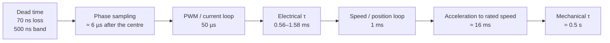
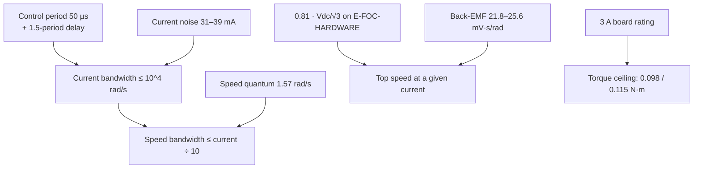

| Field     | Value                   |
|-----------|-------------------------|
| Title     | The Numbers That Matter |
| Type      | theory                  |
| Status    | draft                   |
| Version   | 0.1.0                   |
| Component | numbers-to-know         |
| Date      | 2026-10-29              |

> **Theory document**: Explains the mathematical and engineering principles behind a component or algorithm.
> This document is descriptive — it records the *why* and *how* at a scientific level, independent of any
> specific implementation. Equations use KaTeX ($inline$ and $$block$$). Diagrams use Mermaid.

---

## Overview

The earlier chapters derive relationships. This one puts numbers in them, for the two reference motors and
for the firmware and board e-foc runs on, so that a reader can tell at a glance whether a loop is fast
enough, whether a speed is reachable, or whether an error is above the noise. Every motor figure is derived
from `documentation/theory/foc-plant-models.md` "Reference Motors" (which also shows how the datasheet values
were converted); every firmware or board figure names the file it comes from.

The headline numbers:

- **50 µs** control period, **1.5 periods** of loop delay, **1 ms** outer period.
- **0.56–1.58 ms** electrical time constants: 11 to 32 control periods.
- **50–75 control periods** per electrical cycle at rated speed; **7.2°** of electrical angle per period on
  the Teknic at 6000 rpm.
- **4 mA** current LSB, **31–39 mA** current noise, **1.57 rad/s** speed quantum.
- **3 A** board rating: 42 % of the Teknic's rated torque, 77 % of the Anaheim's.

---

## Prerequisites

[Physical picture](motor-physics.md), [motor model](motor-model.md), [closed-loop control](closed-loop-control.md).

| Symbol    | Meaning                                  | Unit  |
|-----------|------------------------------------------|-------|
| $T_s^i$   | Current-loop period, 1/20 kHz            | s     |
| $T_s^o$   | Outer-loop period, 1/1 kHz               | s     |
| $\tau_e$  | Electrical time constant $L_s/R_s$       | s     |
| $\tau_m$  | Mechanical time constant $J/B_f$         | s     |
| $f_e$     | Electrical frequency $p\,n/60$           | Hz    |
| $K_t$     | Torque constant $\tfrac{3}{2}p\psi_f$    | N·m/A |
| $V_{max}$ | Linear voltage limit $V_{dc}/\sqrt3$     | V     |
| $N_{enc}$ | Encoder counts per mechanical revolution | —     |

---

## Mathematical Foundation

### 1. Firmware and Board Figures

The figures of the `sync_foc_sensored` application on the EK-TM4C1294XL with the E-FOC-HARDWARE power board:

| Figure               | Value                                                                     | Source                                                                                                                   |
|----------------------|---------------------------------------------------------------------------|--------------------------------------------------------------------------------------------------------------------------|
| PWM and current loop | 20 kHz, centre-aligned                                                    | `targets/sync_foc_sensored/main/instantiations/Logic.hpp` (`controlLoopFrequencyHz`)                                     |
| Outer loops          | 1 kHz, every 20th current-loop period                                     | `core/state_machine/OuterLoopStateMachine.hpp`, `core/foc/cascade/CascadeWithSpeedLoop.cpp`                              |
| CPU                  | 120 MHz Cortex-M4F                                                        | `targets/platform_implementations/ti/EK-TM4C1294XL/PinsAndPeripherals.hpp`                                               |
| Inner-loop budget    | 4500 of 6000 cycles per period (37.5 µs); measured 1074–1353              | `documentation/performance-optimization/README.md`, `documentation/requirements/performance/real-time-requirements.yaml` |
| Duty resolution      | 1500 PWM counts per period (60 MHz PWM clock)                             | `documentation/design/service-dead-time-compensation.md`                                                                 |
| Duty delay           | A new duty takes effect one period after its sample                       | `targets/platform_implementations/ti/implementation/PlatformFactoryImpl.cpp` (`DutyUpdateDelayPeriods`)                  |
| Current sense        | 12-bit ADC, 3.3 V reference, 5 A/V around mid-rail: ±8.25 A               | `targets/platform_implementations/motor_boards/E-FOC-HARDWARE/BoardCharacteristics.hpp`                                  |
| Current noise        | 31–39 mA per averaged sample (2× hardware averaging)                      | `documentation/architecture/system.md`                                                                                   |
| Low-side window      | Phase readable up to 70 % duty; no leg above 95 % (bootstrap)             | `BoardCharacteristics.hpp`, `core/platform_abstraction/LowSideShuntWindow.hpp`                                           |
| Dead time            | 500 ns commanded; 70 ns effective loss, 0.2 A knee                        | `Logic.hpp` (`pwmDeadTimeNs`), `BoardCharacteristics.hpp`                                                                |
| Encoder              | 4000 counts per revolution (default)                                      | `core/services/non_volatile_memory/ConfigData.hpp`                                                                       |
| Bus voltage          | Divider 21.25; read once at boot                                          | `BoardCharacteristics.hpp`, `targets/sync_foc_sensored/main/instantiations/Logic.cpp`                                    |
| Protection           | Rated 3 A; over-current trip 6.6 A; over-voltage 58 V; under-voltage 18 V | `BoardCharacteristics.hpp`                                                                                               |

### 2. Time Scales

| Quantity                                     | Expression                       | Anaheim BLY172S-24V-4000 | Teknic M-2310P-LN-04K |
|----------------------------------------------|----------------------------------|--------------------------|-----------------------|
| Electrical time constant                     | $L_s/R_s$                        | 1.58 ms                  | 0.556 ms              |
| … in current-loop periods                    | $\tau_e/T_s^i$                   | 31.6                     | 11.1                  |
| Discretisation measure at 20 kHz             | $R_s T_s^i/L_s$                  | 0.032                    | 0.090                 |
| … at the 10 kHz identification rate          | $R_s T_s/L_s$                    | 0.063                    | 0.180                 |
| Mechanical time constant (assumed $B_f$)     | $J/B_f$                          | 0.48 s                   | 0.47 s                |
| Time to rated speed at rated torque, no load | $J\,\omega_{rated}/\tau_{rated}$ | 15.8 ms                  | 16.2 ms               |
| Electrical frequency at rated speed          | $p\,n/60$                        | 266.7 Hz                 | 400 Hz                |
| Control periods per electrical cycle         | $f_s/f_e$                        | 75                       | 50                    |
| Electrical angle per control period          | $360^\circ f_e/f_s$              | 4.8°                     | 7.2°                  |
| Angle the applied voltage lags (1.5 periods) | $1.5 \times 360^\circ f_e/f_s$   | 7.2°                     | 10.8°                 |

The ladder of time scales, from the switching edge to the mechanics, spans seven decades:

The separation the cascade relies on is visible directly: the current settles in a few electrical time
constants, the speed loop sees a new value every millisecond, and the rotor needs tens of milliseconds to
change speed appreciably.

### 3. Motor Constants and Conversions

| Quantity                                 | Expression                           | Anaheim            | Teknic             |
|------------------------------------------|--------------------------------------|--------------------|--------------------|
| Torque constant                          | $K_t = \tfrac{3}{2} p \psi_f$        | 32.6 mN·m/A        | 38.4 mN·m/A        |
| Rated current (q-axis peak)              | $\tau_{rated}/K_t$                   | 3.89 A             | 7.14 A             |
| Phase back-EMF peak per mechanical rad/s | $p\,\psi_f$                          | 21.8 mV·s/rad      | 25.6 mV·s/rad      |
| Line-to-line back-EMF peak per 1000 rpm  | $\sqrt3\,p\,\psi_f \times 104.72$    | 3.95 V             | 4.64 V             |
| … RMS                                    | divide by $\sqrt2$                   | 2.79 V             | 3.28 V             |
| Speed constant (line-to-line peak)       | $K_v = 60 / (2\pi\sqrt3\,p\,\psi_f)$ | 253 rpm/V          | 215 rpm/V          |
| Voltage base of the modulator            | $1\ \text{pu} = V_{dc}/\sqrt3$       | 13.86 V (24 V bus) | 23.09 V (40 V bus) |

The conversions that cause most of the factor-of-two and factor-of-$\sqrt3$ errors:

| From → to                                         | Factor                                               |
|---------------------------------------------------|------------------------------------------------------|
| rpm → rad/s                                       | $\times\, 2\pi/60 = 0.1047$; 1000 rpm = 104.72 rad/s |
| Mechanical → electrical (angle, speed, frequency) | $\times\, p$                                         |
| Line-to-line → phase, wye ($R$, $L$)              | $\div\, 2$                                           |
| Line-to-line → phase, wye (voltage)               | $\div\, \sqrt3$                                      |
| Peak → RMS                                        | $\div\, \sqrt2$                                      |
| dq vector length → phase peak                     | $\times\, 1$ (amplitude-invariant scaling)           |
| dq power → three-phase power                      | $\times\, \tfrac{3}{2}$                              |
| oz·in → N·m; oz·in·s² → kg·m²                     | $\times\, 7.0616 \times 10^{-3}$ (both)              |

### 4. Operating Envelope and Voltage Budget

At the rated point, steady state, $i_d = 0$ ([motor model](motor-model.md) §8):

| Term                     | Expression                  | Anaheim, 4000 rpm, 3.89 A | Teknic, 6000 rpm, 7.14 A |
|--------------------------|-----------------------------|---------------------------|--------------------------|
| Resistive drop           | $R_s I_q$                   | 1.58 V                    | 2.57 V                   |
| Inductive drop (on $-d$) | $\omega_e L_s I_q$          | 4.17 V                    | 3.59 V                   |
| Back-EMF                 | $\omega_e \psi_f$           | 9.11 V                    | 16.08 V                  |
| Applied voltage          | $\lvert V \rvert$           | 11.48 V                   | 19.00 V                  |
| Share of $V_{max}$       | $\lvert V \rvert / V_{max}$ | 83 %                      | 82 %                     |
| Copper loss              | $\tfrac{3}{2} R_s I_q^2$    | 9.2 W                     | 27.5 W                   |
| Mechanical power         | $\tau\,\omega_m$            | 53.2 W                    | 172 W                    |

**The board's own voltage limit.** The low-side shunts need the readable window of §1. When a voltage vector
would need more, all three duties move down together, which keeps the line-to-line voltages; only a vector
whose middle duty would still exceed 70 % (or whose highest would exceed 95 %) is scaled back along its own
direction (`documentation/architecture/system.md`). In the three directions where two phases share the highest
duty, $\theta = 60^\circ, 180^\circ, 300^\circ$, common-mode injection gives those two phases a duty
$0.866\,m$ above the lowest at modulation $m$, so

$$
0.866\, m \le 0.70 \quad\Rightarrow\quad m \le 0.81
$$

A vector that turns at constant length therefore stays undistorted only up to about $0.81\,V_{max}$ on
E-FOC-HARDWARE; beyond it the vector is flattened in those three directions. The speed limits change
accordingly:

| Speed limit at the rated bus | Anaheim (24 V) | Teknic (40 V) |
|------------------------------|----------------|---------------|
| No load, full linear circle  | 6080 rpm       | 8610 rpm      |
| No load, $0.81\,V_{max}$     | 4910 rpm       | 6960 rpm      |
| 3 A, full linear circle      | 5260 rpm       | 8180 rpm      |
| 3 A, $0.81\,V_{max}$         | 4160 rpm       | 6530 rpm      |

### 5. Resolution and Quantisation

| Quantity                          | Expression                                | Value                                                                 |
|-----------------------------------|-------------------------------------------|-----------------------------------------------------------------------|
| Current LSB                       | $3.3\ \text{V}/4096 \times 5\ \text{A/V}$ | 4.03 mA                                                               |
| Current noise                     | measured, per averaged sample             | 31–39 mA (8–10 LSB); about 1.2 % of 3 A                               |
| Torque per current LSB            | $K_t \times 4.03$ mA                      | 0.13 mN·m (Anaheim), 0.15 mN·m (Teknic)                               |
| Duty step                         | 1/1500 of the period                      | 0.067 %: 16 mV per leg at 24 V, 27 mV at 40 V                         |
| Commanded dead band               | 500 ns / 50 µs                            | 1.0 % of the period                                                   |
| Effective dead-time loss          | 70 ns / 50 µs × $V_{dc}$                  | 34 mV at 24 V, 56 mV at 40 V, per leg                                 |
| Bus-voltage LSB                   | $3.3\ \text{V}/4096 \times 21.25$         | 17 mV                                                                 |
| Encoder angle                     | $2\pi/N_{enc}$                            | 1.57 mrad = 0.09° mechanical; 0.36° electrical ($p = 4$)              |
| Speed quantum                     | $2\pi/(N_{enc}\, T_s^o)$                  | 1.57 rad/s = 15 rpm per count per 1 ms window                         |
| … relative, at 1000 rpm / 100 rpm | quantum / speed                           | 1.5 % / 15 %                                                          |
| Sine table                        | 512 entries, interpolated                 | amplitude error $1.9 \times 10^{-5}$                                  |
| `float` resolution                | $2^{-23}$ relative                        | $1.2 \times 10^{-7}$; one ulp at $\pm\pi$ is $2.4 \times 10^{-7}$ rad |

Two comparisons from this table carry through the design. The dead-time loss (34–56 mV) is comparable to the
resistive drop of a small current, $R_s \times 0.2\ \text{A} = 72$–$81$ mV: it is negligible at load and
dominant near zero current, which is why it is compensated and why identification avoids small currents
(`documentation/design/service-dead-time-compensation.md`). And the current noise is ten times the current
LSB: a wider ADC would not help, a quieter sense chain would.

### 6. Computation Budget

| Figure                               | Value                                                         |
|--------------------------------------|---------------------------------------------------------------|
| Cycles per 20 kHz period             | $120\ \text{MHz}/20\ \text{kHz} = 6000$                       |
| Inner-loop budget                    | 4500 cycles (75 %), 37.5 µs                                   |
| Measured inner loop                  | 1074–1353 cycles (18–23 %), 9–11 µs                           |
| Outer-loop budget                    | 20 000 cycles per 1 ms (17 % of the 120 000 available)        |
| Costly operations avoided in the ISR | `sinf`/`cosf` 50–200 cycles; virtual call 6–20; `vdiv.f32` 14 |

Source: `documentation/performance-optimization/README.md`. The current loop is limited by its delay, not by
computation.

### 7. Rules of Thumb

| If …                                                     | … then expect                                                                                                                                                     |
|----------------------------------------------------------|-------------------------------------------------------------------------------------------------------------------------------------------------------------------|
| $R_s T_s / L_s < 0.1$                                    | Euler and exact ZOH agree on $A_d$ within $x^2/2$ (0.5 %) but on $B_d$ only within $x/2$ (5 %), $x = R_sT_s/L_s$; e-foc uses the exact pair for the current plant |
| Loop delay $T_d = 1.5\,T_s^i = 75$ µs                    | Current-loop bandwidth ≤ about $10^4$ rad/s for 45° of margin                                                                                                     |
| Current bandwidth $\omega_{bw}$, sensor noise $\sigma_i$ | Voltage-command noise $\approx L_s\,\omega_{bw}\,\sigma_i$; keep under 0.08 V RMS                                                                                 |
| Inner bandwidth $k$ times the outer crossover            | Outer loop loses $\arctan(1/k)$: 5.7° at $k = 10$, 11.3° at $k = 5$                                                                                               |
| $f_e$ rises towards $f_s/20$                             | The applied voltage lags $\theta_e$ by $1.5 \times 360^\circ f_e/f_s$, 27° at $f_e = f_s/20$; the current loop sees it as cross-coupling                          |
| Back-EMF approaches $0.81\,V_{max}$ on E-FOC-HARDWARE    | No headroom left to push current: top speed                                                                                                                       |
| A torque ripple at $6 f_e$                               | Dead time or back-EMF harmonics ([disturbances and noise](disturbances-and-noise.md))                                                                             |
| Speed resolution needed at $n$ rpm with 1 ms windows     | 15 rpm per count: average over more windows, or more counts per revolution                                                                                        |

---

## Block Diagrams

### Where Each Number Bites

---

## Numerical Properties

Which input moves which result:

| Input             | Moves                                                              | Sensitivity                                           |
|-------------------|--------------------------------------------------------------------|-------------------------------------------------------|
| $V_{dc}$          | Top speed, modulator per-unit, gain normalisation                  | Top speed $\propto V_{dc}$                            |
| $\psi_f$          | Torque per ampere, back-EMF, top speed                             | Torque $\propto \psi_f$; top speed $\propto 1/\psi_f$ |
| $L_s$             | Current-loop gains, inductive drop, noise into the voltage command | $K_p \propto L_s$                                     |
| $R_s$             | Integral gain, copper loss, low-speed voltage                      | Loss $\propto R_s$                                    |
| $N_{enc}$         | Speed quantum, angle resolution                                    | Quantum $\propto 1/N_{enc}$                           |
| Outer-loop window | Speed quantum, speed-loop delay                                    | Quantum $\propto$ 1/window; delay $\propto$ window    |

---

## Worked Example

**Can the Teknic, on E-FOC-HARDWARE at 40 V, run at its rated 6000 rpm?**

1. **Current.** The board allows 3 A, so torque is $0.0384 \times 3 = 0.115$ N·m, 42 % of rated.
2. **Voltage at 6000 rpm and 3 A.** $\omega_e = 2513$ rad/s. $V_q = 0.36 \times 3 + 2513 \times 0.0064 = 17.2$ V,
   $V_d = -2513 \times 0.0002 \times 3 = -1.51$ V, $|V| = 17.2$ V.
3. **Available voltage.** $0.81 \times 23.09 = 18.7$ V. The demand is 92 % of it.
4. **Verdict.** Yes, with 1.4 V to spare for transients, consistent with the 6530 rpm limit of §4. At 6000 rpm
   each control period sees 7.2° of rotation, and the voltage it computes is applied about 10.8° late.

**The Anaheim at 24 V, 4000 rpm, 3 A** gives $V_q = 0.405 \times 3 + 1675.5 \times 0.00544 = 10.33$ V,
$V_d = -1675.5 \times 0.00064 \times 3 = -3.22$ V, $|V| = 10.8$ V against $0.81 \times 13.86 = 11.2$ V: 97 %, at
the edge, matching the 4160 rpm limit of §4.

---

## Limitations & Assumptions

- **Assumes**: the reference motors' parameters as modelled; $B_f$ is assumed, not published, so $\tau_m$ is
  indicative.
- **Assumes**: steady state for the voltage budgets; transients need extra headroom.
- **Derived, not measured**: the 0.81 modulation limit follows from the two duty limits and common-mode
  injection; the simulation results of `documentation/architecture/system.md` are consistent with it.
- **Board-specific**: §1 and every figure derived from it hold for E-FOC-HARDWARE on the EK-TM4C1294XL;
  another board has its own `BoardCharacteristics`.

## References

1. Texas Instruments — *TM4C1294NCPDT Microcontroller Data Sheet*, SPMS433, 2014.
2. Krishnan, R. — *Permanent Magnet Synchronous and Brushless DC Motor Drives*, CRC Press, 2010.
3. Vendor sources of the reference motors, listed in `documentation/theory/foc-plant-models.md`.
