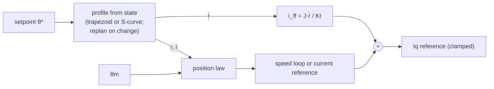

| Field     | Value                   |
|-----------|-------------------------|
| Title     | Position Motion Profile |
| Type      | theory                  |
| Status    | draft                   |
| Version   | 1.0.0                   |
| Component | position-motion-profile |
| Date      | 2026-11-11              |

> **Theory document**: Explains the mathematical and engineering principles behind a component or algorithm.
> This document is descriptive — it records the *why* and *how* at a scientific level, independent of any
> specific implementation. Equations use KaTeX ($inline$ and $$block$$). Block diagrams use Mermaid or
> ASCII art.

---

## Overview

A position setpoint is a step. Handed to a position law at once, the step asks for the largest speed and
current the loop allows, and the rotor arrives with an overshoot and a following error that grows with the
step. A **motion profile** replaces the step with a reference that moves: a position $r(t)$ together with its
velocity $\dot r(t)$ and acceleration $\ddot r(t)$, planned so that the speed, the acceleration and the
deceleration stay within limits the operator sets. The position law tracks $r(t)$, and the velocity and
acceleration feed forward so that the tracking error in the cruise stays small without a high gain.

The profile is a **trapezoid of speed**: constant acceleration up to the profile velocity, a cruise, constant
deceleration to rest on the target. It runs in the 1 kHz outer handler, ahead of the position law
(`documentation/design/foc-position.md`, Motion Profile).

---

## Prerequisites

| Symbol          | Meaning                                                  | Unit               |
|-----------------|----------------------------------------------------------|--------------------|
| $v_{max}$       | Profile velocity                                         | rad/s              |
| $a_{max}$       | Profile acceleration                                     | rad/s²             |
| $d_{max}$       | Profile deceleration (the acceleration when set to 0)    | rad/s²             |
| $q_0, v_0, a_0$ | Position, velocity and acceleration the plan starts from | rad, rad/s, rad/s² |
| $q_f$           | Goal of the plan                                         | rad                |
| $j_{max}$       | Profile jerk limit (0 → trapezoidal plan)                | rad/s³             |
| $T_o$           | Outer-loop period                                        | s                  |
| $J$             | Rotor inertia                                            | kg·m²              |
| $K_t$           | Torque constant, $\tfrac{3}{2} p \psi_f$                 | N·m/A              |

See `documentation/theory/foc-plant-models.md` §3 for the position plant and
`documentation/theory/closed-loop-control.md` for the loops the reference is fed to.

---

## Mathematical Foundation

### Trapezoidal plan from a state

Given a start $(q_0, v_0)$ and a goal $q_f$, the plan is closed form and has no iteration. With
$s = q_f - q_0$, the distance the rotor needs to stop from $v_0$ at the deceleration is

$$
s_{stop} = \frac{v_0 \lvert v_0 \rvert}{2\,d_{max}}
$$

and the direction of travel is $\sigma = +1$ when $s - s_{stop} \ge 0$ and $-1$ otherwise, so a start that
already moves away from the goal brakes first and then reverses. The speed ramps from $v_0$ to
$\sigma v_{max}$ at $a_{max}$ (at $d_{max}$ when $v_0$ is already above $v_{max}$ in the direction of
travel), cruises, and brakes to rest at $d_{max}$:

$$
t_{ramp} = \frac{\sigma v_{max} - v_0}{\pm a_{max}},\qquad
t_{brake} = \frac{v_{max}}{d_{max}},\qquad
t_{cruise} = \frac{s - s_{ramp} - s_{brake}}{\sigma v_{max}}
$$

When $s$ is too short to reach $v_{max}$ the cruise disappears and the peak speed falls to

$$
v_{peak} = \sigma\sqrt{\frac{2\sigma s\,a_{max} d_{max} + v_0^2 d_{max}}{a_{max} + d_{max}}}
$$

(a triangle of speed). The duration is $T = t_{ramp} + t_{cruise} + \lvert v_{peak}\rvert / d_{max}$.
Sampling at a time $t$ is closed form too: one of three polynomials of degree two, or the goal at rest from
$t \ge T$.

**Example.** A move of 1.5 rad at $v_{max} = 20$ rad/s and $a_{max} = d_{max} = 400$ rad/s² takes
$t_{ramp} = 50$ ms (0.5 rad), $t_{brake} = 50$ ms (0.5 rad) and a cruise of $0.5/20 = 25$ ms: $T = 125$ ms.

### Jerk-limited plan from a state (S-curve)

When a jerk limit $j_{max} > 0$ is set alongside $v_{max}$, $a_{max}$ and $d_{max}$, the profile plans an
S-curve from the state $(q_0, v_0, a_0)$. The seven classical phases are: jerk-up, constant-acceleration,
jerk-down (reaching $v_{max}$), cruise, jerk-down (braking), constant-deceleration, jerk-up (to rest at $q_f$).
Not every phase is non-zero for every move.

The direction is determined by the distance the rotor would travel to stop from $(v_0, a_0)$ at the limits,
the same stopping-distance logic as the trapezoid but accounting for the initial acceleration.

The peak velocity is found by a 32-step binary search over the range $[0, v_{max}]$; each evaluation of
the distance-to-peak function costs about two ramp simulations (each 3 × polynomial integration steps plus
3 sqrt and 6 div on a Cortex-M4F), about **70 sqrt + 300 div** in all. The static cycle estimate charges the plan
**3 182 cycles** on a Cortex-M4F, which brings the worst-case outer loop to 11 315 of its 20 000-cycle budget at
120 MHz.

**Preconditions.** All limits must be positive. The initial acceleration must satisfy
$|a_0| \le \max(a_{max}, d_{max})$; on reseed (Enable, after jog) the seed acceleration is 0, which
trivially satisfies this. On replan from the reference state, the last reference acceleration is clamped to
$[-\max(a_{max}, d_{max}),\ +\max(a_{max}, d_{max})]$ before the plan is called, so a mid-move operator
reduction of the limits does not violate the precondition.

**Example.** A move of 1.5 rad at $v_{max} = 20$ rad/s, $a_{max} = d_{max} = 400$ rad/s² and
$j_{max} = 20\,000$ rad/s³ takes a ramp-up of $400/20\,000 = 20$ ms, a constant-acceleration phase, a
ramp-down, a cruise and the mirror on the deceleration side; total $T \approx 142$ ms (measured).

### Replanning from the reference state

A new setpoint while a move is under way must not make the reference jump. The plan therefore restarts from
the **reference** state, not the measured one:

$$
q_0 \leftarrow r[k],\quad v_0 \leftarrow \dot r[k],\quad q_f \leftarrow \text{new goal},\quad t \leftarrow 0
$$

For the trapezoidal plan position and velocity are continuous across the replan; the acceleration steps.
For the jerk-limited plan the third argument is the last reference acceleration $\ddot r[k]$, clamped to
$[-\max(a_{max}, d_{max}),\ +\max(a_{max}, d_{max})]$, so position, velocity **and acceleration** are
continuous across a replan (the jerk steps). A reversal and the speed/rate limits are handled inside the
plan exactly as for the trapezoid.

The plan is sampled once per outer period, at $t = k\,T_o$ with the first sample taken one period after the
replan, so the reference moves in the very period the setpoint arrives.

The profile **seeds** from the measured position and speed (acceleration 0) when the drive is enabled, after a
speed or current command has driven the rotor, and when the profile is switched on; the rotor then starts from
where it is and not from the last setpoint.

### The goal on the circle

The mechanical angle lives on a circle. Without travel limits the goal is placed on the line next to the start
by the wrapped difference, so a move across the encoder seam takes the shorter way:

$$
q_f = q_0 + \mathrm{wrap}(\theta^* - q_0),\qquad \mathrm{wrap}(x) \in (-\pi, \pi]
$$

The plan runs on the line, and the reference handed to the law is $\mathrm{wrap}(r)$. At each replan $q_0$ is
taken as $\mathrm{wrap}(r)$, which keeps the planned quantities within a turn of the seam. Within software
position limits the goal is the setpoint held between the limits and the difference is the plain one, which is
the way that stays inside them (`documentation/design/foc-position.md`, Software Position Limits).

### Feed-forward

The profile hands the law $r$, $\dot r$ and $\ddot r$. The acceleration feed-forward is the torque current
that accelerates the rotor inertia:

$$
\boxed{i_{ff} = \frac{J\,\ddot r}{K_t}}
$$

It is added to the q-axis reference after the speed loop (or after a current-reference law), next to the
friction feed-forward, and the sum stays under the same current limit. A torque constant of zero gives no
feed-forward. The viscous term $B\dot r / K_t$ is not fed forward: the speed loop's integral takes it, and the
friction feed-forward already covers the dry part.

| Position law | Velocity feed-forward                                               | Acceleration feed-forward |
|--------------|---------------------------------------------------------------------|---------------------------|
| PID          | $\dot r$ added to the speed reference, outside the clamped PI state | $i_{ff}$                  |
| Cascade P    | $\omega_{ref} = K_v e + \dot r$                                     | $i_{ff}$                  |
| LQR, LQI     | speed state $(\omega - \dot r) T_o$ instead of $\omega T_o$         | $i_{ff}$                  |
| Two-DOF      | as PID; the reference pre-filter is bypassed                        | $i_{ff}$                  |

Adding $\dot r$ outside the clamped state of the PID keeps the feed-forward out of the integrator, so it
cannot wind up, and the clamp that bounds the feedback still bounds it. The state-feedback laws are designed
for a regulation to a fixed reference, whose speed is zero; with a moving reference the speed that belongs to
zero error is $\dot r$, hence the shifted state. The reference pre-filter of the two-DOF law shapes a step
that the profile has already shaped; running both would add a lag of $\tau_{ff}$ to the planned path, so the
profile replaces it. Without a profile the law is unchanged.

### Errors

Two errors are kept apart. The **tracking error** $r - \theta_m$ is what the position law works on and what
the following-error and encoder plausibility supervision measure: a profile that asks for more than the
drive can follow shows up there. The **target error** $\theta^* - \theta_m$ is what the target-reached check
measures, so a target is not reported reached while the reference is still on its way.

---

## Block Diagram

---

## Numerical Properties

| Property           | Value                                                                                  |
|--------------------|----------------------------------------------------------------------------------------|
| Trapezoidal plan   | closed form, no loop, once per setpoint change                                         |
| S-curve plan       | 32-step bisection, 3 182 cycles (Cortex-M4F); once per setpoint change only            |
| Sample             | closed form, no loop, once per 1 kHz cycle                                             |
| Reference duration | 125 ms for 1.5 rad, 20 rad/s, 400 rad/s² (trapezoid); ≈ 142 ms with 20 000 rad/s³ jerk |
| Memory             | one plan variant (≤ 200 bytes), no heap                                                |
| Profile off        | velocity or acceleration 0: the setpoint reaches the law unchanged                     |
| Jerk off (j = 0)   | trapezoidal plan, bit-identical to the behaviour before jerk was introduced            |

---

## Limitations & Assumptions

- The path is planned in the reference, not the measured, state. A rotor that cannot follow lags behind it;
  the following-error window decides when that is a fault.
- The acceleration feed-forward uses the inertia the drive was given or identified. A wrong inertia leaves
  a residual that the feedback absorbs.
- A reversal of a goal exactly half a turn away flips the shorter way; the plan follows the new side.
- The S-curve plan requires all four limits positive and $|a_0| \le \max(a_{max}, d_{max})$; the firmware
  enforces these before every plan call.
- The S-curve plan cannot handle a deceleration limit $d_{max}$ different from $a_{max}$ when the initial
  acceleration is non-zero and opposite to the travel direction (the bisection still converges, but may
  produce a slightly longer duration than optimal in that edge case).

---

## References

1. Biagiotti, L. & Melchiorri, C. — *Trajectory Planning for Automatic Machines and Robots*, Springer, 2008.
2. Åström, K.J. & Hägglund, T. — *Advanced PID Control*, ISA, 2006. (Reference feed-forward.)
