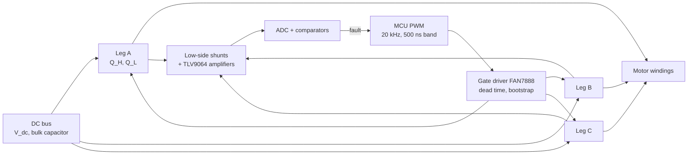
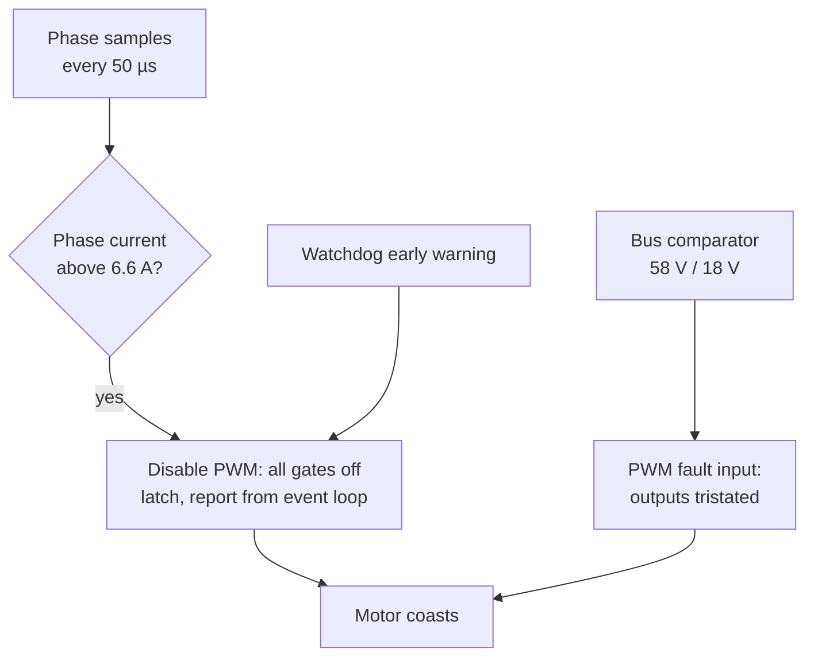

| Field     | Value                                                 |
|-----------|-------------------------------------------------------|
| Title     | The Power Stage — MOSFETs, Half-Bridges and Dead Time |
| Type      | theory                                                |
| Status    | draft                                                 |
| Version   | 0.1.0                                                 |
| Component | power-stage                                           |
| Date      | 2026-10-29                                            |

> **Theory document**: Explains the mathematical and engineering principles behind a component or algorithm.
> This document is descriptive — it records the *why* and *how* at a scientific level, independent of any
> specific implementation. Equations use KaTeX ($inline$ and $$block$$). Diagrams use Mermaid, and the
> animated figure is generated by `documentation/tools/generate-animations.py`.

---

## Overview

Everything the controllers compute ends as six gate signals. The power stage turns them into phase voltages,
and on the way it adds delay, voltage error, losses and failure modes that the model of
[the physical picture](motor-physics.md) §9 leaves out. This chapter follows the path from the gate to the
winding:

- the **MOSFET** as a switch: its channel, its body diode, its capacitances;
- the **gate driver and bootstrap** that make the high-side switch possible, and the duty limit they impose;
- the **half-bridge**, why its two switches must never conduct together, and the **dead time** that prevents
  it;
- what dead time does to the voltage, in three current regimes, and how e-foc corrects it;
- the **losses**, the **DC link** and regeneration, and the **protection** paths.

Figures are those of the E-FOC-HARDWARE board on the EK-TM4C1294XL. The board's own design files live in the
`e-foc-hardware` submodule, which is not checked out with the firmware; the component figures here are those
the software-in-the-loop characterisation took from the parts and the rig
(`documentation/design/software-in-the-loop.md` Part L).

---

## Prerequisites

[Physical picture](motor-physics.md) §9, [numbers that matter](numbers-to-know.md).

| Symbol               | Meaning                                    | Unit  |
|----------------------|--------------------------------------------|-------|
| $R_{ds(on)}$         | MOSFET channel resistance when on          | Ω     |
| $V_f$                | Body-diode forward voltage                 | V     |
| $C_{oss}$, $Q_{oss}$ | MOSFET output capacitance and charge       | F, C  |
| $t_d$                | Dead time as the switch node sees it       | s     |
| $T$, $f_s$           | PWM period and frequency, 50 µs and 20 kHz | s, Hz |
| $d$                  | Duty cycle of a leg                        | —     |
| $C_{node}$           | Total capacitance at the switch node       | F     |
| $V_{dc}$             | DC bus voltage                             | V     |

---

## Mathematical Foundation

### 1. The Inverter at a Glance

| Part on E-FOC-HARDWARE    | Role                     | Figures used here                                                       |
|---------------------------|--------------------------|-------------------------------------------------------------------------|
| CSD88537ND (×3)           | Dual MOSFET, one per leg | 12.5 mΩ, 0.8 V body diode, 133 pF and 25 nC of output charge per switch |
| FAN7888                   | Three-phase gate driver  | 270 ns built-in dead time; about 130 ns turn-on, 150 ns turn-off delay  |
| Low-side shunts + TLV9064 | Phase-current sensing    | Gain 10, 5 A/V at the ADC, ±8.25 A ([sensing chain](sensing-chain.md))  |
| CUR_TOTAL shunt           | Common low-side return   | Feeds an over-current comparator                                        |
| Bus divider               | $V_{dc}$ measurement     | 21.25:1                                                                 |

### 2. The MOSFET as a Switch

A power MOSFET between drain and source behaves, to first order, as a resistor that the gate switches between
$R_{ds(on)}$ and open:

- **On** (gate driven above threshold, usually 10–15 V for a standard part): the channel conducts **in both
  directions** with resistance $R_{ds(on)}$. Current flowing from source to drain through an on channel,
  instead of through the diode beside it, is *synchronous rectification*: the drop is $i\,R_{ds(on)}$ rather
  than $V_f$.
- **Off**: the channel blocks the bus voltage, but the **body diode** that the device's structure forms between
  source and drain still conducts from source to drain, at $V_f \approx 0.8$ V.
- **In between**: the gate charge must move the gate-source and the Miller (gate-drain) capacitances, and the
  drain voltage swings across the output capacitance $C_{oss}$. A transition takes tens of nanoseconds; during it
  the device carries current and voltage at once and dissipates.

The body diode also stores charge while it conducts. When the opposite switch then turns on, that charge is
swept out as a brief reverse-recovery current spike through both devices, one of the sources of the ringing at
each edge.

For a 24–48 V drive the MOSFET wins over the IGBT on every count that matters here: no fixed collector-emitter
drop, fast switching, a body diode for free. $R_{ds(on)}$ rises with die temperature, typically by half to
double between 25 and 125 °C, so conduction loss grows as the board warms.

### 3. Gate Drive and the Bootstrap

The low-side switch's source is at ground, so its gate is driven from a ground-referred supply. The high-side
switch's source is the **switch node**, which moves between 0 and $V_{dc}$; its gate must be driven relative to
that node. The FAN7888 does it with a **bootstrap**: a capacitor per leg, charged through a diode from the
driver's 15 V rail whenever the node is low (the low side conducting), and floating up with the node when the
high side turns on.

Two practical limits follow:

- **The low side must conduct in every period**, or the bootstrap capacitor runs down and the high side
  loses its gate. E-FOC-HARDWARE caps every leg at **95 %** duty, which leaves 2.5 µs per period less the dead
  band (`BoardCharacteristics.hpp`, `documentation/design/hardware-characterisation.md` Part F). The platform
  starts the bridge at 1 % duty on every leg, low sides almost always on, so the capacitors charge first.
- **The driver's supply must stay in regulation.** Its 15 V rail is fed from the bus, which is why the board's
  under-voltage trip sits at 18 V.

The duty cap does not limit the undistorted voltage circle: at modulation $m$ the highest duty sits at most $m$
above the lowest, so the shift that keeps the shunts readable stays inside 95 % up to $m = 0.95$. The shunts' 70 %
readable window binds first and holds the circle to $0.81\,V_{dc}/\sqrt3$ ([numbers that matter](numbers-to-know.md)
§4).

### 4. Shoot-Through and Dead Time

If both switches of a leg conduct at the same time, the bus is shorted through them. The current is limited
only by two channel resistances and the loop's stray inductance, reaches tens of amperes in nanoseconds, and
destroys the devices or the bus. Turning one switch off and the other on at the same instant is not safe:
turn-off is slower than turn-on, and delays differ between devices and drivers. Every leg therefore waits a
**dead time** with both switches off between the two.

During the dead time nothing drives the node; the **phase current** does. A winding's inductance keeps its
current flowing, so the current finds a path through a body diode:

- **Current out of the leg** ($i > 0$): it flows up through the low-side diode, the node sits at $-V_f$. When the
  high side was the one that turned off, the node falls at once, as the ideal waveform does; when the high side
  is the one about to turn on, the node stays low for the whole dead time. The leg loses the volt-seconds of one
  dead time per period.
- **Current into the leg** ($i < 0$): the mirror image, through the high-side diode; the leg gains one dead
  time of volt-seconds.

Averaged over the period, a large current makes the leg's voltage wrong by

$$
\Delta v = -\operatorname{sgn}(i)\,\left(V_{dc} + 2V_f\right)\frac{t_d}{T}
$$

**Small currents.** The node is not clamped at once: the current has to charge or discharge the node
capacitance $C_{node}$ before a diode takes over. Below

$$
|i| < \frac{C_{node}\,V_{dc}}{t_d}
$$

the node is still swinging when the complement turns on, the loss is $i\,t_d^2/(2C_{node}T)$, proportional to the
current, and the winding sees it as extra resistance; at zero current the leg delivers exactly $d\,V_{dc}$
(`documentation/design/software-in-the-loop.md` Part L derives the three regimes). The transition between the
regimes is the **knee**. With the SIL's bench node of 600 pF and 100 ns at 24 V the formula gives 0.14 A; the
rig measured 0.18–0.21 A.

**What the node actually sees.** The MCU commands a 500 ns band. The node's dead time is that band plus the
driver's turn-on delay minus its turn-off delay, and the transitions themselves take part of it. The rig sweep
is the authority: stepping one leg in single PWM counts at 24 V, the loss the winding saw saturated at 0.12–0.16 %
of the period, an **effective 70 ns** at the 500 ns band, with the knee at 0.2 A. Widening the band to 1000, 1500
and 2000 ns moved the loss up in 500 ns steps, each staying about 420 ns short of the band: the driver's and the
switches' delays take that much of every band back (`documentation/design/service-dead-time-compensation.md`). That is also why the band must not be narrowed
without measuring the node on a scope: the margin it leaves against shoot-through is not visible from the
firmware.

**Consequences.** On E-FOC-HARDWARE the error is 0.14 % of $V_{dc}$ per leg: 34 mV at 24 V. Against the large
voltages of a running motor it is nothing. Against the small voltages of identification it is everything: with
no compensation the online resistance estimate read 18 % high; with it, 3 % (`service-dead-time-compensation.md`).
In the phase currents it gives distortion near each zero crossing and harmonics at $6 f_e$ in dq
([disturbances and noise](disturbances-and-noise.md) §3).

**Compensation.** e-foc adds the lost volt-seconds back to every duty, in proportion to the phase current up
to the knee and fully above it:

$$
d_k \leftarrow d_k + \frac{t_{eff}}{T}\cdot \operatorname{clamp}\!\left(\frac{i_k}{i_{knee}},\ -1,\ 1\right)
$$

The ramp is a straight-line stand-in for the small-current regime: the physical loss grows as
$i\,t_d^2/(2C_{node}T)$ and only approaches its saturated value above the knee (at $i = C_{node}V_{dc}/t_d$ it is
half of it), while the ramp reaches full correction at the measured knee. Its purpose is to avoid chattering between
$\pm t_{eff}/T$ when the current is near zero and its sign uncertain
(`core/services/inverter_compensation/InverterCompensation.hpp`).

**Minimum pulse.** A commanded conduction shorter than the dead band and the switching transitions does not
happen as commanded. The firmware has no minimum-pulse handling. The top is guarded by the 95 % bootstrap cap; the
bottom is not: shifting the duties down for the shunts ([low-side shunt current sensing](low-side-current-sensing.md)
§5) drives the lowest duty continuously to exactly 0 %, so it passes through high-side pulses shorter than the
500 ns band (15 PWM counts) on the way.

### 5. Losses

At every instant each leg conducts through exactly one path: a channel or, during dead time, a diode. Per
bridge, with phase-current peak $I$ (mean $\lvert i\rvert = 2I/\pi$, RMS $I/\sqrt2$):

| Loss                    | Expression (whole bridge)                                | E-FOC-HARDWARE at 3 A peak, 24 V         |
|-------------------------|----------------------------------------------------------|------------------------------------------|
| Conduction              | $\tfrac{3}{2}\,R_{ds(on)}\,I^2$                          | 0.17 W                                   |
| Body diode in dead time | $3\cdot V_f\,\tfrac{2I}{\pi}\cdot 2t_d f_s$              | 18 mW (100 ns at the node)               |
| Output capacitance      | $3\cdot Q_{oss} V_{dc} f_s$ (two edges, half each)       | 36 mW                                    |
| Voltage-current overlap | $3\cdot\tfrac{1}{2}V_{dc}\tfrac{2I}{\pi}(t_r + t_f) f_s$ | 55 mW for an assumed 20 ns per edge      |
| Gate drive              | $6\cdot Q_g V_{gs} f_s$                                  | not computable: $Q_g$ is not in the repo |

Under 0.3 W for the semiconductors, against $\tfrac{3}{2} R_s I^2$ = 14.9 W in the bench motor's 1.10 Ω winding at
the same current: at this power level the motor, not the board, is what heats. Switching loss scales with $f_s$,
conduction loss does not, which is half of the trade in choosing the PWM frequency; the other half is the current
ripple ([disturbances and noise](disturbances-and-noise.md) §3), which falls as $1/f_s$.

### 6. The DC Link

The bridge draws current from the bus in pulses at the switching frequency; the bulk capacitor supplies the
pulses and the supply the average. The capacitor's RMS ripple current, simulated for centre-aligned
common-mode-injection SVM, as a fraction of the phase RMS current:

| Modulation | Load angle 0° | Load angle 30° |
|------------|---------------|----------------|
| 0.3        | 0.59          | 0.53           |
| 0.6        | 0.64          | 0.60           |
| 0.9        | 0.47          | 0.48           |

At 3 A peak (2.1 A RMS) the capacitor carries up to 1.4 A RMS, which sets its rating; the bulk capacitance is
not in the repo, so the voltage ripple it leaves is not computed here.

**Supply impedance.** A bench supply with source resistance or a current limit lets the bus sag under load. The
bench's 4 A supply collapsed during calibration (`documentation/design/hardware-characterisation.md`), and the
SIL models the source resistance and the fold-back past the limit (`software-in-the-loop.md` Part K). The 18 V
under-voltage trip is what catches it.

**Regeneration.** A motor that brakes is a generator: the power $\tau\,\omega$ flows back through the bridge into
the bus. A supply cannot absorb it, so the capacitor charges. The Teknic's rotor alone at 6000 rpm stores
$\tfrac{1}{2}J\omega^2 = 1.39$ J. Returned whole into a 470 µF bus at 24 V it would raise the bus to about
81 V; into 1000 µF, to 58 V. The winding and switch losses absorb part of it, a load's inertia adds more. e-foc
has no brake chopper and no regeneration limit; the 58 V over-voltage comparator is the guard.

**Coasting with the gates off.** With all six gates off the body diodes form a three-phase rectifier. While the
motor's line-to-line back-EMF peak stays below $V_{dc}$ they block and the rotor coasts freely. Above it they
conduct and brake the motor into the bus: the Teknic at 6000 rpm makes 27.8 V line-to-line, more than a 24 V bus
but less than its rated 40 V.

### 7. Protection

| Fault         | Threshold (E-FOC-HARDWARE)             | Detected by                                                        | Action                                                                                            |
|---------------|----------------------------------------|--------------------------------------------------------------------|---------------------------------------------------------------------------------------------------|
| Over-current  | 6.6 A (80 % of the 8.25 A sense range) | Software check of every rebuilt phase sample; CUR_TOTAL comparator | Software: PWM disabled, all gates off, latched; comparator: PWM fault input tristates the outputs |
| Over-voltage  | 58 V                                   | ADC digital comparator on the bus channel                          | PWM fault input tristates the outputs                                                             |
| Under-voltage | 18 V                                   | ADC digital comparator on the bus channel                          | PWM fault input tristates the outputs                                                             |
| Software hang | 25 ms early warning, 100 ms expiry     | Watchdog                                                           | Event-loop hang: power stage cut, then reset; hung interrupt: reset only                          |

Sources: `BoardCharacteristics.hpp`, `targets/platform_implementations/ti/implementation/PlatformFactoryImpl.cpp`,
`documentation/design/error-handling.md`, `documentation/design/watchdog.md`.

Three properties of this scheme matter in practice:

- **Detection is once per PWM period.** The comparators sit on ADC steps triggered by the PWM, and the software
  check runs in the current interrupt: up to 50 µs pass between a fault and its detection. A wye winding sees at
  most $\tfrac{2}{3}V_{dc}$ across one phase (one leg high, two low), so in that time its current rises by up to
  $\tfrac{2}{3}V_{dc}\,T/L_s$: 0.75 A on the bench motor, 1.25 A on the Anaheim, **6.7 A on the low-inductance
  Teknic at 40 V**. The sense range has to cover the trip level plus that rise, or the fault
  current saturates the ADC before it is seen.
- **The CUR_TOTAL comparator cannot see bus current on this board.** Its shunt carries the three low-side
  returns, sampled at the PWM counter's zero where they sum to zero; over-current protection rests on the
  per-phase software check (`documentation/design/error-handling.md`).
- **A fault leaves the motor coasting**, not braked: every gate off, the bridge latched until the fault is
  cleared: at most three clears, the budget restored after 10 s of clean running. A 250 ms dwell before a clear
  applies on platforms that report their protection status; the TI platform reports it as unknown, so there only
  the budget applies (`documentation/design/error-handling.md`).

On the FRDM-MC-LVPMSM board with the TM4C123 there are no comparators; the shared software check is the only
over-current protection.

### 8. Layout and Practical Hygiene

Much of what makes a power stage work never appears in its equations:

- **Commutation loop.** The loop from the bulk capacitor through both switches of a leg has stray inductance; each
  edge rings in it, and the overshoot adds to the device's voltage stress. Keeping it small (a ceramic capacitor
  at each leg) matters more than the switch choice.
- **Kelvin sensing.** The shunt's sense traces must leave its pads separately from the power path, or the power
  trace's own resistance and inductance add to the measured voltage.
- **Sample away from edges.** Every switching edge couples into the amplifiers and the ground. Sampling at the
  centre of the low-side window, where no edge occurs, is the timing half of the cure
  ([sensing chain](sensing-chain.md)).
- **Gate resistance.** A larger gate resistor slows the edges: less ringing and less coupling, more overlap loss.
- **Thermal path.** $R_{ds(on)}$ rises with temperature; the copper area under the devices is their heatsink.

---

## Block Diagrams

### From a Duty to the Winding

### Fault Paths

---

## Numerical Properties

| Property                           | Value                                                                             |
|------------------------------------|-----------------------------------------------------------------------------------|
| PWM                                | 20 kHz, centre-aligned, 1500 counts per period (33 ns per count edge pair)        |
| Commanded dead band                | 500 ns (1 % of the period)                                                        |
| Effective dead-time loss           | 70 ns, 0.14 % of the period; knee 0.2 A                                           |
| Duty limits                        | 70 % readable, 95 % bootstrap                                                     |
| Switch resistance                  | 12.5 mΩ per switch                                                                |
| Semiconductor loss at 3 A          | < 0.3 W                                                                           |
| Fault detection latency            | ≤ 1 PWM period, 50 µs                                                             |
| Current rise in one period (bound) | $\tfrac{2}{3}V_{dc}T/L_s$: 0.75 A (bench), 1.25 A (Anaheim), 6.7 A (Teknic, 40 V) |

---

## Worked Example

**Dead time against identification on the bench motor** (1.10 Ω, 24 V, 70 ns effective):

1. Voltage error per leg: $24 \times 70\ \text{ns}/50\ \mu\text{s} = 34$ mV.
2. At the online estimator's excitation, 2.5 % of 3 A = 75 mA, the winding's own drop is
   $1.10 \times 0.075 = 83$ mV. This current is below the 0.2 A knee, where the loss is proportional to current:
   about $34 \times 0.075/0.2 = 12.8$ mV, 15 % of the drop. Proportional to current, it reads as resistance: the
   estimate comes out about 15 % high, in line with the 18 % measured without compensation.
3. At 1–2 A, where the calibration measures, the loss is saturated at 34 mV against a 1.1–2.2 V drop: 1.5–3 %.
4. Hence the compensation and its knee: below the knee the error is a resistance error the estimator cannot tell
   from the winding's.

**Regeneration check for the Teknic** at 40 V, braking from 6000 rpm: 1.39 J in the rotor. For the bus to stay
under the 58 V trip with all of it returned, $C \ge 2E/(58^2 - 40^2) = 1.6$ mF. A smaller bus capacitor needs
braking that is slow enough for the losses to absorb the energy, or a brake resistor.

---

## Limitations & Assumptions

- **Source of figures**: component values come from the SIL characterisation of the rig, not from schematics,
  which are in a submodule not checked out with the firmware.
- **Illustrative**: the 20 ns transition time and the bus capacitances in the regeneration example are assumed,
  to show orders of magnitude.
- **Simplifies**: diode reverse recovery and ringing are described, not modelled.
- **Does not cover**: EMC filtering, insulation, and the thermal design of the board.

## References

1. Mohan, N., Undeland, T.M. & Robbins, W.P. — *Power Electronics: Converters, Applications, and Design*, 3rd
   ed., Wiley, 2003.
2. Erickson, R.W. & Maksimović, D. — *Fundamentals of Power Electronics*, 3rd ed., Springer, 2020.
3. Balogh, L. — *Fundamentals of MOSFET and IGBT Gate Driver Circuits*, Texas Instruments SLUA618, 2017.
4. Kolar, J.W. & Round, S.D. — "Analytical calculation of the RMS current stress on the DC-link capacitor of
   voltage-PWM converter systems", *IEE Proceedings — Electric Power Applications*, 153(4):535–543, 2006.
5. Choi, J.-W. & Sul, S.-K. — "Inverter output voltage synthesis using novel dead time compensation",
   *IEEE Transactions on Power Electronics*, 11(2):221–227, 1996.
