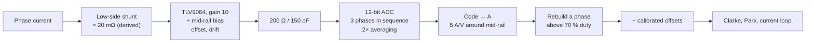
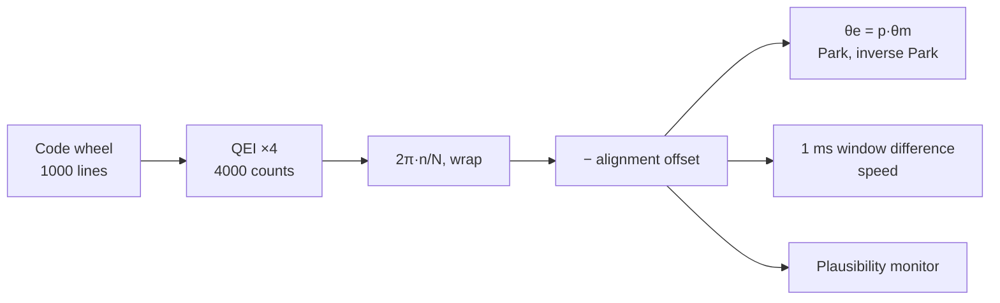

| Field     | Value                                                   |
|-----------|---------------------------------------------------------|
| Title     | The Sensing Chain — Shunts, Amplifiers, ADC and Encoder |
| Type      | theory                                                  |
| Status    | draft                                                   |
| Version   | 0.1.0                                                   |
| Component | sensing-chain                                           |
| Date      | 2026-10-29                                              |

> **Theory document**: Explains the mathematical and engineering principles behind a component or algorithm.
> This document is descriptive — it records the *why* and *how* at a scientific level, independent of any
> specific implementation. Equations use KaTeX ($inline$ and $$block$$). Diagrams use Mermaid.

---

## Overview

A loop believes its sensors ([closed-loop control](closed-loop-control.md) §2): every error in a measured
current or angle below the bandwidth becomes a real error in the motor. This chapter follows each signal from
the physical quantity to the number the controller uses, and lists what each stage adds:

- **phase current**: shunt → amplifier (gain, **offset**, **drift**, bandwidth) → anti-alias filter → ADC
  (timing, quantisation, noise) → conversion and offset calibration;
- **rotor angle**: quadrature encoder → counter → angle, with its quantisation, wiring and plausibility check;
- **bus voltage**: divider → ADC, read once at boot.

The chapter ends with an error budget: which errors e-foc calibrates out, which it lives with, and which it does
not yet measure.

---

## Prerequisites

[Power stage](power-stage.md), [disturbances and noise](disturbances-and-noise.md) §4.

| Symbol    | Meaning                                        | Unit |
|-----------|------------------------------------------------|------|
| $R_{sh}$  | Shunt resistance                               | Ω    |
| $G$       | Amplifier gain                                 | —    |
| $V_{os}$  | Amplifier input offset voltage                 | V    |
| $V_{mid}$ | Mid-rail bias at the ADC input                 | V    |
| $k_{ADC}$ | Conversion slope, 5 A/V on E-FOC-HARDWARE      | A/V  |
| $t_h$     | Hold instant of a conversion after the trigger | s    |
| $N_{enc}$ | Encoder counts per revolution                  | —    |

---

## Mathematical Foundation

### 1. Where to Put the Shunt

| Topology             | Measures                                    | For                              | Against                                                                       |
|----------------------|---------------------------------------------|----------------------------------|-------------------------------------------------------------------------------|
| Low-side, per leg    | A phase current while its low side conducts | Ground-referred, cheap amplifier | Only readable in the low-side window; duty limit                              |
| In-line, per phase   | The phase current at all times              | Always readable, no window       | Amplifier must reject the full switching common mode                          |
| Single DC-link shunt | Bus-current pulses                          | One sensor                       | Phases rebuilt from two samples per period; needs minimum active-vector times |

E-FOC-HARDWARE has a shunt under each low-side switch, an amplifier per phase and one ADC that converts the
three phases in sequence from a trigger at the PWM counter's zero, the centre of the low-side window, plus a
fourth shunt on the common low-side return for the over-current comparator
(`documentation/design/software-in-the-loop.md` Part M, `documentation/design/error-handling.md`).

**The window.** In a centre-aligned period a leg at duty $d$ conducts on its low side for $(1-d)\,T$, centred on
the counter's zero. A conversion that holds at $t_h$ after the trigger reads a valid current only if the window
is still open:

$$
d \le 1 - \frac{2\,\max\left(t_h,\ t_{db} + t_{settle} - t_{start}\right)}{T}
$$

where the first term keeps the hold inside the closing edge and the second gives the amplifier time to settle after
the opening edge ([low-side shunt current sensing](low-side-current-sensing.md) §3).

The last phase holds 5.25 µs after the trigger with the shortest sample-and-hold, which allows $d \le 79\,\%$; with
a 16-clock sample-and-hold it held at 9.75 µs, 61 %. The board's limit is set below both,
from measurement, at 70 % (a phase read within 0.25 A at 71.5 % and 1 A low at 79.7 %,
`documentation/design/hardware-characterisation.md` Part F). Above it the firmware lowers all three duties
together and rebuilds the hidden phase from $i_a + i_b + i_c = 0$
(`core/platform_abstraction/LowSideShuntWindow.hpp`). The timing, the problems of low-side sensing and the PWM
configuration it needs are treated in [low-side shunt current sensing](low-side-current-sensing.md).

### 2. From Current to Volts

The amplifier turns the small shunt voltage into the ADC's range around a mid-rail bias, so that both current
directions fit:

$$
V_{ADC} = V_{mid} + G\,R_{sh}\, i + G\,V_{os} + \dots, \qquad
i_{meas} = k_{ADC}\left(V_{ADC} - \tfrac{1}{2}V_{ref}\right)
$$

E-FOC-HARDWARE: TLV9064 amplifiers at gain 10 behind 200 Ω and 150 pF, a conversion slope of 5 A/V around the
3.3 V reference's mid-point, so ±8.25 A in 4096 codes of 4.03 mA (`BoardCharacteristics.hpp`,
`core/platform_abstraction/AdcPhaseCurrentMeasurement.hpp`). The shunt value is not in the firmware tree; 5 A/V
at gain 10 implies $R_{sh} = 1/(5 \times 10) = 20$ mΩ if nothing else divides the signal.

**The shunt trade.** A larger shunt gives more signal against the amplifier's offset and noise, and more loss:
at 3 A peak and about half the time conducting, 20 mΩ dissipates 45 mW and warms, and a shunt's temperature
coefficient (typically 50–100 ppm/K for a metal element) turns that warming into gain drift.

### 3. Amplifier Offset and Drift

Every error voltage at the amplifier's input appears at the ADC multiplied by the amplifier's noise gain,
$\approx G$, and in the measured current multiplied again by $k_{ADC}$:

$$
\Delta i = k_{ADC}\, G\, V_{os} = 5 \times 10 \times V_{os} = 50\ \text{A/V} \times V_{os}
$$

| Source                                               | Value assumed              | Current error        | Removed by offset calibration? |
|------------------------------------------------------|----------------------------|----------------------|--------------------------------|
| Op-amp input offset, typical                         | 0.3 mV (TLV906x datasheet) | 15 mA                | Yes                            |
| Op-amp input offset, maximum                         | 1.6 mV (TLV906x datasheet) | 80 mA                | Yes                            |
| Op-amp offset drift, 50 K warm-up                    | 0.6 µV/K typical           | 1.5 mA               | No                             |
| Mid-rail bias, if a 1 % divider from the reference   | ±16.5 mV at the ADC        | 82 mA                | Yes                            |
| Mid-rail bias drift, 50 ppm/K divider mismatch, 50 K | 2.1 mV at the ADC          | 10 mA                | No                             |
| ADC offset                                           | a few LSB                  | ≈ 10 mA              | Yes                            |
| **Measured raw offsets on the bench**                |                            | **+27, −18, +54 mA** | Yes                            |

The measured offsets sit where this budget puts them: tens of milliamperes, dominated by the static terms that the
calibration removes (a later calibration stored +25, −17, +45 mA, `documentation/design/state-machine.md`).
What remains after calibration is drift: the amplifier's own, small, and the bias network's, which can be larger
than the amplifier's and depends on a board design not visible from the firmware. Making the bias ratiometric to
the ADC reference, so that both move together, cancels the supply's part of it.

A residual offset rotates in dq at the electrical frequency and makes a torque ripple $K_t|\mathbf{o}|$ at $f_e$
([disturbances and noise](disturbances-and-noise.md) §4). *e-foc today:* offsets are measured with the rotor at
rest, all legs at 50 %, at every calibration and before an electrical identification over CAN, and restored from
the calibration record at boot. Each window discards 200 samples and averages 2000 (110 ms, noise below 1 mA); a
measurement keeps the mean of two windows whose offsets agree within 10 mA on every phase, takes a third when they
do not, and fails without an agreeing pair, so a single disturbed window is never stored. On the bench a
back-to-back calibration once read one phase 52 mA low in one window, which the second window now catches
(`documentation/design/service-current-offsets.md`). Drift after warm-up is not tracked; the
hardware-characterisation plan measures each condition cold and after ten minutes of PWM to separate it from
noise.

### 4. Gain Errors and Phase Mismatch

The current's scale depends on the shunt's value and the amplifier's gain-setting resistors. With 1 % parts, a
channel's gain can be off by up to about 3 % (1 % shunt, two 1 % resistors), and two channels can differ by
about twice that in the worst case. A gain error common to all phases scales the current loop's gain and the
torque; a **mismatch** between phases leaves a ripple at $2 f_e$ in dq of $\varepsilon I/3$ per unit mismatch
$\varepsilon$ on one phase ([disturbances and noise](disturbances-and-noise.md) §4). *e-foc today:* gains are
not calibrated; a per-phase check against a bench meter is planned
(`documentation/design/hardware-characterisation.md` Part B).

### 5. Bandwidth, Settling and Filtering

After each switching edge the amplifier's input steps, and its output must settle before the conversion holds.
A gain-10 stage on a 10 MHz gain-bandwidth amplifier closes at about 1 MHz, a time constant of 160 ns; the 200 Ω,
150 pF filter adds 30 ns. The SIL models the chain as one 200 ns first-order lag, consistent with these. Settling
to 12 bits takes $\ln 4096 \approx 8.3$ time constants, about 1.7 µs: small against the window, which is why the
readable limit comes from the window's closing, not its opening.

The filter is not an anti-alias filter for the control loop: at 5 MHz it passes the switching ripple. Aliasing is
avoided by timing instead, sampling where the symmetric ripple crosses its mean
([disturbances and noise](disturbances-and-noise.md) §3).

### 6. The ADC: Timing, Quantisation and Noise

The three phases are converted one after another, each step averaged over two conversions, so six conversions
follow the trigger. The hold instant of conversion $k = 0 \dots 5$ is

$$
t_k = t_{trig} + \frac{k\,(N_{sh} + N_{conv}) + N_{sh}}{f_{ADC}}
$$

with $N_{sh}$ sample-and-hold clocks and $N_{conv}$ = 12 conversion clocks at a 16 MHz converter clock
(`software-in-the-loop.md` Part M). Phase A averages conversions 0 and 1, C conversions 4 and 5: with 4 clocks
the last holds at $(5 \times 16 + 4)/16$ MHz = 5.25 µs. Three consequences:

- **Sample-and-hold length is a trade.** A longer one lets the sampling capacitor charge through the source
  impedance; a shorter one keeps the last phase inside the window. On the bench, 16 clocks read the last phase
  10–34 % low at 50–65 % duty; 4 clocks read all three within 2.5 % up to 69 % duty (`documentation/architecture/system.md`).
- **The phases are not sampled at one instant.** While all legs are low, the zero vector, each phase current
  moves at $-(e_k + R_s i_k)/L_s$. A phase read $\Delta t$ after the centre is off its period mean by about that
  slope times $\Delta t$. At rated speed and 5 µs that is 71 mA on the Anaheim (9.1 V back-EMF over 0.64 mH) and
  0.40 A on the low-inductance Teknic (16 V over 0.2 mH): a speed-dependent error that grows for exactly the
  motors with the largest PWM ripple.
- **Noise dominates quantisation.** One LSB is 4.03 mA, an RMS quantisation error of $4.03/\sqrt{12} = 1.2$ mA.
  The measured noise is 31–39 mA per averaged sample, about 50 mA per single conversion: eight to ten LSB.
  Hardware averaging over two conversions is worth having (dropping it raised the noise by 15–25 %); a wider
  converter would not be.

The calibration stores the measured noise RMS, and the automatic current-loop bandwidth is held where the
proportional gain keeps that noise under 0.08 V of voltage command
(`documentation/design/controller-selection.md`).

### 7. The Encoder

A quadrature encoder gives two square waves, A and B, a quarter cycle apart; their order tells the direction.
Counting both edges of both channels (×4 decoding) gives four counts per line: the default 4000 counts per
revolution of e-foc is a 1000-line encoder read this way. The QEI counter is converted to an angle as
$2\pi\,n/N_{enc}$ and wrapped to $[-\pi, \pi)$ (`core/platform_abstraction/QuadratureEncoderDecorator.hpp`); the
platform then subtracts the alignment offset (`targets/platform_implementations/ti/implementation/PlatformFactoryImpl.cpp`).

| Property         | E-FOC-HARDWARE / e-foc                                                                                                                                    | Consequence                                                                                            |
|------------------|-----------------------------------------------------------------------------------------------------------------------------------------------------------|--------------------------------------------------------------------------------------------------------|
| Resolution       | 4000 counts, set from the configuration record                                                                                                            | 0.09° mechanical, 0.36° electrical per count                                                           |
| Index (Z)        | Wired, not used; the counter resets on its maximum                                                                                                        | No absolute reference: alignment at every calibration, and the cogging map indexed by electrical angle |
| Channel polarity | Phase A inverted on the EK-TM4C1294XL wiring                                                                                                              | A wiring fact the platform must state                                                                  |
| Speed            | Difference of window angles over 1 ms, unfiltered                                                                                                         | 1.57 rad/s quantum ([disturbances and noise](disturbances-and-noise.md) §4)                            |
| Plausibility     | Fault if, for 100 ms, the drive pushes ≥ 5 % of its current limit and asks for motion while the angle stays within 0.01 rad (defaults, settable over CAN) | Detects a disconnected or stuck encoder; a rotor pushed against the drive and held is a stall instead  |
| Standstill       | Within 2 mrad for 100 ms                                                                                                                                  | Gates the offset measurement                                                                           |

Practical errors that the counter cannot see: a code wheel mounted off-centre or with uneven slots (a periodic
angle error, once per revolution, whose speed error grows with speed); count dither at rest, flipping between two
neighbours; electrical noise on long encoder cables, which a digital glitch filter in the counter suppresses; and
mechanical compliance between the encoder and the rotor. Sources: `core/supervision/EncoderPlausibilityMonitor.hpp`, `documentation/design/fault-supervision.md`,
`core/services/standstill/RotorStandstillImpl.hpp`.

### 8. Bus Voltage and Temperature

The bus is divided by 21.25 into the ADC: a 70 V full scale, 17 mV per LSB, read through a long sample-and-hold
with eightfold oversampling. *e-foc today:* the control reads it once, at boot, and uses that value for the
modulator's normalisation and the identification; the same pin is converted twice per PWM period, but only for
the over- and under-voltage comparators ([power stage](power-stage.md) §7). The consequences of a bus that moves
afterwards are in [disturbances and noise](disturbances-and-noise.md) §3.

There is no temperature sensor on the TI platform, and the firmware never raises an over-temperature fault. The
drift of $R_s$ is tracked by the online estimator; nothing tracks the board's or the magnets' temperature.

### 9. The Error Budget

| Error                          | Size on E-FOC-HARDWARE                             | Signature in dq  | Handled by                                                                                                             |
|--------------------------------|----------------------------------------------------|------------------|------------------------------------------------------------------------------------------------------------------------|
| Static offsets                 | 18–54 mA raw                                       | $1 f_e$          | Offset calibration, < 1 mA residual on a measured phase; a rebuilt phase carries $-(o_a+o_b+o_c)$, −63 mA on the bench |
| Offset drift after calibration | ~2–12 mA over a 50 K warm-up (estimated)           | $1 f_e$          | Nothing yet; re-calibration                                                                                            |
| Gain mismatch between phases   | up to a few % (component tolerances)               | $2 f_e$          | Nothing yet                                                                                                            |
| Common gain error              | up to ~3 %                                         | DC: torque scale | Integral action absorbs it in speed and position modes                                                                 |
| Noise                          | 31–39 mA RMS                                       | Broadband        | Bandwidth cap; centre sampling                                                                                         |
| Quantisation                   | 1.2 mA RMS                                         | Broadband        | Negligible                                                                                                             |
| Sampling skew between phases   | up to 0.4 A on the Teknic at rated speed (derived) | Speed-dependent  | Nothing yet                                                                                                            |
| Window closing                 | > 70 % duty                                        | Phase lost       | Duty shift and hidden-phase rebuild                                                                                    |
| Encoder quantisation           | 0.36° electrical; 1.57 rad/s speed                 | Speed noise      | Window-mean positions in the estimators                                                                                |

---

## Block Diagrams

### Phase-Current Path

### Angle Path

---

## Numerical Properties

| Property                    | Value                                                                               |
|-----------------------------|-------------------------------------------------------------------------------------|
| Current range and LSB       | ±8.25 A, 4.03 mA                                                                    |
| Current noise               | 31–39 mA RMS per averaged sample                                                    |
| Amplifier settling (12 bit) | ≈ 1.7 µs after an edge (derived)                                                    |
| Last-phase hold instant     | 5.25 µs after the trigger (4-clock sample-and-hold)                                 |
| Readable duty               | 70 % (measured); 79 % before settling (derived)                                     |
| Offset calibration          | Two agreeing windows of 2000 samples, 220 ms (330 ms with a third); residual < 1 mA |
| Encoder                     | 4000 counts; 0.36° electrical                                                       |
| Bus measurement             | 17 mV per LSB, read at boot                                                         |

---

## Worked Example

**How much offset drift is too much?** On the Teknic ($K_t$ = 38.4 mN·m/A), a residual offset vector of
$|\mathbf{o}|$ makes a torque ripple $K_t|\mathbf{o}|$ at $f_e$. Against the speed quantum's 0.9 mN·m of torque
noise ([disturbances and noise](disturbances-and-noise.md), *Worked Example*), an offset matters once
$K_t|\mathbf{o}| \gtrsim 0.9$ mN·m, that is $|\mathbf{o}| \gtrsim 23$ mA. The amplifier's own drift (1.5 mA over
50 K) never gets there. A drift shared by the three channels, a common bias network for example, is common mode:
the three-sensor Clarke transform removes it entirely while all three phases are measured, and an offset on a single
phase enters the vector at only two-thirds of its size, so the thresholds here are conservative. A rebuilt phase
breaks that: built from two channels, it carries twice their common drift with the opposite sign. The raw offsets
(tens of mA) are past the threshold from the start, which is why the calibration is not optional.

---

## Limitations & Assumptions

- **Assumes**: the TLV906x datasheet's typical and maximum figures, and 1 % passive parts, for the error budget;
  the board's actual bias network and shunt part are not in the firmware tree.
- **Derived**: the 20 mΩ shunt, the settling time and the sampling-skew error are computed from stated figures, not
  measured.
- **Does not cover**: isolated or Hall-effect current sensors, sin/cos or absolute encoders, sensorless angle
  estimation.

## References

1. Texas Instruments — *TLV9061, TLV9062, TLV9064 10-MHz, RRIO, CMOS Operational Amplifiers* datasheet.
2. Texas Instruments — *TM4C1294NCPDT Microcontroller Data Sheet*, ADC chapter.
3. Briz, F., Degner, M.W. & Lorenz, R.D. — "Analysis and design of current regulators using complex vectors",
   *IEEE Transactions on Industry Applications*, 36(3):817–825, 2000.
4. Kester, W. (ed.) — *The Data Conversion Handbook*, Analog Devices / Newnes, 2005.
